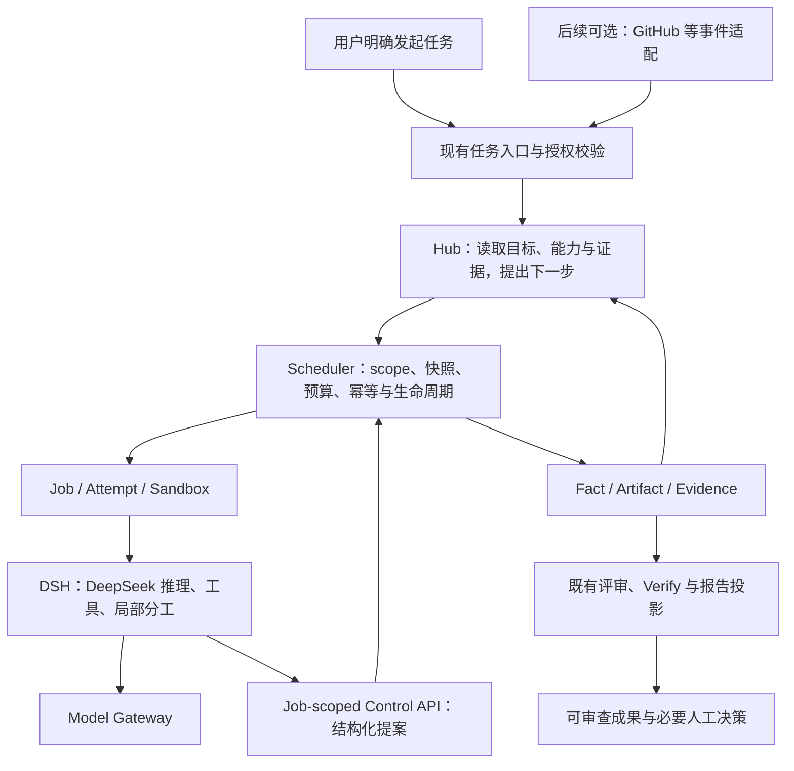

# 研究报告：在 DeepSonar 中嵌入 DeepSeek 驱动的通用自主 Super Agent

> 研究日期：2026-11-01。状态：研究提案，供架构评审与后续拆分，不代表开始实施或生产上线。
> 研究问题：DeepSeek 驱动的通用自主 Agent 相对 DeepSonar 现有设计有哪些真实差距或收益，是否值得嵌入？本文不将 Super Agent 视为某个必须整包安装的产品，也不把通用能力等同于无限权限。
> DeepSonar 核对基线：远端 main [`e219b53f1e4101b1b64fc97537c15f8eb582d87f`](https://github.com/SummerSec/DeepSonar/commit/e219b53f1e4101b1b64fc97537c15f8eb582d87f)。本地 checkout 较旧，以下当前判断采用远端核查结果；运行环境与已发布镜像未在本次验证。

## 1. 研究结论（2026-11-01 讨论后修订）

**DeepSonar 的现有设计已经覆盖本报告讨论的大部分自主 Agent 能力，部分已经实现。目前没有充分证据支持再嵌入一个独立 Super Agent 系统。** 初稿将已有机制、尚未完成的设计和潜在效果提升放在同一条“嵌入”路线中，容易使人误以为这些能力需要引入 Super Agent 才能获得；本次据此修正研究定位与推荐顺序。

本单调整为：**以 DeepSeek Super Agent 作为参考，针对现有 DeepSonar 做能力差距与效果评估；只有发现明确缺口和收益，才吸收对应策略或组件。** 不预设新增产品层、执行器、角色、队列或状态机，也不将已有机制换名视为能力提升。

研究必须分开记录三类结果：

1. **已有机制**：Hub/Intent/Job、自主能力发现、Skill 拉取、多 Agent、项目知识及成果评价等，优先验证与复用，不重复立项。
2. **尚未完整落地的既有设计**：多轮持续调整、复杂依赖规划等，沿现有架构与对应 Issue 推进；不能列为引入外部原型的独有收益。
3. **待证明的效果改善**：DeepSeek 模型、分工策略、提示与上下文组织是否提高判据满足率、减少人工介入或降低成本，需要相对冻结基线对照，当前没有收益证据。

DeepSeek + 现有 DSH 可以作为候选实验组合，但不是新的平台默认，也不构成必须整包嵌入上游原型的理由。若研究最终只有已有能力重新组合和命名，则结论应允许“不新增系统或功能层”。

## 2. 概念与外部研究依据

需要区分三个层次：

| 层次 | 在本方案中的含义 |
| --- | --- |
| DeepSeek 模型 | 推理和工具调用的模型后端；经 Scheduler-owned Model Gateway 使用 |
| DeepSeek Harness / DSH | Agent 执行循环、工具、子代理和 Session 的运行时；DeepSonar 已有治理适配 |
| Super Agent | 面向目标的产品行为和能力组合，不新增拥有权限与终态写权的超级执行者 |

DeepSeek API 的官方文档提供工具调用与思考模式说明；在携带 tools 的 Chat Completion 请求中，历史 reasoning_content 的保留有协议要求。应验证所选 SDK、DSH 与 Gateway 的完整链路，不以“API 格式兼容”推定所有行为兼容。模型 ID、能力、配额和价格在试验前按实际账号核对，不将网页列出的型号写死为平台新默认。来源：[Thinking Mode](https://api-docs.deepseek.com/guides/thinking_mode/)、[Tool Calls](https://api-docs.deepseek.com/guides/tool_calls/)。

参考实现 [`deepseek-ai/dsh-superagent-prototype`](https://github.com/deepseek-ai/dsh-superagent-prototype/tree/6337fc823ce20251c8de8085948165c81aaa701e) 明确是研究原型、不是正式 DeepSeek 产品，也不保证文章设想全部实现。其 README 展示的是单 GitHub 仓库的主动编码 Agent，不能据此证明通用自主 Agent 已被生产验证。[README](https://github.com/deepseek-ai/dsh-superagent-prototype/blob/6337fc823ce20251c8de8085948165c81aaa701e/README.md)

可借鉴的是低打扰交付、显式请求与主动规则分离、结构化人工问题和成果回到来源讨论。[设计理念](https://github.com/deepseek-ai/dsh-superagent-prototype/blob/6337fc823ce20251c8de8085948165c81aaa701e/docs/000-philosophy.md)

其 Source/Trigger、授权依据和订阅关系提供了事件入口的分析模型；这里仅用于映射，不原样引入整套领域对象。[领域模型](https://github.com/deepseek-ai/dsh-superagent-prototype/blob/6337fc823ce20251c8de8085948165c81aaa701e/docs/001-domain.md)、[授权模型](https://github.com/deepseek-ai/dsh-superagent-prototype/blob/6337fc823ce20251c8de8085948165c81aaa701e/docs/002-authorization.md)

关键差异是原型执行器使用操作者 OS 身份运行命令，文档也明确命令包装与目录不是安全边界，合并要求部分依靠 prompt。DeepSonar 不能复制这种执行与授权方式；运行必须进入现有沙箱，长期外部凭据留在宿主，外部写入须经受治理路径。[执行模型](https://github.com/deepseek-ai/dsh-superagent-prototype/blob/6337fc823ce20251c8de8085948165c81aaa701e/docs/003-execution.md)

## 3. DeepSonar 已有基础与不能夸大的边界

以下是源码、契约或专题的静态核对，不是本次测试通过声明。

| 已有能力 | 核查入口 | 对方案的意义与限制 |
| --- | --- | --- |
| DSH 受治理运行时 | [dsh-profile.ts](https://github.com/SummerSec/DeepSonar/blob/e219b53f1e4101b1b64fc97537c15f8eb582d87f/packages/runtime-sandbox/src/dsh-profile.ts) | 当前源码固定 `0.2.1-rc.2`，显式插件树，支持 Standard/PTC、spawn/fork 子代理与压缩；不需要新增第四种 CLI |
| Provider/Gateway 投影 | [dsh-pi-ai.ts](https://github.com/SummerSec/DeepSonar/blob/e219b53f1e4101b1b64fc97537c15f8eb582d87f/packages/runtime-sandbox/src/dsh-pi-ai.ts)、[CLI 契约](https://github.com/SummerSec/DeepSonar/blob/e219b53f1e4101b1b64fc97537c15f8eb582d87f/docs/AGENT_CLI_RUNTIME_ADAPTERS.md) | 保持现有账号解析、模型目录和短期 Gateway token；不能让原型原生 Provider 绕过 Gateway |
| Hub、Intent、Job/Attempt 与 Control API | [DESIGN](https://github.com/SummerSec/DeepSonar/blob/e219b53f1e4101b1b64fc97537c15f8eb582d87f/DESIGN.md) | 模型只提案，Scheduler 校验与执行；不新增第二套队列、执行器或 Job 终态 |
| 能力发现与 Skill 拉取 | 同上 §4.1 | 使用现有 Job-scoped 目录和 pull_skill；发现、下载或阅读不等于授权或方法有效 |
| 项目 Memory/Skill 生命周期 | [项目知识](https://github.com/SummerSec/DeepSonar/blob/e219b53f1e4101b1b64fc97537c15f8eb582d87f/docs/PROJECT_KNOWLEDGE.md)、#752 | 已有版本、评审与权限机制；不能另建 Super Agent 私有知识真相或把历史经验当当前授权 |
| 目标与缺口收敛 | [Plan 缺口投影](https://github.com/SummerSec/DeepSonar/blob/e219b53f1e4101b1b64fc97537c15f8eb582d87f/docs/PLAN_GAP_PROJECTION.md)、[有界补证设计对照](https://github.com/SummerSec/DeepSonar/blob/e219b53f1e4101b1b64fc97537c15f8eb582d87f/docs/PLAN_BOUNDED_INTENT_DESIGN.md) | #775 已含一次有界补证、完成依据门禁和持久接纳回执；首片每 Canvas 至多一次补证，不等于持续自适应或完整 Plan 依赖图调度 |
| 通用任务成果 | [任务结果评审](https://github.com/SummerSec/DeepSonar/blob/e219b53f1e4101b1b64fc97537c15f8eb582d87f/docs/TASK_RESULT_REVIEW.md) | 工程 delivery、合法 negative_result 可用 task.result 表达，不必为每种成果构造 Finding；已有成果与评价路径优先复用 |

### 3.1 能力重叠与可能提升：已有机制不计作新增收益

下表承接前文固定代码基线，不表示本次重新运行了测试或已验证效果。

| 讨论的能力 / 希望解决的问题 | 现有设计与实现 | 可以研究的提升 | 当前判断 |
| --- | --- | --- | --- |
| 目标驱动推进，减少用户逐步拆任务和催下一步 | 已有 Hub → Intent → Job 闭环，模型依据图状态提出工作 | 下一步选择的质量、目标覆盖与无进展识别 | 已有基础；策略效果待测 |
| 自主发现与选择工具、Skill，减少人工指定方法 | 已有能力目录、Job-scoped 发现、Skill 搜索与拉取 | 选择准确性、无效调用和上下文成本 | 已有机制；不能把“可发现”当作“会选对” |
| 多 Agent 分工，减少单会话上下文拥挤 | 已有独立 Scheduler Job 与 DSH 原生子代理；二者边界不同 | 任务拆分、分工策略、上下文利用及总成本控制 | 已有并行能力；增加 Agent 数量不保证收益 |
| 跨研究、代码、测试、文档衔接，减少人工搬运上下文 | 已有角色/Pack、Intent/Job、共享事实与成果投影基础 | 针对具体任务核查输入输出、证据引用和交付接线 | 是否存在新增缺口须逐个场景确认，不能泛称平台尚无跨能力协作 |
| 根据证据调整方法，避免失败后停滞或重复尝试 | #775 已有 Plan 缺口投影、一次有界补证、完成门禁及回执 | 多轮调整、复杂依赖和有界持续规划 | 部分已实现；剩余沿 #775 推进，不新建规划协议 |
| 项目知识复用，减少反复解释背景和摸索方法 | 已有 Memory/Skill 生命周期、版本、评审与授权 | 召回适用性、知识质量及跨任务实际收益 | 已有机制；效果研究沿 #777，不能把历史经验当当前事实或授权 |
| 围绕完成条件交付，避免过程很多却无可验收结果 | 已有 task.result、Fact/Artifact/Evidence、评审/报告；Plan 完成门已有接线 | 对具体任务的证据充分性、成果完整度和交付体验 | 已有基础且各切片完成程度不同；仍按 #767/#775 分别核验 |
| 低打扰交互，减少通知和重复提问 | 已有任务工作台与人工消息基础；#830 正在明确注意力原则 | 通知去重、关键决策呈现与成果回传 | 属于既有产品体验改善；不需要为此另建面板或 Super Agent 层 |

**能力提升与架构新增是两回事。** 同一套现有机制也可能通过模型、prompt、任务拆分或接线改善获得更好效果；这只能在实验后称为提升。它不会自动提高漏洞判断准确率、保证降低成本或证明优于现有模型组合。

**两个特别需要验证的边界：**

1. DSH 原生子代理是在一个运行时内分工，不自动成为独立的 DeepSonar Job/Attempt，也不自动获得独立凭据、配额和审计身份。必须核对嵌套调用、汇总用量、终态撤权和取消传播。需要独立权限、镜像、项目范围或恢复边界的工作，经 Hub 提案创建独立 Job。
2. DSH 的同进程 follow-up 与跨进程持久恢复是不同能力。当前 adapter 声明 `persistentSessionResume=false`，跨进程恢复返回 `CONTEXT_RESUME_UNSUPPORTED`，不能因上游原型会恢复 Ticket 就宣称 DeepSonar 可以恢复同一 Agent Session。平台持久状态可用于提出新工作，但旧 Attempt、快照、Evidence 和未知效果不能被改写或自动重放。[adapter 源码](https://github.com/SummerSec/DeepSonar/blob/e219b53f1e4101b1b64fc97537c15f8eb582d87f/packages/runtime-sandbox/src/runtime-adapters.ts#L889-L891)

## 4. 备选路线

| 路线 | 收益 | 代价与判断 |
| --- | --- | --- |
| 仅让现有 Agent 使用 DeepSeek | 最小改动，可先验证模型协议和基础效果 | 是可用基线，但不能单独覆盖事件接入、目标持续收敛和产品交付 |
| **在现有内核上比较并吸收具体策略或组件** | 复用现有授权、运行时、证据和评价，避免重复建设 | **优先做差距研究。** 只有确认缺口和收益后才实施；完整复用现有能力也是有效结论 |
| 原样部署上游 Super Agent 为旁路系统 | 接近原型演示路径 | 会产生重复授权、状态和执行通道；与当前内核约束冲突，不建议直接作为平台执行架构 |

模型选择与 Agent 运行时选择应分开。首个验证组合可选 DeepSeek + DSH，但业务 Pack 不应依赖厂商名称分支；模型 ID 必须来自获授权目录，Job 创建时冻结，不在运行中静默换模型。

## 5. 如发现真实缺口时的架构约束

此图主要复用现有执行链，表达后续改进必须遵守的边界，不代表需要新增一层 Super Agent；其中具体通用任务与外部事件接线仍须逐项确认。

### 5.1 用户交付与 Agent 行为

- 用户提交目标、资产/仓库、授权范围和完成条件；信息能从已有材料核实时先读取，缺少关键决定再提出具体问题。
- Hub 按需 graph_query 和能力发现，不把整张图、全部 Skill 或所有外部讨论默认塞入上下文。
- 已准入 Pack 负责研究、代码、测试或文档等方法；先支持少量代表性任务，不新增 super_agent 固定角色枚举。
- 局部只读分析可由 DSH 子代理协作；跨镜像、独立权限或需要独立验收的工作使用已有 Intent/Job。
- 结果沿 Fact/Artifact/Evidence 与评审路径交付。代码任务先形成可审查 diff、验证记录和成果说明；是否写入 GitHub、开 PR 或合并分别取决于已有授权与宿主能力，不因 Agent 自称完成而执行。
- 复用任务工作台六视图。必要决策、真实阻塞和可用成果优先显示；详细过程保留审计并按需展开，避免增加第二套面板和设置。

### 5.2 可选的外部事件入口

外部入口是后续独立切片，不是首片前置条件。若纳入 GitHub：

1. 先核查平台已有接入与投影能力，只有缺口才增加薄适配层；验签、账号/仓库/项目映射、事件去重和持久游标属于宿主责任。
2. 外部评论、PR 内容和 CI 输出都是不可信上下文。订阅、关联讨论、被提及或机器人发言都不能扩大当前授权；新的工作请求必须经过确定性权限校验。
3. 重复投递、乱序、机器人自回复和重启不得产生重复任务。事件需保留来源与内容身份；删除或更新来源不改写历史事实。
4. 主动规则先记录“建议做什么”，不创建执行 Job、不产生外部写入；该观察阶段也要有独立预算。后续启用须显式限定任务类型、范围和副作用上限。
5. 外部写入复用或补充受治理 effect/receipt/settlement。结果未知时先对账，不盲目重试发评论、开 PR 或重复推送。

不照搬原型 Ticket/Assignment/Store 到平台，不建立另一套任务状态机。若事件入口确需少量持久映射，须先评审所有权与基线 schema 变更。

## 6. 最小验证计划

本单只提交研究。建议后续以代码、离线夹具、模拟 Gateway 和数据库集成为工程验收基础；本单不要求执行付费模型或生产试验。实际模型质量与节省成本须另列研究证据，不以未运行的试验作收益承诺。

### 阶段 A：先验证现有基线，再确认差距

选择至少三类样本：有明确判据的代码修复、需要引用来源的研究报告、需要已有证据才能下结论的审计任务。每类包含成功、前置条件不足和证据冲突案例；固定输入版本、允许操作、预期产物与独立判断依据。核对现有 Pack/Skill 是否已覆盖，复用 #767、#775、#752、#776，不重复立项。 先让现有配置完成相同任务，记录基线结果；逐项区分已有机制、既有设计待完成项与真实新增缺口。若现有路径已经满足需求，不为展示 Super Agent 再增加系统或工作流。

### 阶段 B：针对明确问题比较最小改进

只对阶段 A 确认的问题提出改进，并与现有基线使用相同任务、输入、权限和总预算比较；模型、分工策略或交付接线分别控制变量，避免把多种变化混成一个“Super Agent 效果”。从用户显式任务启动，沿已有 DSH/Gateway/Control API 路径形成可查询成果、证据与停止理由；Plan 路径保持现有一次补证和完成门，不先开放递归自主规划。对 DeepSeek 协议做模拟响应回归，涵盖流式工具调用、reasoning 历史、错误响应、取消和截断。真实模型试验若后续另行执行，记录准确版本、预算和逐例结果。

### 阶段 C：按实测缺口扩展

已有明确任务闭环稳定后，再评审外部事件入口或主动观察。持续自适应规划归 #775 的后续边界；项目知识推荐/晋升不在本研究中另造机制。每个扩展须说明减少哪种人工负担，不能仅以增加 Agent 数量为收益。

### 必须覆盖的行为场景

| 场景 | 验收观察 |
| --- | --- |
| 正常交付与证据不足 | 成果可复查；unknown、blocked、not_executed 不被写成通过或阴性 |
| 非法/跨项目引用、越权工具与目录漂移 | 服务端拒绝，拒绝不产生部分派发或授权扩张 |
| 重复请求、并发修订与缓存丢失 | 幂等、版本冲突和 durable receipt 可查询；accepted 不冒充最终成功 |
| 子代理递归、后台任务、预算耗尽 | 总成本有上限，取消与终态撤权覆盖整个执行树，不形成逃逸后台工作 |
| 超时、取消、重启与恢复不支持 | 明确失败/阻塞并按现有生命周期清理；不静默另开会话重放旧副作用 |
| unknown external effect | 停止自动重放，保留可对账证据 |
| 提示注入与外部消息续接 | 不可信文本不能更改 scope、模型路由、凭据、快照或完成判据 |

效果指标建议记录：独立判据满足率、错误完成声明、人工决策次数及耗时、重复/无用通知、无进展轮数、token/墙钟时间和证据可追溯性。报告样本数、失败分母与环境原因；真实价格另按试验时账单计算，不预设节省比例。

## 7. 与现有 Issue 的关系及工程边界

- #830：低注意力成本与设计原则，作为交互约束引用，不在本单重复修改理念文档。
- #767：任务输入、前置条件和目标成果规则；已实现与未完成验收需分别核查。
- #775：目标—证据—缺口收敛，复用已合入 A/B 切片，完整持续自适应仍是后续。
- #752、#776：复用项目知识与修复反馈已有实现；关闭状态不能单独证明通用 Agent 的效果。
- #777：项目 Memory/Skill 跨任务复用的独立效果研究，知识收益验证沿用该研究边界，不另起重复评测机制。
- #778：能力使用与条件建议可提供研究数据，条件匹配不能当作独立效果证明。

后续需求影响首先核对现有 `FR-CAP-001/002/003/004`（发现与拉取）、`FR-KNOW-001/002`（项目知识）、`FR-CAP-006` / `FR-HUB-005`（Plan 与 Hub）、`NFR-EVO-003` / `IR-001/002`（运行时和接口），以及 `NFR-REL-008`（恢复）。编号含义以该基线的[系统规格](https://github.com/SummerSec/DeepSonar/blob/e219b53f1e4101b1b64fc97537c15f8eb582d87f/docs/architecture/01-system-specification.md)与[追溯矩阵](https://github.com/SummerSec/DeepSonar/blob/e219b53f1e4101b1b64fc97537c15f8eb582d87f/docs/architecture/traceability.md)为准；本文只引用，不新增或重定义需求。

进入实施时，按实际变更映射系统规格、traceability、运行时/接口/安全视图、专题与 DESIGN；新增重大架构取舍再写 ADR。若修改 schema，只改 schema 基线、同步版本并走隔离 rebuild 验证。API、运行时或 Web 变更分别运行对应行为测试和 gate，并确认测试脚本进入 CI。

本次仅创建与修订研究 Issue，没有修改仓库实现、schema、API 或 as-built 文档，因此不刷新文档日期、不执行构建、数据库或沙箱测试。以上测试均为后续验证要求。

## 8. 本研究的评审与后续出口（修订）

- [ ] 按 §3.1 逐项记录已有机制、实现边界、既有待完成设计与真实新增缺口，附固定基线证据。
- [ ] 明确不以独立 Super Agent 系统为预设结果；若只有已有能力重组和命名，结论为无需新增系统层。
- [ ] 选定代表性任务，先记录现有配置的交付结果、人工介入、错误完成声明、时间与成本基线。
- [ ] 对已确认的问题比较最小策略/组件改进；模型与协作方式控制变量，分开记录工程行为验证与模型效果研究。
- [ ] 核验子代理预算、取消传播、权限继承与恢复边界，未验证项不直接登记为实现缺失。
- [ ] 多轮持续规划沿 #775、任务交付沿 #767、知识效果沿 #777、注意力体验沿 #830 衔接；不重复建设对应机制。
- [ ] 只把有证据的新增缺口拆成实现 Issue；没有证据时保留待验证判断，不承诺准确率或成本收益。

**修订后的建议：先研究现有方案与参考原型的真实差距，再决定是否吸收具体改进。目前不足以推荐独立嵌入 Super Agent。**

## 结论与后续

本报告的结论是「不新增系统或功能层」：现有 Hub/Intent/Job、能力发现、Skill 拉取、项目知识与成果评价已覆盖讨论到的大部分能力；待证明的是效果改善，需要相对冻结基线做对照实验，当前没有收益证据。后续若要做对照实验，按现有架构推进，不新增执行器、队列或状态机。
