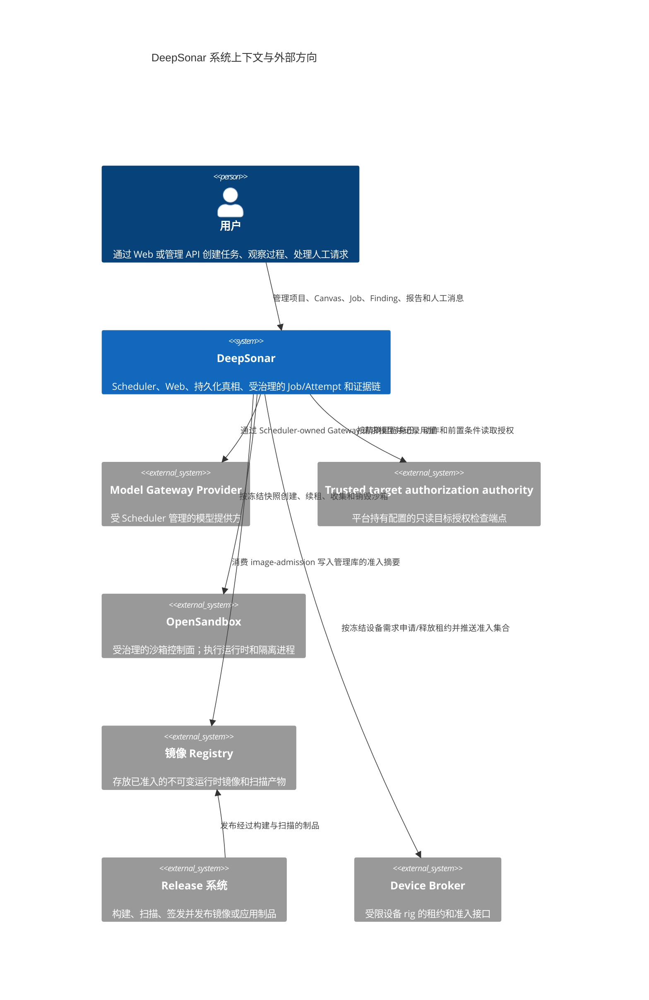

# 02 上下文与范围

> 状态：**as-built**（#741；#767/#775 同步）。说明 DeepSonar 的系统上下文、外部参与者、边界和接口方向；不替代接口细则。
> 同步日期：2026-10-31

本视图以代码、部署文件和可信内核设计为事实来源。系统的核心边界是 Scheduler：它读取管理真相，依据冻结的 Job 快照调度唯一允许的副作用，并把结构化结果写回 Canvas、Artifact、Finding、Evidence 和报告投影。Web、Worker、Hub 和 Agent 都不能绕过 Scheduler 直接改变终态。总体内核边界见 [DESIGN.md](../../DESIGN.md)，详细架构背景见 [ARCHITECTURE.md](../ARCHITECTURE.md)。

## 系统上下文

图中的箭头表示受治理的调用方向。用户的浏览器只进入 Web 的管理面，Web 再通过 Scheduler API 读取或提交管理操作；浏览器不是执行者。Scheduler 使用 `gateway.ts` 的 Provider 适配和网关策略与模型提供方通信，使用目标授权适配器读取平台 authority 的只读判定，再使用运行时沙箱适配器与 OpenSandbox 的管理接口通信；目标 authority 不执行目标动作，模型响应也必须经过结构化事件和 Job-scoped Control API 才能形成内部事实。相关入口见 [`routes.ts`](../../apps/scheduler/src/routes.ts)、[`gateway.ts`](../../apps/scheduler/src/gateway.ts)、[`dispatcher.ts`](../../apps/scheduler/src/dispatcher.ts) 和 [`target-authorization`](../../apps/scheduler/src/domains/target-authorization/)。

## 参与者和接口方向

| 参与者或系统 | 进入 DeepSonar 的内容 | DeepSonar 对外的内容 | 约束 |
| --- | --- | --- | --- |
| 用户、Web、管理 API | DeepSonar 接收项目、任务、取消/恢复、Finding 处置、报告请求、人工回复 | DeepSonar 返回状态、Canvas 投影、证据索引、报告、审计结果 | 管理认证、项目作用域和 OpenAPI 约束由 Scheduler 执行；Web 不持有数据库或 Blob 存储凭据 |
| Model Gateway Provider | DeepSonar 的 Gateway 向 Provider 发送模型请求，并在 Scheduler 进程内按 credential 注入上游认证 | Provider 返回模型响应、流、错误和用量信息 | Provider 长期认证只在 Scheduler Gateway 进程内使用，不进入 Agent 快照、沙箱或 Evidence；响应不能直接写库 |
| Trusted target authorization authority | Scheduler 发送平台生成的项目、目标、主体、声明身份、精确动作、前置条件和内容/契约摘要 | authority 返回严格版本化的 allow/deny、策略 revision、过期时间、作用域、动作和前置条件状态 | URL、authority ID、secret 引用和动作链只来自 Scheduler 宿主配置；请求体不含原始内容或 secret，secret 仅用于宿主传输认证；authority 只读且不执行目标动作 |
| OpenSandbox | DeepSonar 发送创建/续租/收集/销毁请求和冻结的资源、网络、镜像约束 | OpenSandbox 返回沙箱句柄、进程/工具输出、资源状态、清理结果 | Job/Attempt 外部效果先登记 effect；效果未知时进入对账路径，不自动重放 |
| Device Broker | DeepSonar 发送设备准入集合、租约申请和释放请求 | Broker 返回符合共享契约的设备租约、端点和释放结果 | Scheduler 解析 Broker 响应后才落库；Broker 是不可信外部进程，租约由 TTL 和 Reaper 兜底 |
| 镜像 Registry | image-admission 从 Registry 拉取并检查镜像引用 | Registry 返回镜像内容和摘要；准入摘要写入 PostgreSQL 供 Scheduler 读取 | 只能使用准入的不可变引用；任意用户或 Agent 不能提交 OCI 地址扩大边界 |
| Release 系统（GitHub/CI 外部服务） | Release 服务向 Registry 发布构建/扫描/签发后的制品 | Registry/发布服务返回制品状态，供 image-admission 消费 | 发布流水线不属于 Scheduler 运行时控制面；运行时只信任准入记录和摘要 |
| Plane（未实现占位） | 当前版本没有外部 Plane 输入或关联状态接口 | 无当前同步、回执或写回路径 | 未来集成必须经过单独的项目 scope、事件去重和审计设计；不能据此推导现有 as-built 能力 |

## 范围

系统范围包括项目和权限、Canvas 图、Job/Attempt 生命周期、能力与 Skill 目录、角色/运行时快照、模型网关、目标授权只读适配、沙箱和设备租约、结构化 Control 事件、Artifact/Finding/Verify/Research/Report、Evidence、审计、镜像准入、Web 工作台以及这些边界的恢复和清理。四个可部署应用是 `apps/scheduler`、`apps/web`、`apps/image-admission` 和 `apps/device-broker`；共享协议和运行时实现位于三个 `packages` 包中，组件所有权见 [05 Building Blocks](05-building-blocks.md)。Plan v2 的用户目标、路线和执行投影属于 Scheduler/Canvas 范围，但仍沿用既有 Hub Intent、Job 和 Attempt 路径；Pi 观测记忆是显式 opt-in 的 Job/Session 上下文扩展，Gateway、凭据、归档脱敏和镜像准入仍属于同一 Scheduler 内核边界。

系统范围之外的是模型内部推理、第三方 Provider 的可用性承诺、目标 authority 对外部目标真实可写性的承诺、OpenSandbox 或设备本身的硬件安全、Registry 内容、GitHub/CI Release 服务的发布流程，以及尚未实现的 Plane 集成。image-admission、Scheduler 的目录/快照/准入、平台版本只读发现和本地报告投影仍在系统范围内；系统会对外部效果做认证、超时、审计、准入和对账，但不能把外部系统的行为宣称为本地事实。

## 上下文边界的例外

- `Web` 可以订阅 Job 流和展示报告，但流传输不产生新的管理真相；跨副本缺少本地 Evidence 时必须显示不可用。
- `apps/device-broker` 位于一次性或受限设备环境。设备被视为不可信外部资源，Scheduler 通过租约、项目选择和冻结快照控制访问。
- 目标 authority 是 Scheduler 宿主配置的只读外部参与者；它只确认当前项目、目标、主体、动作和前置条件，不能接收或执行目标动作。authority 配置变化或 grant 不匹配时，系统必须 fail closed。
- Plane 目前只是未实现的集成占位，不属于当前上下文接口，也没有配置即可启用的同步路径；系统使用本地管理面完成任务闭环。
- Release 只是镜像/应用制品的生命周期参与者，不能直接修改运行中 Job、Attempt、Canvas 或终态。
