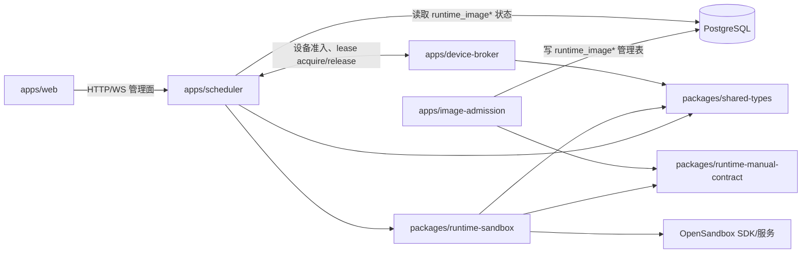

# 05 构建块与所有权

> 状态：**as-built**（#741）。列出四个应用、三个共享包和 Scheduler 域的责任边界及依赖方向；领域状态机由专题文档维护。
> 同步日期：2026-10-20

构建块按照“入口组装、领域负责规则、基础设施负责外部效果”分层。所有权以目录、注册入口和运行时依赖为事实；完整 bounded-context 说明见 [ARCHITECTURE_SCHEDULER_BOUNDED_CONTEXTS.md](../ARCHITECTURE_SCHEDULER_BOUNDED_CONTEXTS.md)。

## 应用和共享包

| 构建块 | 所有权 | 输入/输出和依赖方向 |
| --- | --- | --- |
| `apps/scheduler` | HTTP/WS 管理面、Control API、数据库事务、Job/Attempt、Gateway、Evidence、Hub、Verify/Research/Report、审计和副作用 | 依赖三个共享包以及 PostgreSQL、Blob/S3、Provider、OpenSandbox、Device Broker；不被 Web 或 Agent 直接调用内部数据库 |
| `apps/web` | React 工作台、Canvas 显示、Job/Finding/Report 交互和 URL `tab` 视图 | 只调用 Scheduler 管理/流接口；依赖 `shared-types`，不挂载管理存储 |
| `apps/image-admission` | 镜像扫描、签名/身份校验、可信状态和准入目录 | 依赖 `runtime-manual-contract` 与 PostgreSQL；通过数据库表供 Scheduler 读取，不能改变 Job 快照或运行中 Attempt |
| `apps/device-broker` | 设备 rig 入口、设备 allowlist、短期 lease、设备事件 | 依赖 `shared-types`；不把 USB/特权设备直通 Scheduler 或沙箱 |
| `packages/shared-types` | Zod schema、Control/Capability/RepairFeedback、Canvas/图查询和协议常量 | 低层叶子包；不访问数据库、网络或外部副作用 |
| `packages/runtime-sandbox` | Provider-neutral runtime host、OpenSandbox 适配、Compose 网络规则和文件传输 | 依赖 shared types、运行时工具手册契约和 OpenSandbox SDK；只由 Scheduler 的执行路径驱动 |
| `packages/runtime-manual-contract` | 运行时工具手册的元数据/索引与镜像标签契约 | 无业务依赖；供镜像准入和沙箱校验共同读取 |

依赖方向禁止反向穿透：共享包不能依赖应用；Web、镜像准入和设备 Broker 不能成为第二 Scheduler；领域通过明确的服务接口和事务边界协作。若要新增能力，优先增加 Capability Pack 或域内实现，复用现有 Job/Attempt/effect、Control API、沙箱和审计。

## Scheduler 域所有权地图

| 域 | 所有的规则和状态 | 主要协作方向 |
| --- | --- | --- |
| `api-token` | 管理 API token 生命周期、hash/prefix 和作用域 | → auth、audit、project scope |
| `artifacts` | Artifact 版本、claims、evidence、relations 的内部写入真相 | → canvas、finding-verification、report |
| `audit` | 去凭据 append-only 审计投影 | ← 所有需要审计的域 |
| `auth` | 管理认证、Actor、项目/作用域钩子 | → project/task、job-control、audit |
| `canvas` | Canvas 节点、边、revision、广播和人消息的过程真相 | → event-ingestion、hub、job-lifecycle |
| `capability-pack` | Pack manifest、选择、组合校验和物化预览 | → platform-api、role-runtime-snapshot |
| `cli-capability` | 通用 CLI 能力目录、镜像兼容性、admission/freeze（例如文本搜索、JSON 查询、Git 等工具）；不等同于 Agent CLI selector | → capability-pack、role-runtime-snapshot、platform-api |
| `context` | 受限上下文、图查询和提示投影边界 | → hub、platform-api、verify、report |
| `credential` | Provider 凭据加密存储和安全管理投影 | → provider-adapter、role-runtime-snapshot、gateway |
| `dashboard` | 管理端聚合读取和运维视图 | → job、canvas、finding、report |
| `device` | 设备要求、Broker 认证、lease 和回收 | → job-attempt、dispatcher、device-broker |
| `event-ingestion` | 事件 envelope、dedup、Job sequence 和语义副作用事务 | → canvas、job-lifecycle、hub、audit |
| `extension-materialization` | 经准入的 CLI/Skill 扩展 materialization | → capability-pack、skill-source、runtime snapshot |
| `finding-research` | 语义 cluster、canonical anchor、relative priority 和研究审计 | → finding、report；不反向改变 Verify |
| `finding-verification` | Verify rounds、证据门、rework、needs_human、确认/驳回 | → artifacts、job-lifecycle、canvas |
| `hub-orchestration` | Hub eligibility、intent 校验、轮次和进展 | → context、job-lifecycle、canvas |
| `job-attempt` | Attempt、phase、effect pending/settlement、replay 和资源清理 | → dispatcher、sandbox、audit |
| `job-control` | 取消、恢复、重跑、人工路径等管理动作 | → job-lifecycle、job-attempt、canvas |
| `job-lifecycle` | Job 状态策略、claim/failure/timeout/orphan/reconcile | → attempt、dispatcher、hub |
| `language-server-capability` | 语言服务能力目录和准入描述 | → capability-pack、platform-api |
| `plan-protocol` | 计划和计划结果协议、版本与校验 | → platform-api、job-control、canvas |
| `platform-api` | Job-scoped Control operation registry、token、动态接口和反馈 | → 所有允许 Agent 提案的域 |
| `platform-claims` | 平台级暂停/恢复等 claim | → dispatcher、settings、audit |
| `platform-updates` | 从 registry catalog 做平台版本/结构化 manifest 的只读发现，并写入 `platform_update_checks` 单例；不执行升级或 apply | → runtime-image、settings、audit；Web 只读展示管理员提示 |
| `project-knowledge` | #752 项目 Memory/Skill 的版本、来源、work、阶段分配、试验评测、审查结算、精确授权、usage/feedback 和持久 receipt；平台硬门在 Scheduler | → event-ingestion、job-lifecycle、shared-assets、platform-api、role-runtime-snapshot；Web 仅用管理 API。详见[项目知识专题](../PROJECT_KNOWLEDGE.md) |
| `project-agent-allowlist` | 项目 Agent CLI/Provider allowlist、默认选择和 Hub 安全目录；Job 创建时由 snapshot 域重新校验 | → role-runtime-snapshot、provider-adapter、platform-api |
| `project-skill-allowlist` | 项目 Skill 来源和选择约束 | → skill-source、extension-materialization |
| `project-task` | 项目任务入口、Canvas 根和 ingress 幂等 | → canvas、hub、job-lifecycle |
| `provider-adapter` | Provider/model 目录、兼容性和网关选择 | → credential、gateway、runtime snapshot |
| `report-convergence` | Task/Finding 报告输入门、版本、SARIF 和失败状态 | → context、canvas、research |
| `role-config` | 角色/项目候选配置和管理投影 | → runtime snapshot、auth |
| `role-runtime-snapshot` | 创建期 CLI、Provider、技能、镜像、网络、凭据和 knobs 快照 | → dispatcher、job-attempt；不拥有 Job 状态 |
| `runtime-image` | 运行时镜像目录、摘要、渠道、扫描和信任关联 | → image-admission、runtime snapshot、sandbox |
| `settings` | 平台配置和 guardrail 默认值 | → config、platform-claims、audit |
| `shared-assets` | 内容寻址 Blob、版本、作用域、配额和 Job 绑定 | → canvas、dispatcher、evidence |
| `skill-source` | Skill 来源、trusted/enabled 状态、选择和内容 hash | → platform-api、extension-materialization |
| `stream` | WS ticket、Evidence catch-up、过程流可见性和背压 | → evidence、auth、job-lifecycle |
| `system` | 健康、schema/启动检查和系统级装配 | → 所有应用基础设施 |
| `transfer` | 导入/导出包的格式、校验、作用域和审计 | → auth、project、shared-assets、audit |
| `worker-nodes` | 远程 Worker 注册、心跳和节点能力 | → dispatcher、runtime-sandbox、audit |

领域之间不共享私有表写入规则；跨域写入由拥有者提供事务入口。锁顺序、Canvas-first 规则和禁止的反向依赖以 [Scheduler bounded contexts](../ARCHITECTURE_SCHEDULER_BOUNDED_CONTEXTS.md) 的锁序章节为单一权威。
