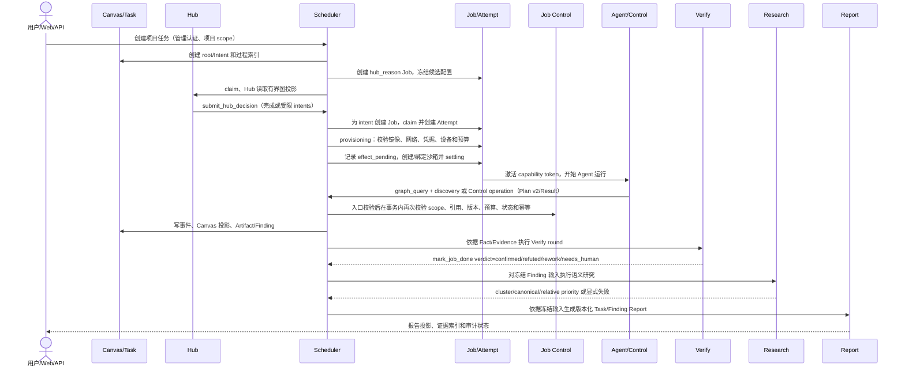

# 06 运行时视图

> 状态：**as-built**（#741；#767/#775 同步）。描述任务从入口到报告的正常链路，以及越权、超时、取消、重启、未知效果和人工路径。
> 同步日期：2026-11-05

运行时主线由 Scheduler 编排，Hub 和 Agent 都通过有界上下文和 Job-scoped Control 操作参与。Canvas 是过程/观察真相，Artifact 是结构化内部写入真相，Evidence 是沙箱执行与原始证据真相，报告是冻结输入后的投影；不能用制造者文本互相替代。Job/Attempt 状态的完整规则见 [ARCHITECTURE_SCHEDULER_BOUNDED_CONTEXTS.md](../ARCHITECTURE_SCHEDULER_BOUNDED_CONTEXTS.md)。

## Finding quality worker and preload (#819, 2026-11-01 merged engineering slice)

[Startup](<../../apps/scheduler/src/index.ts>) freezes [loaded quality assets](<../../apps/scheduler/src/domains/project-finding-research/quality-assets.ts>) before application schema SQL/service startup. Node24 synchronous [source capture](<../../apps/scheduler/src/domains/project-finding-research/quality-source-capture.ts>) is preloaded after TSX/source transforms and before the fourteen governed modules, capturing actual nextLoad source bytes before evaluation. [Dev/start](<../../apps/scheduler/package.json>) and CI direct compiled starts carry that preload. Missing/late capture fails closed, with no disk reread; Node/loader/preload are TCB, not self-signature or successful evaluation proof.

The existing maintenance gate owns [quality-worker](<../../apps/scheduler/src/domains/project-finding-research/quality-worker.ts>) startup/stop. Stop synchronously forbids new ticks and returns its owned in-flight drain; startup retains drains across maintenance close/reopen and waits for them before SQL end. Each RR tick locks current/head/work and appends one admitted holdout-subject observation with generation/ordinal checkpoint. A separate completion tick appends zero observations, re-observes the full bounded cohort, recomputes metrics and binds actual work/dataset/run/evaluation. Report and review readers reconstruct the same durable/current-source chain in their caller RR snapshot; stale/conflicting work fails closed. This is bounded engineering, not measured throughput or production drain evidence.

Protocol freeze/declaration precede separately committed raw holdout exposure; later parse/admission failure cannot erase it. `admitted`, `completed` and `reviewed` are structural stages, never current quality certificates. Host verification of independent evidence, certificate/CAS promotion and guarded public relations remain unimplemented; status stays not_evaluated/published=false. The agreed schema67 SQL/HTTP/worker engineering slice passed at fdb55a01 in Actions; subsequent #838 repair checks and final-main acceptance are separate. Historical schema66 evidence and [independent quality inputs](<../PROJECT_FINDING_EVALUATION.md>) do not replace either engineering or quality acceptance.

## 凭据与 CLI 解析（#757）

`resolveProviderCredentialForJob` 是 readiness 与 Job 创建共同使用的解析入口，需求见 [FR-CRED-002](01-system-specification.md#fr-cred-002-providermodel-catalog-与兼容性)。解析先限于本项目或全局的 active Provider 账号，以及独立的项目 CLI / 凭据白名单，再校验 Provider 协议与模型要求；不能先用系统 CLI 种子筛掉唯一有效账号。

1. Hub 的 Provider/model 需求、项目默认模型和全局角色模型按既有优先级形成模型要求；模型按每张凭据的 CLI 方言核对配置清单。
2. Hub 显式 CLI 是硬约束，与候选冲突继续 `provider_credential_cli_mismatch`（`permanent_failure`）；不能通过改选 CLI 绕过排他绑定。
3. 唯一候选直接决定 CLI。只有跨 CLI 多候选才用项目 `default_agent_cli` > 全局 RoleConfig 显式 CLI 作软偏好；全局种子 NULL 不构成偏好，用户显式 `claude-code` 构成偏好。项目默认凭据只在剩余候选内查找，不能绕过模型/CLI/授权条件；仍不唯一时返回 `provider_credential_multi_match`，提示收窄需求或由管理员配置默认凭据。
4. 未配置凭据白名单时动态读取当前作用域候选，不在读取时写入 ID。显式白名单及默认凭据的删除、停用或不可访问引用返回 `provider_credential_allowlist_stale`（`permanent_failure`），RepairFeedback 指向管理员修复名单；既不扩大授权，也不把权限修复交给模型。
5. 选中的账号、CLI、Provider/model 按原规则进入新 Job 快照。账号 × CLI 1:1、并发计账和 Gateway 密钥隔离不变；不修改任何已有 Job 快照或镜像准入。

项目 CLI/Provider 管理页独立加载账号列表，区分加载中、加载失败与成功空列表。只有成功读取当前项目可见账号后才判定默认账号和白名单引用失效；未加载成功时保存 CLI 不能清除默认账号或写入空凭据白名单。Pi 模型快照对账号目录中含 `/` 的完整模型 ID 保持一致，CLI 路由单独冻结，详见 [CLI 运行时契约](../AGENT_CLI_RUNTIME_ADAPTERS.md#pi-coding-agent-rpc140)。

实现入口：[凭据解析](../../apps/scheduler/src/domains/provider-adapter/resolve-credential.ts)、[快照组装](../../apps/scheduler/src/domains/role-runtime-snapshot/application.ts)、[readiness](../../apps/scheduler/src/readiness.ts)。

## 正常链路

任务入口创建 Canvas 根和 Hub Job；Hub 不直接写 Job 终态，而是提交经过引用和预算校验的意图。Dispatcher 按冻结快照领取 Job、创建唯一 active Attempt、登记 provisioning/agent 外部效果，并在 Agent 结束后由 Scheduler 收敛。所有 Control operation 先由 [`executor-real.ts`](../../apps/scheduler/src/executor-real.ts) 和 Control registry 做入口校验；只读 discovery 返回有界投影，不进入 event-ingestion 语义事件事务。改变语义或外部效果的 operation 再由 event-ingestion 在持久化事务中锁 Job 并重复检查角色、scope、引用、状态和协议；非法输入会回滚该事务的所有副作用。Plan v1 的历史记录只读，`submit_plan`/`submit_plan_result` 的新写入和执行只接纳 v2：授权用户先以 Canvas `plan_objective.expected_revision` 做目标 CAS，模型再以 `execution_route` 做路线 CAS；Scheduler 在同一事件事务中复用既有 Hub Intent materializer 计算 ready task、校验完整路线并创建普通 Worker Job，不建立第二队列或执行通道。`emit_fact`/`emit_finding` 的 side-effects 会调用 Artifact model/persistence，再绑定 Canvas Fact/Finding；Artifact 的 source operation 和绑定关系由 [`side-effects.ts`](../../apps/scheduler/src/domains/event-ingestion/side-effects.ts) 保存。Verify 只消费 Fact、Artifact、Evidence 和独立 Evaluation。Research 只写其语义结果，Report 只把冻结输入投影给用户。

### 任务契约与目标授权派发门（#767）

显式契约在创建前校验，必要条件阻塞返回 409 且不建任务；通过后规范化并保存到 Canvas 和新 Job 冻结快照。契约自声明不构成当前授权。契约请求写目标或声明需要可验证目标身份时，Scheduler 只使用宿主配置的 `deepsonar.target-authorization/v1` 只读 authority：请求绑定当前项目、`reference-http/v1` 目标、认证主体、tenant/role/resource、精确动作链、必需前置条件、原始内容 SHA、规范化契约 SHA、派生 revision 和 authority freshness；response 必须逐项复述并 allow 全部动作、满足全部前置条件，且返回有效 authority revision/expiry。secret、URL、authority ID 和动作链不来自任务、Canvas、Job 或模型。

成功判定只生成 secret-free snapshot，并在创建 Job 的事务中写入 Scheduler-owned `audit_logs` 的 `task.target_authorization` grant。Dispatcher 在 sandbox provisioning 前按冻结 revision 重新检查；`resume-frozen`/`rerun-current` 在中断 Attempt、撤销 grant 或转回 pending 前检查。child/system follow-on Job 只能从该审计账本继承与权威 Canvas 内容/契约一致的 grant；Canvas metadata 不能替代 host grant。配置漂移、缺失/改变 grant、撤权、过期、身份/目标/动作/前置条件或 binding 不匹配均 fail closed；不可重试的 `target_authorization_grant_invalid` 不创建 sandbox、不重放目标动作。

Hub/Report follow-on admission 在 savepoint 内处理该拒绝：回滚本批新 Job，保留前驱已写入的 terminal result，并把 Canvas convergence 持久暂停；Plan v2 依赖 admission 使用同一错误持久停止，不撤销前驱已证明输出。详细协议见 [目标授权专题](../TARGET_AUTHORIZATION.md) 和 [ADR-0011](adr/0011-trusted-target-authorization.md)。若契约不能安全表达写入目标，不自动把原目标降级为只读；由创建者重新下发明确的较窄目标。

## 项目知识工作链（#752 分支）

普通 Job 从冻结目录按需搜索、读取 Memory 或拉取 Skill，实际使用生成稳定 usage_ref；有可读来源或反馈证据时可请求整理。Scheduler 创建独立 work/Canvas，依次分派 maker、按 case×arm 分离的 trial Job、evaluator 与 reviewer；这些都是现有 Job/Attempt/沙箱路径，不新增模型执行者，也不触发业务 Hub/Report。trial 只得到相应 arm 和 stage audience 的输入，发布共享资产 JSON 并以 `emit_fact` 引用其版本/hash，评测读取实际 Evidence；缺环境、证据或终态异常保持 `needs_eval`/阻断，不以文字结论晋升。审查通过才在事务中切 active 指针；失败或重启依持久 assignment/receipt 恢复，未知外部效果不自动重放。项目治理 recipe 在 work 创建时冻结，修订仅进入下一 work。详细状态和预算见[项目知识专题](../PROJECT_KNOWLEDGE.md)。现有集成测试使用构造的 Job/Attempt 与 Evidence，未证明真实沙箱或模型效果。

## 非正常路径

| 触发 | Scheduler 响应 | 结果和后续 |
| --- | --- | --- |
| 无效 token、Job 不属于项目、operation 不在 allowlist、不可见节点或坏 schema | 所有 operation 先做 token/operation/schema 检查；mutating operation 的 event-ingestion 事务内再次锁 Job、检查 scope/引用/语义状态，失败时回滚整笔副作用；401/403/409/422 按错误类别返回，模型可修正项带 RepairFeedback | 不提交部分事实或外部效果；永久越权不可通过重试修复 |
| 同一 Idempotency-Key 重复且输入相同 | 所有 operation POST 都要求 UUID key；只读 operation 使用接口层缓存/冲突检查，mutating operation 还由事件/effect durable dedup 保护 | 调用方可安全读取接口结果；同 key 不同 operation/input 返回冲突 |
| 事件窗口或图查询预算耗尽 | 429 或预算错误，反馈当前状态和剩余预算 | 用新的有界查询/延迟重试修复；不扩大 Job scope |
| provisioning 在外部效果开始前已知失败 | 记录失败并按已知可重试策略决定新 Attempt；Job 进入失败或受控 retry | 只有明确安全的 provisioning 重试允许继续；不重复未知外部效果 |
| effect intent 已写但外部结果未知（例如沙箱句柄/销毁回执缺失） | Attempt effect 标记 `unknown`，Job 进入 orphan/对账路径，保留 effect id | **禁止自动重放未知效果**；由对账或人工确认后采取下一步 |
| 已接受 done 后 CLI 再请求模型 | 仅对具有结构化终态来源的精确 Gateway 完成拒绝放行原 Hub/done bundle；进程退出、缺终态、传输/诊断或语义失败不覆盖 | 不重试进程、不重放未知效果，仍过原 ingestion/lifecycle 门；来源契约与离线回归见 [CLI adapters](../AGENT_CLI_RUNTIME_ADAPTERS.md#runner-failure-provenance-919) |
| 用户取消或 deadline 超时 | 以状态 CAS 收敛 Job/Attempt，停止 lease，撤销 token，执行可重复清理 | 迟到回调不能复活 Job；清理自身若未知也保留 unknown 记录 |
| Scheduler 重启 | preparing 且没有 effect 的 Job 可回 pending；已发 intent、未结算或有外部句柄的 Attempt 走 unknown/orphan | Reaper/reconcile 先对账再清理；不能把“没有日志”当作“没有效果” |
| Agent 调用 `request_human` | 执行器在异步预检前后检查完成预留及终态互斥，防止等待期间已接受完成或人工请求后再覆盖；记录 human message，Job 进入 `waiting_human`；人工回复另走 ACK operation | ACK 与 injected 分离；有回复可回 pending，等待人工预算超时由 Reaper 将 Job 置为 `failed` 并以 `human_timeout` 记因 |
| Verify 等待证据、回到 rework 或进入 needs_human | Verify 域拥有 round 状态；Agent 的合法 verdict 是 `confirmed`、`rework`、`needs_human` 或 `refuted`，Scheduler 可按收敛政策把结果记录为 `inconclusive` | 不以 Agent 总结替代证据门；不可判定结果显式保留 |
| Research 失败 | 在研究 run 中记录失败；savepoint 不回滚主 Finding/Report | 可重新发起有界研究，但不能修改 Verify、严重性或 Fact 状态 |
| Report 失败或输入变化 | 保留旧成功版本，记录当前版本失败或追加新版本 | 报告投影失败不改写内部 Artifact/Finding/Evidence |

Attempt 的 `job_attempt_effects` 先 `effect_pending` 后 settlement，只有代码明确标记为安全的清理效果可重放；未知效果始终需要对账或人工。控制流和清理路径必须写审计并释放设备租约、共享资产卷、token 和沙箱资源。

Gateway 503 仅在内核明确证明请求尚未启动时可降级；`unknown` 或 `pending` 必须硬失败，provider 5xx 文案不构成外部效果 authority。

## 数据库锁序、共享卷与完成恢复（#871/#873/#874）

涉及图投影的事务按 Canvas → Job → Attempt → effects 获取锁；节点/边触发器也会锁 Canvas，不能在持 Job 后才更新节点。claim 按有界 keyset 候选页使用独立事务，每页重新获取 claim advisory lock 并读取平台暂停、活动数与配额。先排序锁 Canvas，再锁项目/Job/Attempt 并核验当前 scope 和调度条件，仅成功领取计入配额；忙锁候选不消耗槽位。需要继续扫描时先提交并释放本页锁，下一页重新按同一锁序开始，不能持 Job/Attempt 锁回头锁新 Canvas。context 的 Job-only 写入在同一 Job → Attempt 事务更新两份投影。仅已回滚的纯数据库事务允许按 [DB conflict helper](../../apps/scheduler/src/db-conflict-retry.ts)有界重试；Gateway 在 admission 提交后只向上游发一次请求，不重放请求或未知效果。

任务硬删除与归档复用上述锁序（#904 / #917 评审）：claim advisory → Canvas → 排序 Job → Attempt/effects，保留判定与数据库取消同事务；知识治理回执、版本、评估及设备租约历史保持不变，命中时在取消前拒绝。事务调用方通过 `deferProvisionInterruption` 将 provision abort/provider cancel 延后到真实提交成功，之后再销毁 sandbox；取消 CAS 后的 SQL 失败不应改变外部 runner。独立 PostgreSQL 回归覆盖删除回滚、提交后中断与归档/事件交错，最终工程验收仍以当前 SHA 的 Actions 为准。

[共享资产生命周期锁](../../apps/scheduler/src/shared-asset-lifecycle.ts)使用独立 PostgreSQL session 串行同 Job 的 prepare 与 cleanup，不占住业务连接池等待外部 provision。准备要求当前最新 active Attempt，锁保持到 runner 验证只读挂载并提交资源绑定/running CAS；旧 finally、Reaper 和扫描器在获得锁后重新读取归属，active/新 Attempt 拒绝删除。Docker 的实际 volume/helper 名称由独立 generation 决定，prepare 只操作本 generation；cleanup 固定资源快照后重验独立 session 许可，每次破坏性操作或重试前再检查，不能失锁后采纳后继资源。Docker 再严格验证 managed/Job/generation 标签，helper 用 inspect 得到的不可变容器 ID 清理，卷非 force 删除；精确不存在、fenced skip 与失败分别处理。完整边界见[共享资产专题](../SHARED_ASSET_BLOB_STORE.md#跨-attempt-共享卷生命周期871)。续租由[Attempt lease helper](../../apps/scheduler/src/attempt-lease.ts)维护精确 registration 与 stop closure，旧 finally 不删除新 timer；alive 探测后再次核归属，在短 Job → 最新 Attempt 事务中检查 active/cancel 与 Job/Attempt 双 sandbox 绑定，旧 tick 不续后继 lease。无服务 timer 与真实 PostgreSQL 归属回归均已接源码，实际结果以最终 Actions 为准。

完成被未知效果或未知修正用量阻断时，原负回执与宿主恢复事实同事务落库；原 key 重放保持原结果。Reaper 的既有 tick 按有界 keyset 扫描恢复根，冻结原 deadline 与有限 wake，不能自动执行对账。只有带 Scheduler 冻结引用的去重 Hub 可提出 `reconcile_effects` 或 `stop`，沿原 Control/语义事务重新校验权限、scope、快照和证据 CAS。对账只消费精确 effect 的持久用量证据；中断、缺少句柄或零 unknown 不证明资源停止。原会话仍活动时重新完成仍走全部既有门；退出会话/新 Attempt 的完整继续执行仍未交付。pause、auto-stop、人工与 Verify 等待保持权威。见 [FR-CTRL-010](01-system-specification.md#fr-ctrl-010-完成未知效果的受治理恢复)、[ADR 0015](adr/0015-governed-completion-recovery.md)和[专题](../REPAIR_FEEDBACK_DONE_REPAIR.md#completion-recovery-v1)。

上述修复已接入现有 Actions 脚本；本分支最终 SHA 的 PostgreSQL、完整核心及镜像验收尚未执行通过，源码存在不作为运行证据。

## OpenSandbox upgrade and recovery boundary (IR-001/003)

The 2026-11-01 [SDK binding](../../packages/runtime-sandbox/src/opensandbox-sdk-client.ts) explicitly disables SDK 1.2 implicit wake retry. Historical local installed-constructor create/connect/clone/ownership regressions are verified: `withTransportIfMissing()` clones and initializes an uninitialized config for SDK-owned closure, while an initialized config is borrowed and stays caller-owned. The client singleton stays uninitialized; upload recycling closes the previous local transport and passes a genuinely new uninitialized config to `Sandbox.connect`, without killing the remote sandbox. This does not delegate Job/Attempt/effect recovery to the SDK or prove live execution. Unknown/pending effects remain Scheduler-owned and are not replayable merely because an upstream wake marker appears. PTY/hosts mapping, frozen resources/network/volume input and create TTL remain unchanged; detailed source gates, scoped pinned-server parsing evidence and remaining live/native/final-combination boundaries are owned by the [upgrade record](../OPENSANDBOX_1_2_UPGRADE.md).

## 有界读取和语义事件

真实执行器按 `hub`、`agent`、`verify`、`report` scope 构造不同的服务端图快照；Hub 的启动指令明确要求在增量到达后重新调用 `graph_query(overview)`，Worker/Verify/Report 使用各自的任务快照和证据输入。初始 L0/overview 只提供有界 handle；`graph_query(kind=plan_objective)` 是完整 Job-scoped、独立于已接受 Plan 的读取，返回 `items[0]` 持久化 objective tuple，不提供 selectors、cross-scope 或 wholeGraph。预算或 input hash 不满足时明确失败，不写入部分 Plan 读取证明。所有 `graph_query` 都受 kind、引用、脱敏和单次投影硬上限限制；累计字节/调用额度默认不限，只有显式正整数配置时限制。完整响应（包括引用和元数据）超过 [graph-query.ts](../../apps/scheduler/src/graph-query.ts) 的单次响应硬上限 时先拒绝，不写入任何计数、引用或 Plan 读取证明；已接受响应按最终序列化字节计数，反馈剩余字节可保守少报几个字节以避免自引用计数。证据预览不授权被截断的 Fact 引用。该上限只约束单次响应，不限制跨成功查询累积的已见引用集合，也不约束完整 Canvas 加载内存。返回投影会记录本轮可见引用，不能凭猜测提交节点 ID。语义事件必须通过 shared Zod schema、入口 handler 和 event-ingestion 事务三层校验；CLI 文本、伪造工具调用、Shell 控制文件和管理 API 猜测不构成事件。实现入口是 [`executor-real.ts`](../../apps/scheduler/src/executor-real.ts) 和 [`graph-query.ts`](../../apps/scheduler/src/graph-query.ts)。

平台暂停领取的排空判定同时检查在途 Job 与所有 Attempt（包括已终结 Attempt）的 `effect_pending` / `unknown` 外部效果；Attempt 结束不是效果已结算的证明，全部结算前保持 `pausing`（FR-JOB-004 / FR-JOB-006 / FR-JOB-010）。

## 维护升级与业务执行的交界

普通平台暂停仍允许入队；[维护升级](adr/0008-maintenance-candidate-upgrade.md) 增加真正的数据库身份隔离。顺序是只读核验 → 暂停/排空 → 旧身份 NOLOGIN 与会话清退 → 验证备份 → 候选重建 → preparing 服务与节点验证 → 激活。不能通过中止 Job 来伪造排空。目标 preparing 状态关闭业务 HTTP/WebSocket 与后台任务，世代或版本不匹配也保持关闭；数据库隔离仍是旧节点不能写入的依据。

中断续做读取固定目标 journal，重复步骤前核对实际回执。激活前失败回源并保持暂停；激活成功或结果不明时不允许自动回旧数据。维护状态机、宿主/受管 SSH 和显式恢复领取已有实现；schema 61 → 62 的 16 项 Compose 场景及独立知识后台停写场景已通过并清理。具体历史基线与隔离环境见 [升级演练](../../deploy/UPGRADE_REHEARSAL.md)，不能据此推定 Windows Docker 全流程、断电或真实模型验证已完成。

## Pi 大输出捕获（#765）

RPC 按[帧与保存预算](../../packages/runtime-sandbox/src/pi-rpc-output.ts)有界扫描；受支持大事件在 workspace 与 Attempt evidence 保存完整脱敏 JSON 后，才生成文本预览。控制字段保留，错误响应不得变成成功；恢复进程共享运行级保存预算，写盘、超额与损坏明确失败并记录 capture_complete=false。元数据与 hash 范围见 [CLI 契约](../AGENT_CLI_RUNTIME_ADAPTERS.md#pi-大输出与证据765)，真实生产重跑未验证。

## Pi 会话观测记忆（#815）

只有能力组合显式选择已注册 OM 时，新 Job 才冻结插件/配置/模型；Scheduler 物化受审 wrapper 的字面配置 loader，并签发与 main 分离的 `observational_memory` Gateway token。`requires_egress=false` 不放宽业务网络，`requires_gateway=true` 要求所有后台模型调用走冻结路由。当前 Session 的私有配置与身份守卫拒绝环境覆盖、配置漂移及切换/分叉，不回读最新设置。

新 Job 的 `freezePiExtensions` 从 Scheduler 选定 `runtimeImage.image_version` 执行 [shared registry](../../packages/shared-types/src/pi-extensions.ts) 的 OM 专属下限，缺失/非法/旧 metadata 拒绝，历史冻结快照不重写。[runtime-adapters](../../packages/runtime-sandbox/src/runtime-adapters.ts) 在 Pi 启动/恢复及首个 prompt 前执行独立 [内容 guard](../../packages/runtime-sandbox/src/pi-memory-image-guard.ts)；缺少 canonical package/entry/wrapper 时不启动 `runAsync`/RPC。实际本地镜像正负例、canonical RPC 与回归证据集中见 [RPC 专题](../PI_OBSERVATIONAL_MEMORY_RPC.md#2026-10-31-主线程-built-image-验收)。

有限 Job 总额要求显式主/后台分配且不超额；总额不限时不推导百分比。Gateway 按全部 token 历史累计，在 Job 锁内预留并结算；pending/unknown 保守阻断后台，单次上游尝试不自动重放未知效果，终态撤销全部 workload token。只有精确已知 quota 或 `effect_status=not_started` transient 可让 wrapper 发出可见 diagnostic 并交回 native compaction；权限、协议、snapshot、pending/unknown 和任何 extension_error 保持硬失败。

后台请求只有在内核严格确认请求前 transport 失败、且持久写入零用量和 effect `never_started` 后才返回 `503 gateway_transient/not_started`；请求次数不退还，settlement 失败保留 pending/unknown 并返回 409，provider JSON/SSE/refusal 不能伪造该分类。详见 [Gateway 专题](../PI_OBSERVATIONAL_MEMORY_GATEWAY.md)。

有界 recall、新 Session/RPC 大帧归档与 viewer 脱敏保留控制身份，memory 不贡献 Fact/Evidence/完成 authority。历史 HTTP preview/download 已在截断/发送前按 Pi header/manifest 独立脱敏，immutable archive metadata 不变，projection bytes/SHA/Content-Digest 另报，相关集成已通过。实际本地 base 镜像 canonical RPC 和独立生产 guard 已验，证据见上述 RPC 专题；本轮工程已随 [#831 在 fdb55a01 主线 Actions 验收](<../TASK_DISPATCH_ACCEPTANCE.md#831-engineering-acceptance-2026-11-01>)，后续修复 SHA、发布通道/平台和 registry/catalog 仍另验，质量/成本收益 unknown。源码见[wrapper](../../agent-harness/pi-observational-memory-governed.ts)、[共享脱敏策略](../../packages/shared-types/src/pi-observational-memory-redaction.ts)与[验收矩阵](../TASK_DISPATCH_ACCEPTANCE.md)。Runtime、历史归档和 Web 复用该浏览器安全策略；Node 流式缓冲留在 runtime-sandbox，Web 隔离镜像无需复制运行时源码。

## DSH 子代理与完成门（#766）

对应 FR-CRED-005。DSH 父会话 idle 时若仍存在受认证谱系下的活跃子代理，不触发完成门、催促或 shutdown。只有对应 `subagent.finished` 结束该轮子代理活动；子 idle 不是完成依据，恢复 running 会重新计入活动。全部子代理完成后等待父会话接收结果并再次 idle，再按原完成回执契约结算。父错误、Job 超时与取消仍可终止运行。验证入口是现有 `ci:unit:runtime-sandbox` 中的 `runtime-dsh-recovery.test.ts`（新版真实协议回放）及 CI 的 DSH Cordis Docker smoke。

## Plan 单步决策（#775 B 历史只读）

B 首片的既有 Hub Intent 可携带 `plan_basis`，绑定当前 Plan/任务输入/证据/事件 revision；`graph_query(plan_gap)` 保存有界已读证明，补证仍沿既有 Intent → Job/Attempt/Evidence 路径，完成需要全部判据当前正向操作员授权。持久接纳回执只用于恢复原响应，不启动新执行。历史 v1 Plan/Result 可供审计和投影读取，但新的 Control 写入不再以 v1 作为执行输入；v1 未派发路线修订也只保留历史回放边界。详见 [Plan 范围](../PLAN_GAP_PROJECTION.md#b既有-intent-上的一次补证)。

## 目标约束传播与候选准入（#767）

所有已有契约执行统一基本完整性和整契约摘要绑定；冻结与压缩保留约束段。先持久观察 Fact/Artifact，再对研究候选逐判据检查；至少一项验收贡献不是整体完成。赏金追加规则筛选不替代独立资格。候选继续既有技术 Verify，unknown/不符拒绝 Finding；拒绝不会自动保存未提交观察。详见[通用标准与研究候选](../TASK_OUTCOME_ADMISSION.md)。

Plan 接纳采用事务外 preflight → Canvas/Job 锁内本地 prepare 与持久回执 → 原 Attempt commit；最终事件仍经既有 ingestion 结算。缓存或 handler 丢失可读原响应，不启动新执行。 详见 [持久化边界](../PLAN_BOUNDED_INTENT_DESIGN.md#持久化与原子性)。

## 目标结果与 Plan 显式关联（#767）

Task result 通过 emit_fact 写入版本 Artifact；delivery/negative_result 可由隔离来源 Job 评审，blocked/not_executed 仅留缺口。报告重核最新来源、实际字节与完整评价集合。Plan 可选关联已接线：操作员显式选择任务判据，接纳后失效仍阻止最终完成；持久接纳不是执行结算。详见[结果评审](../TASK_RESULT_REVIEW.md)、[Plan 关联](../PLAN_GAP_PROJECTION.md#可选目标评审关联767)及[验收矩阵](../TASK_DISPATCH_ACCEPTANCE.md)。

## 程序规则附加评审（#767）

程序规则附加评审复用普通 goal_review Job 与既有 Artifact/Evidence，不增加执行通道；仅 supplied bounty Finding，program_rule:<ruleid> 与通用目标 criteria 分开。报告按同 Finding/整契约重核完整规则评价集合，失效/冲突/预算不足不得提升。详见[评审](../TASK_GOAL_REVIEW.md)与[验收矩阵](../TASK_DISPATCH_ACCEPTANCE.md)。

Plan 的 supplementation_execution 从已提交 continue 决策及完整 child/Intent/Attempt 关联重建一次补证生命周期；接纳回执不算执行，后续 Hub 不算补证 child。 见 [Plan 执行投影](../PLAN_GAP_PROJECTION.md#一次补证的执行投影)。

## Plan v2 执行（#775 C）

Plan v2 bootstrap 只约束执行型 Plan。没有持久 objective、活动 Plan basis 或显式 Plan owner 的普通 Hub 任务仍使用既有 Intent 路径；平台下发文案不能把可选 objective 缺失扩大为人工阻塞。已有 Plan 上下文继续 fail closed，适用范围见 [Plan 专题](../PLAN_GAP_PROJECTION.md#job-scoped-objective-读取与首个-hub-submit)。

本节“执行完成”专指 `plan_execution.stop_reason=complete` 和 objective `status=completed` 的工程投影：依赖输出条件已经满足，不授予任务语义完成。后续 Hub/Report 仍由 `criteriaAuthorizeCompletion` 和当前来源重验阻断未获操作员正向授权的收敛。

授权用户通过 `PATCH /tasks/{canvasId}` 提交 `plan_objective.expected_revision` CAS，Scheduler 在 Canvas 行锁内保存目标 ID/revision、完整 CompletionPolicy、生命周期预算、输入 SHA 和状态。模型只能提交与当前用户目标恒等的 v2 Plan；`submit_plan` 必须带 `execution_route` CAS，目标 revision、路线 revision、Plan SHA 和已派发 task 的字节身份都要匹配。用户目标修订、路线重提或新 Idempotency-Key 不能重置已消耗的 lifetime task/round/no-progress 预算，也不能让旧目标 Job/Attempt 的输出成为新目标依赖。已消费的 continue 结果用当前 owner/Canvas/项目及 Plan 身份一致的持久 semantic event 水位去重；活动/ready 工作延后评估，相同事件在 owner/child 回调和进程重建中不重计，新事件即使正文相同仍可计入下一轮。缺失或不一致的来源 fail closed，细节见 [Plan 专题](../PLAN_GAP_PROJECTION.md#多轮推进重启与停止)。

Scheduler 先对完整路线做 Hub Intent admission，再在同一 event-ingestion 事务中调用现有 Hub Intent materializer；任一延迟 task 越权或快照/镜像/CLI/Provider/model/Finding/Verify/网络/共享资产检查失败，整条提案拒绝，不留下部分 child Job。Plan v2 没有专属队列或第二执行通道，普通 Hub/Worker Job 仍使用既有 Job/Attempt 生命周期。

`depends_on` 只有在前置 Job 与最新 Attempt 成功、当前目标 revision/task SHA 匹配、submitted 且未 superseded 的 Artifact/Finding/Fact 保持有效，并且 Artifact 与对应 semantic event 的严格 `plan.output` 绑定覆盖全部 `expected_outputs` 时才释放。每项输出还必须由当前 Attempt 的实际留存 Evidence 通过路径、finalized manifest、长度和 SHA 校验；这只是工程上的来源/留存关联，不是语义完成 authority，单独的 done、PlanResult 或 Artifact 绑定不能释放依赖。

Scheduler 将取消、超时、失败、缺失输出、无进展、预算耗尽和 unknown external effect 持久写入停止状态；未知效果 fail closed。只有当前目标全部 task 输出齐全，并通过完整、当前、正向且由操作员授权的必要判据，以及既有 Verify/Report/Task 完成门，才能收敛为 complete；`PlanResult.complete` 只是模型提案。target authorization grant 在后置 Hub/Report admission 中失效时，savepoint 回滚该批新 Job、保留前驱 terminal result 并暂停 Canvas；Plan 依赖 admission 使用同一 `target_authorization_grant_invalid` 持久停止，不撤销前驱已证明输出。

当前实现入口为 [`plan.ts`](../../packages/shared-types/src/plan.ts)、[`objective.ts`](../../apps/scheduler/src/domains/plan-protocol/objective.ts)、[`execution.ts`](../../apps/scheduler/src/domains/plan-protocol/execution.ts)、[`execution-output.ts`](../../apps/scheduler/src/domains/plan-protocol/execution-output.ts) 和 [`side-effects.ts`](../../apps/scheduler/src/domains/event-ingestion/side-effects.ts)。离线/隔离 PostgreSQL 夹具可验证 CAS、依赖、留存字节、停止和历史拒绝；v2 replay 的分项结果与 dirty provenance 限制见[验收矩阵](../TASK_DISPATCH_ACCEPTANCE.md)，不能写成 `5619154f` 精确最终验收，也不是 17 个独立测试。最终组合 CI、真实模型、生产部署、独立人工质量集和冻结留出阈值未由此替代。

2026-10-31 的 terminal/bootstrap 回归已通过；其中 `finalizeJob` core 终态事务把 Job/model token、Control token、audit 与终态收口放在一起，终态后实际 HTTP 请求为 401，`gateway-token-revocation.ts` 复用调用方 Job 锁且不吞失败。该核验只覆盖这条 finalizeJob 路径，不推断所有 drain/Reaper 清理路径。schema rebuild/restore 的完整本地夹具证据见[验收矩阵](../TASK_DISPATCH_ACCEPTANCE.md)。

## Plan 未派发路线修订（#775 v1 历史）

该 v1 路线修订仅作为不可变历史记录读取；当前路线修改使用上文 v2 `execution_route` CAS。历史事件、快照和回执不改写，未知效果、待结算回执或失效目标都不能借旧协议恢复执行。详见[路线生命周期](../PLAN_GAP_PROJECTION.md#未派发路线修订)。
