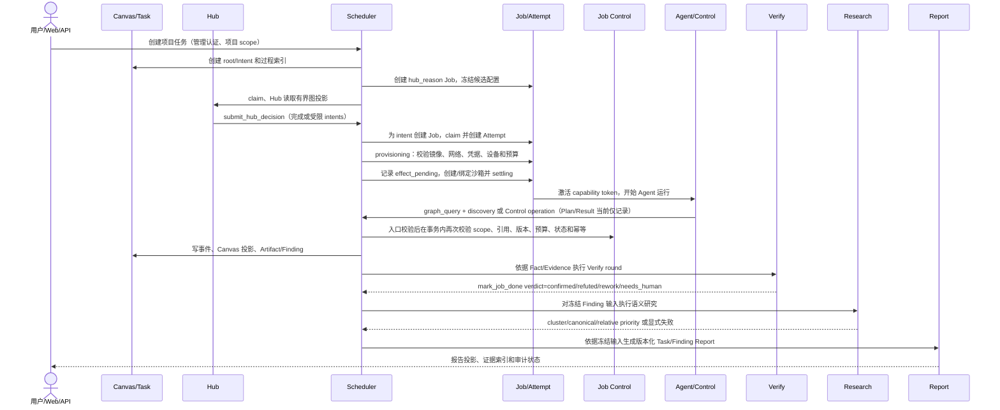

# 06 运行时视图

> 状态：**as-built**（#741）。描述任务从入口到报告的正常链路，以及越权、超时、取消、重启、未知效果和人工路径。
> 同步日期：2026-10-30

运行时主线由 Scheduler 编排，Hub 和 Agent 都通过有界上下文和 Job-scoped Control 操作参与。Canvas 是过程/观察真相，Artifact 是结构化内部写入真相，Evidence 是沙箱执行与原始证据真相，报告是冻结输入后的投影；不能用制造者文本互相替代。Job/Attempt 状态的完整规则见 [ARCHITECTURE_SCHEDULER_BOUNDED_CONTEXTS.md](../ARCHITECTURE_SCHEDULER_BOUNDED_CONTEXTS.md)。

## 凭据与 CLI 解析（#757）

`resolveProviderCredentialForJob` 是 readiness 与 Job 创建共同使用的解析入口，需求见 [FR-CRED-002](01-system-specification.md#fr-cred-002-providermodel-catalog-与兼容性)。解析先限于本项目或全局的 active Provider 账号，以及独立的项目 CLI / 凭据白名单，再校验 Provider 协议与模型要求；不能先用系统 CLI 种子筛掉唯一有效账号。

1. Hub 的 Provider/model 需求、项目默认模型和全局角色模型按既有优先级形成模型要求；模型按每张凭据的 CLI 方言核对配置清单。
2. Hub 显式 CLI 是硬约束，与候选冲突继续 `provider_credential_cli_mismatch`（`permanent_failure`）；不能通过改选 CLI 绕过排他绑定。
3. 唯一候选直接决定 CLI。只有跨 CLI 多候选才用项目 `default_agent_cli` > 全局 RoleConfig 显式 CLI 作软偏好；全局种子 NULL 不构成偏好，用户显式 `claude-code` 构成偏好。项目默认凭据只在剩余候选内查找，不能绕过模型/CLI/授权条件；仍不唯一时返回 `provider_credential_multi_match`，提示收窄需求或由管理员配置默认凭据。
4. 未配置凭据白名单时动态读取当前作用域候选，不在读取时写入 ID。显式白名单及默认凭据的删除、停用或不可访问引用返回 `provider_credential_allowlist_stale`（`permanent_failure`），RepairFeedback 指向管理员修复名单；既不扩大授权，也不把权限修复交给模型。
5. 选中的账号、CLI、Provider/model 按原规则进入新 Job 快照。账号 × CLI 1:1、并发计账和 Gateway 密钥隔离不变；不修改任何已有 Job 快照或镜像准入。

实现入口：[凭据解析](../../apps/scheduler/src/domains/provider-adapter/resolve-credential.ts)、[快照组装](../../apps/scheduler/src/domains/role-runtime-snapshot/application.ts)、[readiness](../../apps/scheduler/src/readiness.ts)。

## 正常链路

任务入口创建 Canvas 根和 Hub Job；Hub 不直接写 Job 终态，而是提交经过引用和预算校验的意图。Dispatcher 按冻结快照领取 Job、创建唯一 active Attempt、登记 provisioning/agent 外部效果，并在 Agent 结束后由 Scheduler 收敛。所有 Control operation 先由 [`executor-real.ts`](../../apps/scheduler/src/executor-real.ts) 和 Control registry 做入口校验；只读 discovery 返回有界投影，不进入 event-ingestion 语义事件事务。改变语义或外部效果的 operation 再由 event-ingestion 在持久化事务中锁 Job 并重复检查角色、scope、引用、状态和协议；非法输入会回滚该事务的所有副作用。`submit_plan`/`submit_plan_result` 记录版本化输入/结果，不直接派发 Worker、执行依赖图或写 Job 终态；首次显式 Plan 激活当前 Canvas 的依据门，带 `plan_basis` 的既有 Hub Intent 可进行一次补证，complete/报告受当前全判据授权校验。`emit_fact`/`emit_finding` 的 side-effects 会调用 Artifact model/persistence，再绑定 Canvas Fact/Finding；Artifact 的 source operation 和绑定关系由 [`side-effects.ts`](../../apps/scheduler/src/domains/event-ingestion/side-effects.ts) 保存。Verify 只消费 Fact、Artifact、Evidence 和独立 Evaluation。Research 只写其语义结果，Report 只把冻结输入投影给用户。

### 任务契约派发门（#767）

显式契约在创建前校验，必要条件阻塞返回 409 且不建任务；通过后规范化并保存到 Canvas 和新 Job 冻结快照；同一画布的新 Job 在沙箱 provisioning 前重新检查当前项目边界与凭据可用性。契约自声明不构成当前授权。所需动作被禁止、必要身份/权限未知或凭据失效时，停止整个依赖执行链，沿用既有失败处理，不新建 Job 状态。当前没有安全拆分任意自然语言任务的能力，因此不自动把写入链改成只读并宣称原目标完成；应由创建者重新下发明确的较窄目标。

## 项目知识工作链（#752 分支）

普通 Job 从冻结目录按需搜索、读取 Memory 或拉取 Skill，实际使用生成稳定 usage_ref；有可读来源或反馈证据时可请求整理。Scheduler 创建独立 work/Canvas，依次分派 maker、按 case×arm 分离的 trial Job、evaluator 与 reviewer；这些都是现有 Job/Attempt/沙箱路径，不新增模型执行者，也不触发业务 Hub/Report。trial 只得到相应 arm 和 stage audience 的输入，发布共享资产 JSON 并以 `emit_fact` 引用其版本/hash，评测读取实际 Evidence；缺环境、证据或终态异常保持 `needs_eval`/阻断，不以文字结论晋升。审查通过才在事务中切 active 指针；失败或重启依持久 assignment/receipt 恢复，未知外部效果不自动重放。项目治理 recipe 在 work 创建时冻结，修订仅进入下一 work。详细状态和预算见[项目知识专题](../PROJECT_KNOWLEDGE.md)。现有集成测试使用构造的 Job/Attempt 与 Evidence，未证明真实沙箱或模型效果。

## 非正常路径

| 触发 | Scheduler 响应 | 结果和后续 |
| --- | --- | --- |
| 无效 token、Job 不属于项目、operation 不在 allowlist、不可见节点或坏 schema | 所有 operation 先做 token/operation/schema 检查；mutating operation 的 event-ingestion 事务内再次锁 Job、检查 scope/引用/语义状态，失败时回滚整笔副作用；401/403/409/422 按错误类别返回，模型可修正项带 RepairFeedback | 不提交部分事实或外部效果；永久越权不可通过重试修复 |
| 同一 Idempotency-Key 重复且输入相同 | 所有 operation POST 都要求 UUID key；只读 operation 使用接口层缓存/冲突检查，mutating operation 还由事件/effect durable dedup 保护 | 调用方可安全读取接口结果；同 key 不同 operation/input 返回冲突 |
| 事件窗口或图查询预算耗尽 | 429 或预算错误，反馈当前状态和剩余预算 | 用新的有界查询/延迟重试修复；不扩大 Job scope |
| provisioning 在外部效果开始前已知失败 | 记录失败并按已知可重试策略决定新 Attempt；Job 进入失败或受控 retry | 只有明确安全的 provisioning 重试允许继续；不重复未知外部效果 |
| effect intent 已写但外部结果未知（例如沙箱句柄/销毁回执缺失） | Attempt effect 标记 `unknown`，Job 进入 orphan/对账路径，保留 effect id | **禁止自动重放未知效果**；由对账或人工确认后采取下一步 |
| 用户取消或 deadline 超时 | 以状态 CAS 收敛 Job/Attempt，停止 lease，撤销 token，执行可重复清理 | 迟到回调不能复活 Job；清理自身若未知也保留 unknown 记录 |
| Scheduler 重启 | preparing 且没有 effect 的 Job 可回 pending；已发 intent、未结算或有外部句柄的 Attempt 走 unknown/orphan | Reaper/reconcile 先对账再清理；不能把“没有日志”当作“没有效果” |
| Agent 调用 `request_human` | 执行器在异步预检前后检查完成预留及终态互斥，防止等待期间已接受完成或人工请求后再覆盖；记录 human message，Job 进入 `waiting_human`；人工回复另走 ACK operation | ACK 与 injected 分离；有回复可回 pending，等待人工预算超时由 Reaper 将 Job 置为 `failed` 并以 `human_timeout` 记因 |
| Verify 等待证据、回到 rework 或进入 needs_human | Verify 域拥有 round 状态；Agent 的合法 verdict 是 `confirmed`、`rework`、`needs_human` 或 `refuted`，Scheduler 可按收敛政策把结果记录为 `inconclusive` | 不以 Agent 总结替代证据门；不可判定结果显式保留 |
| Research 失败 | 在研究 run 中记录失败；savepoint 不回滚主 Finding/Report | 可重新发起有界研究，但不能修改 Verify、严重性或 Fact 状态 |
| Report 失败或输入变化 | 保留旧成功版本，记录当前版本失败或追加新版本 | 报告投影失败不改写内部 Artifact/Finding/Evidence |

Attempt 的 `job_attempt_effects` 先 `effect_pending` 后 settlement，只有代码明确标记为安全的清理效果可重放；未知效果始终需要对账或人工。控制流和清理路径必须写审计并释放设备租约、共享资产卷、token 和沙箱资源。

## 有界读取和语义事件

真实执行器按 `hub`、`agent`、`verify`、`report` scope 构造不同的服务端图快照；Hub 的启动指令明确要求在增量到达后重新调用 `graph_query(overview)`，Worker/Verify/Report 使用各自的任务快照和证据输入。所有 `graph_query` 都受 kind、引用、脱敏和字节/调用预算限制，返回投影会记录本轮可见引用，不能凭猜测提交节点 ID。语义事件必须通过 shared Zod schema、入口 handler 和 event-ingestion 事务三层校验；CLI 文本、伪造工具调用、Shell 控制文件和管理 API 猜测不构成事件。实现入口是 [`executor-real.ts`](../../apps/scheduler/src/executor-real.ts) 和 [`graph-query.ts`](../../apps/scheduler/src/graph-query.ts)。

平台暂停领取的排空判定同时检查在途 Job 与所有 Attempt（包括已终结 Attempt）的 `effect_pending` / `unknown` 外部效果；Attempt 结束不是效果已结算的证明，全部结算前保持 `pausing`（FR-JOB-004 / FR-JOB-006 / FR-JOB-010）。

## 维护升级与业务执行的交界

普通平台暂停仍允许入队；[维护升级](adr/0008-maintenance-candidate-upgrade.md) 增加真正的数据库身份隔离。顺序是只读核验 → 暂停/排空 → 旧身份 NOLOGIN 与会话清退 → 验证备份 → 候选重建 → preparing 服务与节点验证 → 激活。不能通过中止 Job 来伪造排空。目标 preparing 状态关闭业务 HTTP/WebSocket 与后台任务，世代或版本不匹配也保持关闭；数据库隔离仍是旧节点不能写入的依据。

中断续做读取固定目标 journal，重复步骤前核对实际回执。激活前失败回源并保持暂停；激活成功或结果不明时不允许自动回旧数据。维护状态机、宿主/受管 SSH 和显式恢复领取已有实现；schema 61 → 62 的 16 项 Compose 场景及独立知识后台停写场景已通过并清理。具体历史基线与隔离环境见 [升级演练](../../deploy/UPGRADE_REHEARSAL.md)，不能据此推定 Windows Docker 全流程、断电或真实模型验证已完成。

## Pi 大输出捕获（#765）

RPC 按帧有界扫描，默认 8MiB 硬上限（可配置至 64MiB）；超过 1MiB 的受支持事件保存完整脱敏 JSON 到 workspace 与 Attempt evidence 后，再生成有界文本预览。控制字段不丢弃，错误响应不得变为成功；每次运行含恢复共用 128MiB 保存预算，写盘背压、超额与损坏明确失败且记录 capture_complete=false。元数据及 hash 范围见 [CLI 运行时契约](../AGENT_CLI_RUNTIME_ADAPTERS.md#pi-大输出与证据765)。不改变数据库、Job 授权或 Pi 内部模型上下文；真实生产重跑未验证。

## DSH 子代理与完成门（#766）

对应 FR-CRED-005。DSH 父会话 idle 时若仍存在受认证谱系下的活跃子代理，不触发完成门、催促或 shutdown。只有对应 `subagent.finished` 结束该轮子代理活动；子 idle 不是完成依据，恢复 running 会重新计入活动。全部子代理完成后等待父会话接收结果并再次 idle，再按原完成回执契约结算。父错误、Job 超时与取消仍可终止运行。验证入口是现有 `ci:unit:runtime-sandbox` 中的 `runtime-dsh-recovery.test.ts`（新版真实协议回放）及 CI 的 DSH Cordis Docker smoke。

## Plan 单步决策（#775 B 首片）

既有 Hub Intent 可携带 plan_basis，绑定当前 Plan/任务输入/证据/事件 revision；graph_query plan_gap 保存有界已读证明。Canvas 最多一次补证，完成需要全部判据当前正向操作员授权；自动完成亦受该门禁。延迟终态事件保留依据，最终事务重验。假执行回归与真实质量验收限制见 [Plan 范围](../PLAN_GAP_PROJECTION.md#b既有-intent-上的一次补证)。

Plan 接纳采用事务外 preflight → Canvas/Job 锁内本地 prepare 与持久回执 → 原 Attempt commit；最终事件仍经既有 ingestion 结算。缓存或 handler 丢失可读原响应，不启动新执行。 详见 [持久化边界](../PLAN_BOUNDED_INTENT_DESIGN.md#持久化与原子性)。

## 目标约束传播与候选准入（#767）

所有已有契约执行统一基本完整性和整契约摘要绑定；冻结与压缩保留约束段。先持久观察 Fact/Artifact，再对研究候选逐判据检查；至少一项验收贡献不是整体完成。赏金追加规则筛选不替代独立资格。候选继续既有技术 Verify，unknown/不符拒绝 Finding；拒绝不会自动保存未提交观察。详见[通用标准与研究候选](../TASK_OUTCOME_ADMISSION.md)。

Plan 接纳采用事务外 preflight → Canvas/Job 锁内本地 prepare 与持久回执 → 原 Attempt commit；最终事件仍经既有 ingestion 结算。缓存或 handler 丢失可读原响应，不启动新执行。 详见 [持久化边界](../PLAN_BOUNDED_INTENT_DESIGN.md#持久化与原子性)。

## 目标结果与 Plan 显式关联（#767）

Task result 通过 emit_fact 写入版本 Artifact；delivery/negative_result 可由隔离来源 Job 评审，blocked/not_executed 仅留缺口。报告重核最新来源、实际字节与完整评价集合。Plan 可选关联已接线：操作员显式选择任务判据，接纳后失效仍阻止最终完成；持久接纳不是执行结算。详见[结果评审](../TASK_RESULT_REVIEW.md)、[Plan 关联](../PLAN_GAP_PROJECTION.md#可选目标评审关联767)及[验收矩阵](../TASK_DISPATCH_ACCEPTANCE.md)。

## 程序规则附加评审（#767）

程序规则附加评审复用普通 goal_review Job 与既有 Artifact/Evidence，不增加执行通道；仅 supplied bounty Finding，program_rule:<ruleid> 与通用目标 criteria 分开。报告按同 Finding/整契约重核完整规则评价集合，失效/冲突/预算不足不得提升。详见[评审](../TASK_GOAL_REVIEW.md)与[验收矩阵](../TASK_DISPATCH_ACCEPTANCE.md)。

Plan 的 supplementation_execution 从已提交 continue 决策及完整 child/Intent/Attempt 关联重建一次补证生命周期；接纳回执不算执行，后续 Hub 不算补证 child。 见 [Plan 执行投影](../PLAN_GAP_PROJECTION.md#一次补证的执行投影)。
