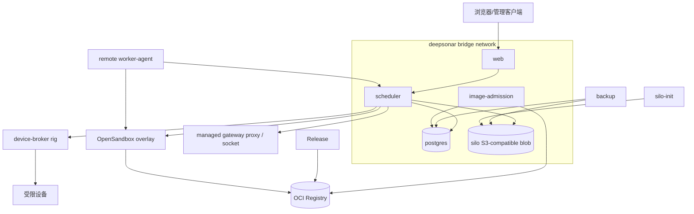
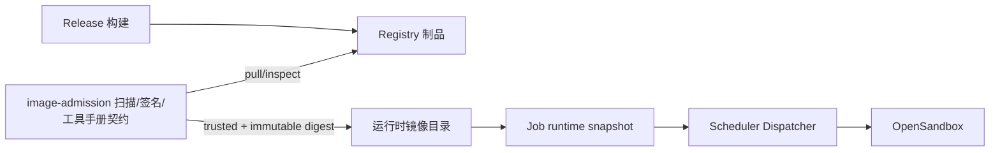

# 07 部署视图

> 状态：**as-built**（#741）。描述生产 Compose、运行时网络、镜像准入、远程 Worker/设备和多副本限制；地址与凭据由部署环境提供。
> 同步日期：2026-10-20

部署事实来自 `deploy/` 下的 Compose 文件、运行时包和镜像准入代码。下图省略了环境变量值、镜像摘要和密钥，只保留拓扑和连接方向。当前 Compose 的 Scheduler、Web、image-admission 等平台服务通过 `DEEPSONAR_IMAGE_TAG` 选择 Release 同步的应用镜像标签；OpenSandbox/Worker 的基础服务可由 Compose 使用摘要固定。Job runtime image 则必须经过准入并在快照中保存解析后的不可变 digest，二者不能混为一谈。#745 新增的 `platform` catalog 结构目前只用于版本发现和管理员提示，不能据此宣称平台 Compose 已按 digest 部署。

## 生产 Compose 拓扑

`docker-compose.prod.yml` 的服务是 `postgres`、`backup`、`silo`、`silo-init`、`scheduler`、`image-admission` 和 `web`；命名卷保存 PostgreSQL、Blob、Silo、备份和扫描数据。Web 仅通过 Scheduler 访问管理接口，Scheduler 连接 PostgreSQL、Silo 和网关代理；image-admission 作为独立 Worker 连接同一 PostgreSQL 写入镜像扫描/准入状态，Scheduler 不通过 HTTP 调它。OpenSandbox 由 `docker-compose.opensandbox.prod.yml` overlay 加入；其管理 API 和凭据由部署环境注入。沙箱 gateway/restricted 网络由 Scheduler 创建，不能把 Compose 网络误当成任务 egress 策略。

远程执行使用 `docker-compose.worker.yml`：Worker Agent 注册、心跳并按控制面安排运行时；Scheduler 仍拥有 Job/Attempt、token、快照和 settlement。设备使用 `docker-compose.device-broker.yml` 的独立 rig，Broker 通过短期租约和 allowlist 访问设备，Compose 不给容器 USB passthrough 或 privileged 权限。

## 镜像准入和运行时路径

镜像准入按 `DEEPSONAR_COSIGN_*` 配置检查签名或 keyless identity/issuer、扫描结果、不可变摘要和运行时工具手册契约；未启用签名策略时，官方 catalog 可记录 `signature: skipped`，这不等于已完成签名验证。第三方镜像的 critical/secret 扫描失败会阻止信任；官方镜像的结果也会记录和告警。`image-admission` 直接拉取并检查 Registry，然后把 digest、扫描和 trust 状态写入 PostgreSQL；Scheduler 读取这些管理表，创建 Job 时把可用镜像选择冻结。Agent、Hub、导入包和任意管理文本不能提交新的 OCI 源。实现参考 [`trust-policy.ts`](../../apps/image-admission/src/trust-policy.ts)、[`cosign-verify.ts`](../../apps/image-admission/src/cosign-verify.ts) 和 [`runtime-manual-contract`](../../packages/runtime-manual-contract/src/index.ts)。

## Mobile ASC 工具供应链（#754）

`deepsonar-mobile` 的 ASC 默认实现为固定源码与 submodule 的 rust_ASC v0.1.1，以锁定依赖、`--no-default-features` 构建 CLI。`rust-asc` 与 `droidasc` 兼容入口使用同一 Rust 实现；`droidasc-python` 显式选择保留的 Python 版本，不自动回退。JADX/apktool、其他工具需要的 Python 仍保留，未引入 MCP 服务或新的执行通道。来源和调用契约见 [运行时工具链](../RUNTIME_TEST_TOOLCHAINS.md)。

镜像定义、环境 smoke 与真实 APK 验收是不同证据。amd64/arm64 构建和执行须分别留证，arm64 QEMU smoke 不代表原生验收；当前真实兼容性和性能仍需专项证据，见 [风险登记](12-risks-and-tech-debt.md)。此变更不更新已准入或运行中的镜像 digest。

## 平台版本发现与部署状态

Scheduler 在 catalog 同步路径比较当前部署版本与 registry 的 `platform` 段（没有该段时使用 `platform_version`），把最近一次结果写入 `platform_update_checks` 单例；管理员可通过只读 `GET /platform/updates` 读取最近一次检查结果，Web 只显示版本提示。该域不执行 `upgrade`、`apply` 或 `rollback`。Release workflow 写出并核对真实 platform digests、仅以不可变 digest 驱动 Compose，以及 `deploy.sh upgrade` 仍未实现；当前平台 Compose 继续使用发布 tag 流程。相关后续和边界见 [平台自动更新后续阶段](12-risks-and-tech-debt.md)。

## 多副本和共享存储限制

PostgreSQL 是跨 Scheduler 副本的管理真相，Silo/S3 是生产 Blob 存储；副本不应依赖各自本地磁盘保存可见 Evidence。过程流的实时总线只做非权威投递。Evidence catch-up 读取当前副本的本地 `BLOB_DIR`；若请求落到没有同一文件的副本，响应必须标注 `visibility=unavailable` 并按协议关闭 WS（代码使用 4415），不能从另一副本猜测或伪造补读。

Compose 测试保证业务服务只加入 `deepsonar`、共享网关 socket 不被错误公开、DNS 不产生不明确的多宿主路径；见 [`compose-network-topology.test.ts`](../../packages/runtime-sandbox/src/compose-network-topology.test.ts)。多副本部署因此需要共享的对象存储和明确的 Worker/OpenSandbox 路由；不能把进程内 stream-bus、临时文件或本地 socket 当成跨副本一致性机制。没有共享卷时，系统应诚实显示不可见，而不是承诺强一致过程流。

设备 rig、OpenSandbox 管理端、Registry 和 Provider 都是边界外部效果。其网络地址、证书和凭据由部署环境配置，本文不写死个人域名、长期 token 或可变标签。
