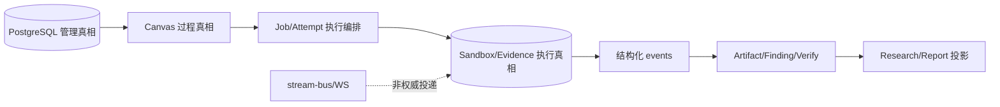
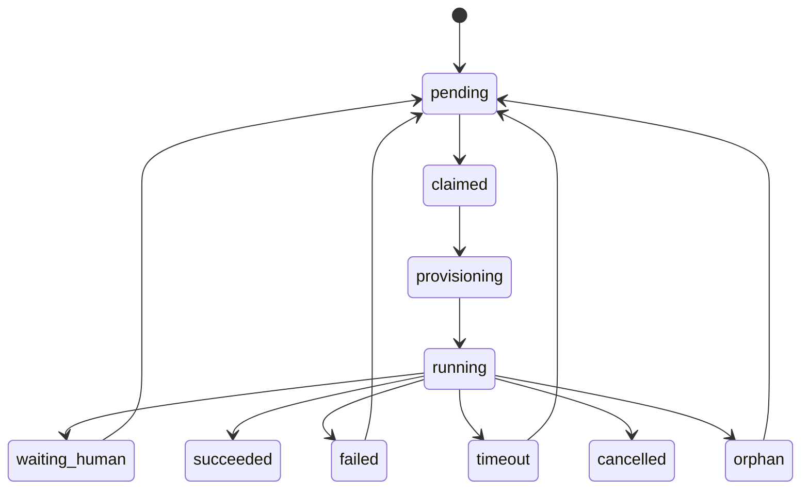

# 08 数据架构与真相流

> 状态：**as-built**（#741）。说明 schema 基线、核心实体、三类真相流和状态机；列定义以 `database/schema.sql` 与代码为准。
> 同步日期：2026-11-08

mark_job_done 修正回执复用 events 的宿主 control_receipt 语义事件、Job 锁、Attempt 关联与原 key/digest；不新建平行效果账本或修改 schema。回执与最终 done 分别派生 Job/key 范围内的不同事件身份，持久接受不代表结算，详见 [#776 B](../REPAIR_FEEDBACK_DONE_REPAIR.md)。

## 完成恢复事实与证据（#874）

[恢复实现](../../apps/scheduler/src/domains/job-attempt/recovery.ts)沿用 `events` / `event_dedup`，不新增 schema、Job 状态或平行效果账本。Job/Attempt 绑定的恢复根由 Scheduler 生成，state/wake 事件只追加；revision 取持久 job sequence，原 deadline、wake 上限和累计预算不会因换 key、证据变化或重启重置。完整 scoped effect/ledger 证据在数据库中计算摘要，模型只读有界、脱敏投影；Canvas metadata 是可重建视图，不能作为恢复授权。

原 completion 负回执不可改写，对账请求的持久接纳也不表示 effect settled。精确 usage proof 必须匹配 project/Job/Attempt/effect；pending、not_reported、缺失用量及未知资源归属不推断为零。Job-only 回执事务不写 Canvas，恢复泵/application 按 Canvas-first 更新投影。决策、未来缺口与待执行验收见 [ADR 0015](adr/0015-governed-completion-recovery.md)、[FR-CTRL-010](01-system-specification.md#fr-ctrl-010-完成未知效果的受治理恢复)及[专题](../REPAIR_FEEDBACK_DONE_REPAIR.md#completion-recovery-v1)。

## 执行前证明与历史预算（#943）

沿用 `events.control_receipt` / `event_dedup` / job sequence，不新增表或状态。`gateway_snapshot_preflight` 由 Dispatcher 的执行前 checkpoint 保存，绑定 Job、唯一首次 Attempt 与完整旧 snapshot 摘要；它不是 Gateway transport settlement 或模型 ACK。恢复只读重验宿主身份/事件摘要及全量效果、token、usage 和后续事件，不能仅凭回执存在重放。完整 `gateway_request_budget` 回执独立保留未签发 workload 的原有限策略；新执行不删除/重写历史回执、Attempt、用量或 deadline，细则见[生命周期专题](../AGENT_REPAIR_LIFECYCLE.md#缺损快照的可信显式恢复943)。最终 SHA Actions 待验。

## Schema 基线纪律

[`database/schema.sql`](../../database/schema.sql) 是唯一基线；[`schema-version.ts`](../../apps/scheduler/src/schema-version.ts) 必须与基线的版本字面量同步，当前集成版本以该常量与基线一致性为准，不代表已发布版本。空库启动直接套用基线；非空库的版本或结构不匹配时 fail closed。改表必须先改基线、同步版本、执行 rebuild plan/apply 并验证备份和列交集回填，不能建立未经审计的增量 ALTER 链。稳定状态、外键、幂等键和权限骨架使用定列；开放内容使用 JSONB；状态字段保持可演进字符串而非被数据库 enum 锁死。

### 直接重建的授权保全（#1002 P2-13）

`db:rebuild` 在移动源表前捕获 `public` 的有效 ACL 与 schema-local 默认授权，恢复原 schema/default 后，基线创建与仍存在的表/列、序列、函数、类型 ACL 恢复在同一发布事务提交，再回填历史数据并核对 ACL；提交前失败回滚新对象。不得先发布带宽默认 TRIGGER 等权限的旧对象，避免撤权后仍存活的触发器；后续回填失败仍不暴露私有数据。源表暂存与整轮回填不因此成为单事务。原 grant option 保留，新增对象只使用原默认授权。没有角色名推断、角色身份修改或无条件 PUBLIC CREATE；对象 owner/grantor 不在本切片的保留承诺内。完整范围、拒绝路径和隔离 Actions 回归见[数据库说明](../../database/README.md#重建授权保全1002-p2-13)。不变更 schema 基线或启动 fail-closed；最终 SHA Actions 待验。

## OpenSandbox pin 与不可变 Job 快照（IR-001/003）

2026-11-01：本次只升级 [SDK/镜像版本事实](../../packages/runtime-sandbox/src/opensandbox-version.ts)及相应依赖、部署和测试；数据库 schema 不变。新 Job 从当前版本事实冻结 pin，已创建 Job 的 SDK 1.1 pin、镜像、Evidence 与审计仍是历史真相，不自动重写或重新绑定为 1.2。SDK 安装版本与冻结 pin 不一致时 binding fail closed，不以最新默认值补齐旧快照。详见 [独立升级记录](../OPENSANDBOX_1_2_UPGRADE.md)。

## 核心实体和关系

| 实体/表组 | 作用 | 关键关系或约束 |
| --- | --- | --- |
| `projects`、`canvases` | 项目 scope 和任务过程容器 | Canvas 隶属项目；用户、API token、Job 和导入导出均按项目授权 |
| `canvas_nodes`、`canvas_edges`、`canvas_changes` | Intent、Fact、Artifact、Finding、Job 等过程图和 revision | 节点/边由拥有域写入；变更日志有可见 floor；Agent 不能提交坐标或任意终态 |
| `jobs`、`job_attempts` | 逻辑任务和一次执行尝试 | Job 有冻结 `agent_snapshot_json`；一个 Job 同时最多一个 active Attempt |
| `job_attempt_effects` | provision、agent run、清理等外部效果意图和 settlement | `effect_pending`/`unknown` 保护崩溃恢复；effect id 幂等；未知不得自动重放；#1002 [管理员单条见证](../../deploy/README.md#管理-api-的单条效果结清1002-p1-9)复用原 settlement_json 保留依据、操作 id 与认证主体，不覆盖已结清证据/ledger/预算，无 schema 变更 |
| `job_tokens`、`job_capability_tokens` | Gateway workload 凭据与独立 Job-scoped Control 能力 | Gateway 区分 `main` / `observational_memory`、冻结 provider/model/route 及有限分配；终态撤销。凭据删除先撤销全部 token，再由 `ON DELETE SET NULL` 脱离秘密凭据；只有 revoked token 可无凭据，历史身份、累计用量和有限额度保留；Job token 不取得管理权限 |
| `job_usage_ledger` | Gateway 观测用量、workload 归因和结算 | 新记录绑定 `job_token_id`；总量与 memory 用量分开，凭据删除不删除 token 或修改账本引用/用量；历史缺失引用保持历史读取，不补造来源 |
| `events`、`event_dedup`、`job_event_rate_limits` | 语义事件、Job 序列和 durable 限流 | event id、Job sequence 和事件 dedup 约束重复；原始运行流不进入 events |
| `artifacts`、`artifact_claims`、`artifact_evidence`、`artifact_relations` | 版本化内部写入真相 | claim/evidence polarity 和 relation 类型结构化保存，旧版本可追溯 |
| `findings`、`finding_verification_rounds` | Finding 处置和 Verify 门 | `verify_status` 与人的 `disposition` 分离；round 保存 eligibility/evidence/rework 状态 |
| `finding_research_runs` 及 cluster/anchor/priority 表 | Research 语义结果与运行审计 | batch 有界、输入幂等；失败不回滚主 Finding/Report |
| `project_finding_identity_sources`、`project_finding_identity_source_revisions` | 每个 Finding 的操作员见证身份来源及不可变 revision | 只接受已知身份字段的 SHA-256 digest；revision 只追加，source 当前指针可撤销 |
| `project_finding_identity_mappings` | Finding 字段到已登记身份来源的显式绑定 | source revision、mapping version、项目/Finding 外键及 CAS；撤销和来源变化在当前读时失效 |
| `project_finding_relation_*` | Scheduler 所有、可重建的跨 Finding 强关系计算与来源检查点 | generation、source/identity fingerprint、rule version、read 状态和质量门；`published` 物理保持关闭 |
| `task_reports`、`finding_reports` | 冻结输入后的版本化 Projection | 一条 scope 只有一个 active 版本；输入/输出 hash 使变化追加版本 |
| `shared_assets*` | 内容寻址共享资产和 Job 版本绑定 | scope、配额、版本和 Blob hash 分离；不把文件内容直接当语义事件 |
| `project_knowledge_*` | 项目 Memory/Skill、不可变版本、work/assignment、proposal/evaluation/receipt、精确 grant 与 usage | 草稿/候选不进普通目录；复合项目/Job/Attempt 外键校验 provenance；版本正文留在 CAS，历史版本含 revoked 保留，不自动 GC |
| `credentials`、`api_tokens`、`audit_logs` | 凭据、管理身份和 append-only 审计 | 密文/nonce/tag 与安全 projection 分离；审计触发器防止更新/删除 |
| `runtime_images*`、`devices*` | 镜像信任目录和设备租约/事件 | 信任状态、摘要、租约和设备状态由对应域持有 |
| `platform_update_checks` | 平台 catalog 与当前部署版本的最近一次只读比较结果 | 单例行；由 `platform-updates` 写入，管理员读取；不触发升级或 Compose 变更 |

本批从已发布 v0.6.2 的基线推进一次集成基线，纳入身份 manifest、mapping、关系计算及质量协议/观察账本；最终编号与 DDL 只按 [`SCHEMA_VERSION`](../../apps/scheduler/src/schema-version.ts) 和 [`database/schema.sql`](../../database/schema.sql)核对，不为并行未发布编号建立增量迁移链。#831 合入的工程基线 `fdb55a01` 已在 [Actions CI](https://github.com/SummerSec/DeepSonar/actions/runs/41298113058) 完成真实 schema67 rebuild、PGDMP 备份/pg_restore 恢复及 Finding-quality PostgreSQL/HTTP/worker 验收；历史本地结果见[验收矩阵](../TASK_DISPATCH_ACCEPTANCE.md)，不能代替后续 SHA 的检查。

保鲜门禁的单处编号核对：当前集成候选 v71（2026-11-08 核对 DDL 与 `SCHEMA_VERSION`）；核对 main `30860441eb8f89cb6db7e35746fbf194feeba45f` 的基线为70，含凭据历史保全、Canvas 引用索引及 stopped Hub 准入。候选另补 Finding 候选引用的完整外键前缀索引，不是已发布编号。此前 main `1b2a2fca1bb4c43b8c8530c503c0084392bf1619` 的核心 [Actions 42449025632](https://github.com/SummerSec/DeepSonar/actions/runs/42449025632) 成功，不能代替发布准备组合及最终主线提交的工程验收；本机未执行 rebuild、测试、构建或 typecheck。已验收历史工程基线 `fdb55a01b1e02b5b9078586923a8d506ce5bb096` 为 schema67；`ca7d841c` 的 schema66 重建/恢复也只代表历史切片。精确 schema68 → 当前基线的回归固定 main `5bed5018cb8064cd67973efa8713eb2d344f7fb5`，核对 plan 无写入、列交集回填和真实 PGDMP/pg_restore 备份；不自动升级非空库或改写历史用量。

### Canvas 节点引用索引（#1002 P1-6）

边的起点/终点与人工消息的 human/target 节点外键均有前导列索引，避免任务 retry 删除节点时逐节点扫描其它 Canvas 的引用。Finding 候选 sources 与 edges 的左右端级联外键另有完整 `(project_id, finding_id/left_id/right_id)` 前缀索引，不再依赖中间含 `generation` 的排序索引；跨 generation 无匹配 DELETE 对照实际 buffer，并将候选行完整回滚/清理与无关项目保全接入同一 HTTP 回归。既有 Canvas-first 删除事务、外键与项目隔离不变；不提高 timeout、不分批提交。基线变更继续要求版本同步、备份和全量重建。索引前后 SQL 执行计划与真实 HTTP rollback/成功隔离回归接 `pnpm ci:integration:recovery`，基线/重建门接 `pnpm ci:unit:migrations`；最终 SHA Actions 待验，不作为现场延迟根因或容量证明。权威细则见 [数据库说明](../../database/README.md#canvas-节点引用索引1002-p1-6)。

### Report 输入与文件投影（#945）

新 Task/Finding Report 的 `jobs.payload_json.report_input_json` 保存精确 UTF-8 JSON 字符串，不对 JSONB 对象重新编码；`report_input_sha256` 校验该字符串的完整字节。既有 Report 行继续保存 scope/version/Job 外键、`input_uri`、`input_sha256`，与 Job payload 在同一事务提交，状态和版本规则不变；开放冻结正文留在既有 JSONB，不新增 DDL 或 schema 版本。Report 输入的管理真相是该 SQL 冻结字节，文件只是领取后的可恢复投影，未提交事务不能留下新输入文件。

[Report input reader/materializer](../../apps/scheduler/src/report-input.ts)核对 Job 类型、项目/Canvas、Finding、版本、URI 以及可用的 Report 行摘要/身份；文件冲突保留旧字节并拒绝，缺少冻结正文的历史 Job 不从文件或当前事实补读/重建，要求显式创建新报告。历史输出与 Evidence 不迁移，输入文件发布不意味着模型已开始或报告已成功。最终输出仍按原有文件/hash 契约保存，不能把输入分离当作输出和 SQL 的跨存储原子性证明。沿用 [ADR 0004](adr/0004-fact-and-finding-verification.md) 的投影边界，工程证据以最终 Actions 为准。

### Skill 源已批准目录与候选（#960）

`skill_sources.catalog_json/catalog_snapshot_hash/last_commit_sha/last_content_hash/synced_at` 始终描述当前已发布目录 A；承认既有控制面 live 授权事实，不自动复制旧值到候选，不重造历史批准。schema68 仅增加默认 NULL 的 `candidate_hash`（FK 指向 `shared_asset_blobs`）、`candidate_json`、`last_checked_at`、`last_sync_error`，不增加增量 ALTER。已有非空库须遵守基线版本/结构 fail-closed 与受控重建纪律；本次未在本地重建数据库。

候选描述符为 `deepsonar.skill-source-candidate/v1`，仅保存 `source_instance_id`、`repo_url`、`branch`、字符串 `revocation_epoch`、`commit_sha`、`content_hash`、`module_count`、`synced_at`、`synced_by` 元数据。完整模块及文件文本仍在现有不可变 CAS manifest；校验原始 manifest bytes 的 hash，不对 JSONB 再编码后与原 hash 比较。live 与 candidate 指针都作为[只读可达性审计](../../apps/scheduler/src/domains/project-knowledge/reachability.ts)的 `skill_source` 保留根；候选覆盖、批准清除或删除 source 后仅移除该引用，历史 Job/版本等其它根仍可保留原字节。当前 planner 的 `deletion_enabled=false`，不启用自动 GC；保留候选字节不等于给 Job 授权。候选 B 的暂存或健康检查不能改 A 的正文、指针、commit、hash、信任、启用或 RoleConfig；仅有效 live 同 hash 的健康核验允许前移 A 的 `synced_at`。检查成功/失败时间与安全有限错误码单独存列，不能保存 Git stderr、凭据或 URL 查询。

显式审批在 source 行锁短事务中精确 CAS 比较候选 hash、expected epoch、调用者所见的 expected source instance 与描述符身份，并从 CAS 验证来源、commit、模块数量和内容 hash 后发布；删除/重建同 source ID 即使重用 hash/epoch，也必须拒绝旧实例审批请求；live `synced_at` 采用候选实际核验时间，清候选并在同事务完成 selector heal、批准与正文变化审计（包括模块 ID 不变而正文变化）。显式传事务的系统审计失败会回滚发布和 heal，不在事务外预报成功。[生命周期服务](../../apps/scheduler/src/skill-source-catalog-lifecycle.ts)及[真实 PG 服务回归](../../apps/scheduler/src/skill-source-catalog-lifecycle.integration.test.ts)为实现入口。

新 Job 只冻结 A 的原 CAS/commit/content/instance/epoch；候选是否存在以 `source_update_pending` 作为观察保存，连同年龄等观测字段排除 `catalog_hash`，缺省该字段的旧冻结哈希保持可读。批准 B 只改变后续 Job，不能重绑旧 Job A 的 manifest 或修改 token/epoch 来掩盖拒绝；显式禁用/撤信任仍以不可逆 epoch 收紧旧 Job。没有成功时间的年龄不回退 `created_at`：API/Job 保留 null，Prometheus 使用合法 `+Inf`。数据与服务回归接在既有 project-knowledge/platform-api CI 入口，本次仅静态核对接线，未运行测试。

### 任务契约快照（#767）

`canvases.target_json.task_contract` 保存规范化后的版本化契约，包含 schema 与模板版本；`content` 保留原始用户需求。Job 的 `agent_snapshot_json.task_contract` 冻结该契约用于执行提示；未提交契约的 Job 不增加此字段。模板升级不会重写既有契约。沿用现有 JSONB，不新增数据库表/列或第二份任务真相。派发时读取当前权限只用于撤销/收窄检查，不改变历史 Job 冻结运行快照。

目标授权的 host grant 复用 append-only `audit_logs`，固定 system actor 与 `task.target_authorization` action，保存 Canvas/project、内容/契约/revision 及严格无密钥 snapshot；不从任意 Canvas metadata 或调用方同名字段读取 authority。中央子/系统 Job 准入只取最新有效绑定，provision/rerun 另核 live authority；旧行保留不等于可回退授权。见 [grant store](../../apps/scheduler/src/domains/target-authorization/grant.ts)及 [ADR 0011](adr/0011-trusted-target-authorization.md)。

### 模型预算声明与冻结（#958）

既有 `credentials.model_catalog_json` 保存结构化发现描述，`limit_source` 逐字段区分 declared/missing/invalid，信任仅为 `provider_declared`；目录 ID 投影保持可读，但不扩大账号配置模型名单。新 Job 的 `agent_snapshot_json.model_budget` 保存 context/output 的 configured、declared、effective、source 与 catalog revision；未知 CLI 默认为 null，历史缺字段不自动补冻。Pi 物化参数来自同一冻结值，不重新读取当前发现。

沿用现有 JSONB 与 Evidence，无新表/列或第二份用量余额。运行时限制、length 形状、恢复和摘要观测进入受保护运行诊断，不记录正文/密钥，也不凭原生 compaction 事件构造 context digest/revision。完整字段与来源以[共享 schema](../../packages/shared-types/src/model-budget.ts)和[专题](../PI_MODEL_BUDGET_RECOVERY.md)为准，最终 SHA Actions 待验；声明不证明上游容量。

### Pi 观测记忆的配置、账本与归档（#815）

OM 的 package/version/integrity/entry、wrapper 指纹、Job/当前 Session 配置与模型进入现有冻结快照和 Runtime Profile；不是项目知识库，也不新增 memory 事实表。Gateway 从内核签发的 `job_tokens.workload` 识别后台，不接受客户端 header/body 自报来源；有限总额在所有轮换、撤销及历史 token 上聚合，总/主/后台分配不可隐式转借，冻结总额不限则仍不限。

后台 usage、effect settlement 与 token counter 在原有 Job 锁/事务内结算。pending 保留占额，缺失 usage/unknown 需对账且不能按零退款或自动重放；Job 终态撤销凭据不删除在途用量或未知效果。Dashboard 总量保留全部观测并分 workload；项目/任务/Finding/Replay 的单位成本只以主执行口径统计，后台用量另列，不声称收益。字段与边界见[预算策略](../../apps/scheduler/src/gateway-om-budget.ts)、[Gateway](../../apps/scheduler/src/gateway.ts)和[专题](../PI_OBSERVATIONAL_MEMORY_GATEWAY.md)。

Session observation/reflection、fold/recall 正文只用于上下文；新归档、RPC 大帧副本和 viewer 脱敏保留身份与来源元数据，物理归档不使 memory 成为 Fact/Evidence authority。历史 HTTP preview/download 已在预览截断或发送前按 Pi header/manifest 独立执行结构化脱敏，immutable archive metadata 保持不变，projection bytes/SHA/Content-Digest 另报，相关真实路由集成已通过。实际本地构建镜像的 RPC、独立生产 guard 及封装/版本准入回归也已通过，集中见 [RPC 边界](../PI_OBSERVATIONAL_MEMORY_RPC.md#2026-10-31-主线程-built-image-验收)；Gateway 已知请求前失败须持久结算零用量/effect `never_started` 才能降级，详情见 [Gateway 专题](../PI_OBSERVATIONAL_MEMORY_GATEWAY.md)。最终组合 CI 与发布证据仍另验，不推导质量或成本收益。

### Pi RPC 归档索引与读取（#990 切片）

大事件的完整脱敏 JSON 仍保存在 `attempts/<attempt>/runtime/`，但文件落盘后立即原子发布到现有 Job evidence manifest，索引确认先于引用返回；不新增 schema 或独立账本。重建 writer 从该 Attempt 的持久文件元数据计算已用额度，已有归档不覆盖，未登记文件不会被读取入口当作可信引用。新回读在返回值前校验源长度与 SHA，`source` 元数据保持不可变，RFC 6901 选择和 OM 脱敏后的返回值字节/hash 单独报告；不存在或不可见的本地字节明确拒绝，不跨副本补造。契约及最终 SHA 待验范围见 [Pi RPC 专题](../PI_RPC_PAYLOAD_LIMITS.md)。

## 运行身份与可选白名单（#757）

全局 `role_configs.agent_cli=NULL` 是未指定偏好的显式存储语义；种子不再写入 `claude-code`。用户保存的非空值是跨 CLI 候选的偏好，不能排除唯一有效凭据。项目 RoleConfig 不持有 `agent_cli` / `model`，管理写入拒绝这两项，读取不暴露，遗留值清空。已有 Job 的 `agent_snapshot_json` 仍是冻结历史真相，不参与清理或重新解析。

本地 `db:rebuild` 对版本未知或低于 v60、目标至少 v60 且需复制 `role_configs` 的库检查旧身份；非空 CLI 的种子/用户来源不能由值推断。命中旧身份时 `--apply` 默认拒绝且 `--force` 不绕过；管理员复核后可明确 `--reset-role-identity`，在有成功备份或保留源 staging 的前提下丢弃旧角色 CLI/项目模型。全局模型、其余配置和历史 Job 保留；实际条件见 [schema-rebuild.ts](../../apps/scheduler/src/schema-rebuild.ts)，操作步骤见[数据库升级说明](../../database/README.md#v60-角色身份复核757)。宿主维护升级的目标计划与审批另见下方维护升级边界，不能用本地版本阈值替代其风险检查。

项目 `config_json.enabled_agent_clis` 与 `enabled_credential_ids` 独立表示可选收紧；未配置凭据维度不同于显式空数组。读取设置和 Hub 目录不保存派生候选 ID。#914 引用保护使 DELETE 在任何项目仍引用账号时拒绝；设置写入与删除共用凭据行锁，失效引用不能借省略模型字段保存。停用后的显式名单仍保留限制并要求管理员修复，不自动替换或删白名单键；历史 Job 不变。完整事务与反馈边界见[接口规格](09-interface-specs.md#项目凭据引用保护914-切片)，执行解析见[运行时视图](06-runtime-view.md#凭据与-cli-解析757)。

## 三类真相流

1. **管理流。** PostgreSQL 保存项目、权限、配置、Job、snapshot、token、设备、镜像目录、状态和审计。Management API 是管理流的入口，Scheduler 负责事务和状态判定。
2. **过程流。** Canvas 表保存 root、Intent、Fact、Artifact、Finding、Job、边、revision、broadcast 和 human message。Fact 的 `verification_status` 表示证据验证状态；Finding 的 `verify_status` 和人的 `disposition` 独立推进。坐标、广播注入和 ACK 都由宿主控制。
3. **执行流。** Sandbox 产生进程、工具、Session、文件和原始运行流；Scheduler 将其写入受保护的 Evidence/Blob，经过严格 schema 的语义事件才进入 `events` 和内部实体。stream-bus 只用于实时投递，断线补读只信任可见 Evidence。

Artifact、Finding、Verify、Research 和 Report 不是同一张“结果表”：Artifact 是内部写入真相，Finding 是去重和处置实体，Verify 消费结构化事实和证据，Research 只生成语义组织结果，Report 是可重建的用户投影。Projection 失败不能改写上游事实。

#752 的知识目录在 Job 创建时冻结版本/hash/授权身份；读取时再检查当前撤销。全局 Skill 源额外冻结 source instance 与 source/project revocation epoch，避免禁用后重新启用扩张旧快照。知识 mutation 的事件 ID 由 Job ID 与幂等键派生，领域结果和持久 receipt 与事件在同一事务；相同输入重放原结果，不同输入冲突。试验 Evidence 必须绑定独立 trial Job/Attempt、asset 版本/hash 与 case×arm，不能把模型文字当事实。数据细节和保留根见[项目知识专题](../PROJECT_KNOWLEDGE.md)。

## 关键状态机

Job 的 `succeeded` 和 `cancelled` 是终态；`failed/timeout/orphan → pending` 必须服从 reconcile、retry 和未知效果规则。Attempt 还记录 `preparing`、`effect_pending`、`provisioned`、`agent.ready`、`settling`、`terminal`、`interrupted`、`unknown` 等 phase；`job_attempt_effects` 分 `planned/effect_pending/settled/unknown`，其 replay policy 不能由模型决定。

已核验的 core `finalizeJob` 终态事务同时收口 Job/model token、Control token、audit 与终态，终态后实际 HTTP 请求断言 401；该证据只覆盖 finalizeJob 路径，不外推所有 drain/Reaper 清理路径。bootstrap/terminal 及完整 rebuild 日志见[验收矩阵](../TASK_DISPATCH_ACCEPTANCE.md)。

Verify round 有 pending/running/rework/confirmed/needs_human/failed/refuted/inconclusive，Finding 还独立保存 verify status 和 disposition。Research run 有 pending/running/succeeded/failed；Task/Finding report 有 pending/generating/succeeded/failed，并以输入 hash 区分版本。这些状态由各 bounded context 拥有，跨域事件只能通过拥有者入口推进。

## 维护升级的源库、候选库与回执

维护授权允许暂时拒绝业务写入，但不允许丢弃激活后的合法写入。数据库身份隔离完成后生成不可变备份切点；候选库从经校验的备份恢复，再由目标镜像基线重建，源库始终保留。候选 COMMENT 绑定操作、源库、备份 hash 和 restoring/rebuilding/rebuilt 阶段；不能依据半完成 schema_meta 推断重建成功。只读计划包含源结构及目标 DDL 指纹，明确审批删除字段/表等风险，历史 Job 快照语义不在当前自动验证范围。

同 schema 编号不证明相同 DDL：宿主从已验证的当前不可变镜像取得 baseline SHA，目标 CLI 计算目标 SHA；不一致须拒绝版本别名，不能仅凭版本号跳过。角色身份重置必须是独立显式选择并绑定计划，不由维护许可或 force 自动授权。维护记录和激活证据需与本地 journal 对账；未知激活不能触发旧库恢复。代码入口：[候选库管理](../../deploy/platform-upgrade-candidate.mjs)、[schema 计划](../../apps/scheduler/src/platform-upgrade-schema-plan.ts)、[ADR 0008](adr/0008-maintenance-candidate-upgrade.md)。

## Plan 审计与判据绑定（#775 A）

jobs.payload_json.plan_protocol 按 Canvas/项目冻结到报告输入。规范化 raw Plan SHA 与 criterion_id 标识判据；现有 append-only audit_logs 的 canvas.fact.plan_binding 保存操作员评价、来源内容 SHA、Fact 验证 epoch 与 Job/Attempt/event/Artifact revision/Evidence IDs。该审计与 Fact 信任更新原子提交；expected_binding_id 串行 CAS，重复决定幂等。刷新重新核对实际留存内容与来源状态，失效不能自动恢复；历史报告不回写。未新增 schema 或执行账本；A 投影本身不决定整体完成，B 的 complete 仍受完整判据门约束；见 [来源、限额及范围](../PLAN_GAP_PROJECTION.md)。

## Finding 来源身份（#770 A）

Control `event_id` / Idempotency-Key 保持提交幂等；来源 Finding 使用 `(job_id, fingerprint)` 唯一约束。fingerprint 仍由 profile、规范化 title、location、rule_id 生成，只是 Job 内来源标识，不是跨任务问题身份。Job UUID 不同，即使文本完全相同也建立独立 Finding、Artifact 和画布节点；新 Artifact key 为 `finding:<job UUID>:<fingerprint>`，不共享修订链、不继承其他来源的 Verify/disposition/report。

同 Job 同 fingerprint 的完整规范化提案以 `source_digest` 比较（v1 前缀的 SHA-256，递归排序对象键，数组有序，含 raw 来源）。相同提案重交无新增效果；内容不同明确拒绝并回滚，不能静默丢弃新证据。当前没有 Finding 修订协议，title/location/rule_id/profile 身份字段变化是新提案；同 Job 同身份却环境/版本不同必须冲突，不能伪装同源。Job 行锁与同事务 event_dedup 保证并发重放顺序。hash 不是根因或目标版本证据，资产/版本未知仍未知。

基线重建保留已有 Finding UUID、job_id、状态、证据和 Artifact key。历史行的新增 source_digest 为 NULL；原提交事件重放仍由 event_dedup 拦截，但新提交若命中无法证明内容相同的历史来源则 fail closed，不推导摘要或替换旧 Artifact。导入导出携带已有摘要；无摘要的历史行保持未知。此前项目指纹提前去重的提交不自动补造来源，只有另行证明来源和授权才能评估恢复。数据完整性起点是部署本写入契约后接受的独立来源，不是重建日期之前所有事件。跨任务关系、投影和质量评估不属于此切片。

## Finding 操作员见证身份与强关系（#819）

跨任务关系不从 title、summary、location、相似文本、任务目标或自由格式 evidence 推断身份。平台只接受按 Finding/project 归属登记的 typed identity manifest；每个字段只保存 `sha256:` digest，服务端计算 manifest 内容摘要并记录认证主体。允许的 source kind、字段和 CAS/输入形状以 [relation schema](../../apps/scheduler/src/domains/project-finding-research/relation-schemas.ts) 为准，数据库完整性约束见 [`database/schema.sql`](../../database/schema.sql)。

身份分为六个强字段 `asset`、`tenant`、`environment`、`version`、`parameter`、`root_cause`，以及在两边都已知时可阻断关系的上下文字段 `service`、`permission_boundary`；比较规则和版本见 [`identity.ts`](../../apps/scheduler/src/domains/project-finding-research/identity.ts)。只有同项目、六个强字段均为当前有效且无冲突时才可能产生强关系：全部实例字段相同为 `same_problem`，仅 root cause 相同而实例字段不同为 `same_root_cause_different_instance`；缺失、冲突、root-cause authority version 不一致或上下文冲突保持 `insufficient_information`/`distinct`。

身份来源的 authority 是 `platform_admin_attestation`，响应明确 `independent_external_verification=false`：操作员见证是平台内的准入和审计边界，不认证外部官方库存、站点所有权、规则真实性或自然人/模型之间的物理独立性。该边界与 #822 的程序资格分离；程序资格仍由 [FR-FIND-008](01-system-specification.md#fr-find-008-独立程序资格评审) 和 [ADR-0010](adr/0010-program-eligibility-authority.md) 的独立材料/评审投影负责，身份准入不授予提交资格、目标写权限或执行授权。

### 来源、mapping 与失效

- Management API 只允许当前 Finding/project scope 的认证 `admin` principal 登记、修订或撤销 source；内部 worker 不从请求体接受 actor/provenance。source revision 由数据库 append-only trigger 保护，source 当前 revision 和 `revoked_at` 留在拥有表中，历史不删除。
- 新 mapping 的 `expected_mapping_version` 必须为 `null`，服务端从当前 source revision 解析 digest、source metadata 和 freshness；调用方不能自报 `identity_digest`、source revision、source kind、source ref 或 source digest。已有字段只能用最新 mapping version + reason 做显式 CAS remap/revoke；同一次撤销可幂等重放，过期 revision/version 返回冲突。
- `freshness_until`、source revoke、source revision 变化、mapping revoke、字段缺失和跨项目选择都在写入或当前读取时 fail closed。source revision 变化不会改写旧 mapping，但会立即使旧绑定无效并请求新的 relation generation；当前 Finding/source/identity fingerprint 不匹配时，读侧省略 stale relation。
- 每字段的 mapping history 是有界读取；达到实现常量 [`IDENTITY_MAPPING_HISTORY_LIMIT`](../../apps/scheduler/src/domains/project-finding-research/identity-mapping-store.ts) 时 snapshot 标记 `history_truncated`，关系读取为 `blocked`，不能把不完整历史当作完整身份。

### 强关系计算与投影

强关系是 Scheduler-owned 的可重建派生数据，不是 Finding/Artifact 的第二事实源。`project_finding_relation_work` 按 project/generation 保存 cursor、attempt、error 和状态；`project_finding_relation_sources` 保存每个 Finding 的 source/identity fingerprint、检查数量、pair truncation 和 read reason；`project_finding_relations` 保存有序双端关系、匹配/差异字段、rule version、quality gate 和 `published`。source/mapping 变化会创建新的 generation；worker 在维护身份 fence、repeatable-read 与 savepoint 内以有界批次计算，失败保留 checkpoint，不改写来源事实。

2026-11-01 核对：[relation-computation.ts](../../apps/scheduler/src/domains/project-finding-research/relation-computation.ts) 在同一事务内调用 [strong-candidate-selector.ts](../../apps/scheduler/src/domains/project-finding-research/strong-candidate-selector.ts)，共用部署原始 SQL，而不是另一套词法召回或质量评估器。主体 `root_cause.status` 非 `valid` 或 digest 为空时不查询。

SQL 只取同项目 `field=root_cause` 的 mapping，按 project/source/finding 连接 source 和不可变 revision，且 `r.revision=m.source_revision=s.current_revision`；mapping 与 source 均未撤销，revision 的根因摘要匹配主体摘要，`r.freshness_until > now()` 使用调用方当前事务时间。只取 `m.finding_id > 主体UUID`，DISTINCT 后按 UUID ASC 排序；不增加词法/top25、标签、split 或同 Job 条件，也没有历史时间 override。有界选择中的无向规范对仅按 lower UUID → higher UUID 方向计一次，不能用离线有向词法窗口加倍分母；未进窗口不等于明确不同。

查询最多 `RELATION_PAIR_LIMIT + 1` 项，`peerIds` 只交付前 `RELATION_PAIR_LIMIT` 项进入比较；上限定义归共用选择器，原 worker 保留常量 re-export。内部 `observedCount` 只表示包含哨兵的本次有界返回数量；出现哨兵时 `truncated=true`、`countKind=lower_bound`，否则为 `exact`，不推算全语料总数或 rank，哨兵不执行。它不新增公开质量响应或 schema 列；后续六字段/authority version 判定、指纹复查及维护/generation fence 不变。

查询和计算的 Finding/page/pair/Canvas response 上限均由 [`relation-read.ts`](../../apps/scheduler/src/domains/project-finding-research/relation-read.ts) 与 [`relation-computation.ts`](../../apps/scheduler/src/domains/project-finding-research/relation-computation.ts) 以及 [strong-candidate-selector.ts](../../apps/scheduler/src/domains/project-finding-research/strong-candidate-selector.ts) 的命名常量维护；mapping history 由上方 store 常量维护。文档不复制这些可变数值，调用方必须使用响应中的 `read_status`、`read_reason`、`pair_truncated` 和 `query_budget` 判断是否完整。

Current relation production/read constants still return `quality_gate_status=not_evaluated`, `published=false` and suppress public items; unknown includeSuppressed queries remain rejected. Source/identity/generation checks still hide stale relations. The merged schema67 engineering baseline adds structural quality receipts and certificate bindings below, but not an actual current certificate, CAS promotion or guarded nonempty publication. Independent labels, verified asset/family-disjoint partitions, natural-human aliases/provenance and pre-access adopted thresholds remain unverified; [quality engineering](<../PROJECT_FINDING_EVALUATION.md>) is not independent quality delivery.

### Quality ledger and current pointers (2026-11-01, merged schema67 engineering)

[The baseline](<../../database/schema.sql>) and [SCHEMA_VERSION](<../../apps/scheduler/src/schema-version.ts>) specify the merged schema67 engineering baseline accepted at fdb55a01 in Actions. Six tables separate immutable protocol commitments (`project_finding_quality_protocols`), append-only receipts (`project_finding_quality_records`), per-protocol CAS heads (`project_finding_quality_heads`), nullable current-certificate tuples (`project_finding_quality_current`), bounded generations/checkpoints (`project_finding_quality_work`) and immutable generation/ordinal observations (`project_finding_quality_observations`). Composite foreign keys bind project/protocol/record/dataset/subject; append-only INSERT triggers force DB clock timestamps and reject UPDATE/DELETE. A record hash cannot replace durable existence or certify human facts.

[quality-state-store.ts](<../../apps/scheduler/src/domains/project-finding-research/quality-state-store.ts>) locks current then protocol head, compares canonical signed-bigint-range decimal strings, and reloads typed/order-bound records before advancing. Lifetime project history includes expired/revoked protocols and aliases; SQL row/byte budgets reject incomplete history rather than retaining only fresh rows. Exposure commits before raw-body decoding/admission and survives rejection; a repeated unknown-raw request key conflicts, not a new exposure. Limits remain in [quality-contract.ts](<../../apps/scheduler/src/domains/project-finding-research/quality-contract.ts>) and the store SQL, not copied sample minima.

Relations now have structural protocol/certificate foreign keys and guarded scope-digest fields and CHECK: published implies passed with non-null bound fields. This replaces the historical schema66 hard-false SQL check; it does not implement host evidence verification, current-certificate issuance, promotion CAS or public publication. Current tuples may be empty, and revoke only clears its matching tuple without erasing history/observations. Source code and public schemas/read still suppress strong relations. Historical schema66 restore/worker evidence remains separate from the actual schema67 rebuild/restore and SQL/HTTP/worker engineering accepted at fdb55a01 in Actions. See [engineering evidence and deferred quality](<../PROJECT_FINDING_EVALUATION.md#819-sql-quality-engineering-2026-11-01-merged-engineering-slice>); subsequent #838 repair and final-main checks remain separate.

#776 的修正限额冻结在首个 control_receipt 的 repair_token_limit；Gateway effect intent 保存宿主 repair_receipt_ref/repair_reserved_tokens。实际用量仍只在 job_usage_ledger 一次写入，按 Attempt/effect 联结投影累计，无新增表或 schema 版本变更。未知/缺报与已知零分开；详见 [修正预算](../REPAIR_FEEDBACK_DONE_REPAIR.md#独立修正-token-用量与额度)。

Plan 成功响应复用 events.control_receipt；operation、key、原请求/展开输入/最终语义摘要、snapshot 与 Attempt 绑定。其存在不推进 Plan revision 或单步预算；不新增 schema/执行账本。 详见 [持久化边界](../PLAN_BOUNDED_INTENT_DESIGN.md#持久化与原子性)。

## 成果规则与候选依据（#767）

规范化后的整个任务契约由服务端计算 task_contract_sha256，候选绑定目标/可选基线与逐判据 Fact；赏金源材料 source.sha256 是另外的操作员声明身份，不可混用。Finding raw_json 和 Artifact 保存准入依据，status为 admitted_for_research且submission_eligibility:not_assessed。历史冻结不回写，观察先独立落库。详见[通用标准与研究候选](../TASK_OUTCOME_ADMISSION.md)。

## 目标结果与 Plan 显式关联（#767）

task.result 保存声明与事件派生身份，task.goal_evaluation 保存宿主绑定；原文留 Artifact，报告使用有界引用。可选 plan_binding.goal_review 关联 review_artifact_id、task_contract_sha256、criterion_ids、expected_review_sha256（已接线），不增加表或 authority。执行证明摘要不含仅改变人工验证注释的字段；rejected 与 Plan verified 权限仍分别检查。详见[结果评审](../TASK_RESULT_REVIEW.md)、[Plan 关联](../PLAN_GAP_PROJECTION.md#可选目标评审关联767)及[验收矩阵](../TASK_DISPATCH_ACCEPTANCE.md)。

执行证据绑定的 `content_schema_version: 2` 摘要排除 `manual_verification`/`verification_status`，拒绝状态与 Plan verified 授权仍独立校验。旧 v1 摘要可能失效，严格拒绝而不自动转换；历史记录不回写，必要时重新产出结果与评审，不能静默改绑旧 assignment。部署边界见[Plan 来源版本](../PLAN_GAP_PROJECTION.md#可选目标评审关联767)。

## 程序规则附加评审（#767）

程序规则使用冻结 rule_snapshot 的 rule id 派生 program_rule:<ruleid>，复用 task.goal_evaluation；报告 findings[].program_rule_review 保存规则来源摘要、逐项 review_indexes 与状态，不新增数据库表或官方认证身份。详见[评审](../TASK_GOAL_REVIEW.md)与[验收矩阵](../TASK_DISPATCH_ACCEPTANCE.md)。

## 证据追踪诊断修复

Artifact source_event 对应真实证据来源 Attempt，最新 Attempt 仅用于有效性核验，不能替代来源。manifest 声明 hash 与宿主 observed hash 分开，历史不回写。详见[证据追踪](../EVIDENCE_TRACE.md)。

补证执行投影复用 events/jobs/job_attempts/job_attempt_effects/canvas_nodes，不新增 schema。固定排序、无 wall-clock/heartbeat 字段；当前报告刷新冻结新投影，历史不回写。 见 [Plan 执行投影](../PLAN_GAP_PROJECTION.md#一次补证的执行投影)。

## 项目 Finding 特征（#770 C）

schema64 的 project_finding_feature_scan/work/features 是可重建派生数据：持久游标、generation、重试和输入摘要不替代 Finding/Artifact 真相。权威资产/版本/根因字段保持未知，读时核对当前来源与规则；详情状态不授予 Evidence 读取。细节、质量门与验证见[项目 Finding 特征研究](../PROJECT_FINDING_RESEARCH.md)。

schema65 增加 candidate_scan/work/sources/edges，按项目与代保存 canonical 双端弱候选及完整来源摘要。候选与来源进度为可重建派生数据；读前核对当前双端来源，旧代不覆盖新代。真实 v64→65 备份/恢复夹具与运维清理边界见[专题](../PROJECT_FINDING_RESEARCH.md#持久词法候选与代际失效770-d-后续切片)。

### #778 选择声明存储

`record_skill_choice` 复用 `project_knowledge_receipts` 的 operation/result_json 与既有 knowledge 事件，保存宿主重算建议快照和声明理由，不写 usage/work 或新经验表。目录、完整 Candidate CAS 和旧回执不变；SQL 基线无变更，不要求 schema bump/rebuild。历史选择不恢复权限。见[Skill 建议专题](../SKILL_SUGGESTIONS.md)。

## 独立程序资格账本（#822）

FR-FIND-008 复用 `audit_logs` 保存程序材料准入、替代、撤销及操作员评审；不新增 schema 或 Job 生命周期。平台/项目材料的管理准入、评审主体、项目 scope 与 maker 隔离由认证 actor 推导，请求体不能自报 reviewer、权限或资格状态。评审绑定当前 Finding Artifact/来源摘要、来源与 Verify Attempt、确认轮次、冻结目标/基线、材料版本和证据指纹。当前资格在 repeatable-read 只读快照中重新投影；来源、Attempt、证据或材料变化不修改旧评审或历史报告，但使旧批准失效。缺少评审保持 `not_assessed`，失效、冲突、历史损坏/截断或读取预算不足进入 `blocked`，不由最后写入覆盖先前结论；只有仍有效的独立操作员评审可表示 `eligible`，不认证外部官方规则，也不改变技术 Verify、任务判据或执行权限。批量预算外的条目显式返回缺口。数据结构和一致性边界见[程序资格专题](../PROGRAM_ELIGIBILITY.md)、[shared schema](../../packages/shared-types/src/program-eligibility.ts) 与 [ADR-0010](adr/0010-program-eligibility-authority.md)。

## Plan v2 的目标、路线与执行投影（#775）

`canvases.target_json.plan_objective` 保存用户 CAS 的 objective ID/revision、goal、CompletionPolicy、显式预算、输入 SHA 与状态；`plan_execution` 保存 owner、route revision、累计任务/轮次/无进展及停止原因，是 Scheduler 从持久来源维护的当前投影。`last_no_progress_result_event_id` 在首次可评估的 continue 结果消费前缺省；消费后保存现有 `events.id` 的精确正十进制字符串水位，经当前 owner/Canvas/项目和 PlanResult 身份校验，同一事件在回调或重启重建中不再消耗预算。活动或新 ready 工作延后消费，真正新事件仍计数。修订保留水位及 lifetime 计数，不改写历史 Job/Attempt、事件或证据；该字段不新增表、共享 Plan 契约或执行通道。

当前 `submit_plan`/`submit_plan_result` 严格接收 v2，路线 CAS 绑定 objective/owner/revision/Plan SHA。owner 的 `payload_json.plan_protocol`、plan 语义事件、接纳 receipt、普通 Intent/Job 与 `payload_json.plan_context` 共同记录关联；不新增 Plan 执行表或第二队列。前驱输出来自事件/Artifact 的相同 `plan.output` 扩展、成功且当前的 Attempt 与实际留存 Evidence，并覆盖期望输出；关联不证明语义满足。

`stop_reason=complete` / objective `completed` 只表达工程路线输出条件；Hub/Report 的任务完成还须当前操作员正向判据。v1 目标契约只读历史；普通 HubIntent 走原 handler，不制造新的 v1 `plan_protocol`。`applyHubPlanAdapter`、`persistPlanAudit`、副作用 writer 与 pure legacy `adapt*` helper/type/export 已物理删除；不可变 v1 与 `hub_intent_adapter` 历史审计仍可解析，不能作为新执行输入。代码见 [objective](../../apps/scheduler/src/domains/plan-protocol/objective.ts)、[执行](../../apps/scheduler/src/domains/plan-protocol/execution.ts)、[输出](../../apps/scheduler/src/domains/plan-protocol/execution-output.ts)与 [ADR 0012](adr/0012-plan-v2-execution.md)。

## Gateway 关联与持久确认（#923）

OM 客户端请求 UUID 保存在现有 `job_attempt_effects.intent_json.gateway_request_id`，结合 Job、Attempt、token 和 workload 查询原 effect/usage ledger，不新增账本或 schema。请求关联不能扩大授权；只有 effect 与 usage 持久 settled 才返回成功确认，pending/unknown 不由 HTTP 数据已交付推定成功。参见[透明传输](../MODEL_GATEWAY_TRANSPARENCY.md)及 [ADR 0017](adr/0017-transparent-gateway-settlement.md)。

#923 未准入的 quota/已回滚 DB 冲突拒绝由[gateway-admission-receipt](../../apps/scheduler/src/gateway-admission-receipt.ts)另开事务写原 events：type=control_receipt、operation=gateway_admission、authority=kernel，原 dedup 与事件限流生效。scope 绑定 Job/Attempt/token/workload/UUID，不创建模型 effect/request/usage，不改 schema；持久失败或 scope 不符不能返回降级 authority。allowance 只读原预算并返回交集，不预留或创建余额账本。

### Gateway 累计请求策略（#923）

`events` 中内核 `control_receipt` 的 `gateway_request_budget` operation 保存版本化 total/main/background 请求上限；Job 级确定性 event ID 与 event_dedup 使相同策略幂等，后续记录只收紧。它保存 token 尚未签发时也存在的冻结约束；用量仍来自所有历史 job_tokens，不复制余额。原始值必须在旧快照被替换前验证和持久化；事务和缺失历史的失败边界见[透明预算契约](../MODEL_GATEWAY_TRANSPARENCY.md#预算与-om-迁移)。
#903 的 Scheduler `repair_generation` 复用 events/event_dedup，保存旧链 superseded 与唯一下一 attempt_no；旧 receipt 不更新，费用仍引用原根，见 [ADR 0016](adr/0016-repair-execution-generations.md)。
