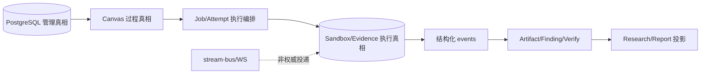
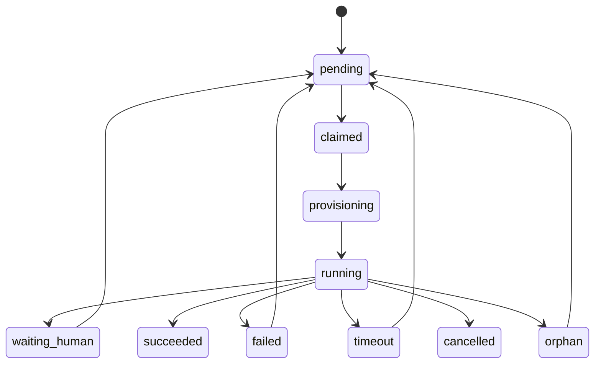

# 08 数据架构与真相流

> 状态：**as-built**（#741）。说明 schema 基线、核心实体、三类真相流和状态机；列定义以 `database/schema.sql` 与代码为准。
> 同步日期：2026-10-21

## Schema 基线纪律

[`database/schema.sql`](../../database/schema.sql) 是唯一基线；[`schema-version.ts`](../../apps/scheduler/src/schema-version.ts) 必须与基线的版本字面量同步，当前集成版本以该常量与基线一致性为准，不代表已发布版本。空库启动直接套用基线；非空库的版本或结构不匹配时 fail closed。改表必须先改基线、同步版本、执行 rebuild plan/apply 并验证备份和列交集回填，不能建立未经审计的增量 ALTER 链。稳定状态、外键、幂等键和权限骨架使用定列；开放内容使用 JSONB；状态字段保持可演进字符串而非被数据库 enum 锁死。

## 核心实体和关系

| 实体/表组 | 作用 | 关键关系或约束 |
| --- | --- | --- |
| `projects`、`canvases` | 项目 scope 和任务过程容器 | Canvas 隶属项目；用户、API token、Job 和导入导出均按项目授权 |
| `canvas_nodes`、`canvas_edges`、`canvas_changes` | Intent、Fact、Artifact、Finding、Job 等过程图和 revision | 节点/边由拥有域写入；变更日志有可见 floor；Agent 不能提交坐标或任意终态 |
| `jobs`、`job_attempts` | 逻辑任务和一次执行尝试 | Job 有冻结 `agent_snapshot_json`；一个 Job 同时最多一个 active Attempt |
| `job_attempt_effects` | provision、agent run、清理等外部效果意图和 settlement | `effect_pending`/`unknown` 保护崩溃恢复；effect id 幂等；未知不得自动重放 |
| `job_tokens`、`job_capability_tokens` | Gateway 凭据与 Job-scoped Control 能力 | 存 hash/prefix 或受限加密投影；终态 Job 撤销 token |
| `events`、`event_dedup`、`job_event_rate_limits` | 语义事件、Job 序列和 durable 限流 | event id、Job sequence 和事件 dedup 约束重复；原始运行流不进入 events |
| `artifacts`、`artifact_claims`、`artifact_evidence`、`artifact_relations` | 版本化内部写入真相 | claim/evidence polarity 和 relation 类型结构化保存，旧版本可追溯 |
| `findings`、`finding_verification_rounds` | Finding 处置和 Verify 门 | `verify_status` 与人的 `disposition` 分离；round 保存 eligibility/evidence/rework 状态 |
| `finding_research_runs` 及 cluster/anchor/priority 表 | Research 语义结果与运行审计 | batch 有界、输入幂等；失败不回滚主 Finding/Report |
| `task_reports`、`finding_reports` | 冻结输入后的版本化 Projection | 一条 scope 只有一个 active 版本；输入/输出 hash 使变化追加版本 |
| `shared_assets*` | 内容寻址共享资产和 Job 版本绑定 | scope、配额、版本和 Blob hash 分离；不把文件内容直接当语义事件 |
| `project_knowledge_*` | 项目 Memory/Skill、不可变版本、work/assignment、proposal/evaluation/receipt、精确 grant 与 usage | 草稿/候选不进普通目录；复合项目/Job/Attempt 外键校验 provenance；版本正文留在 CAS，历史版本含 revoked 保留，不自动 GC |
| `credentials`、`api_tokens`、`audit_logs` | 凭据、管理身份和 append-only 审计 | 密文/nonce/tag 与安全 projection 分离；审计触发器防止更新/删除 |
| `runtime_images*`、`devices*` | 镜像信任目录和设备租约/事件 | 信任状态、摘要、租约和设备状态由对应域持有 |
| `platform_update_checks` | 平台 catalog 与当前部署版本的最近一次只读比较结果 | 单例行；由 `platform-updates` 写入，管理员读取；不触发升级或 Compose 变更 |

## 运行身份与可选白名单（#757）

全局 `role_configs.agent_cli=NULL` 是未指定偏好的显式存储语义；种子不再写入 `claude-code`。用户保存的非空值是跨 CLI 候选的偏好，不能排除唯一有效凭据。项目 RoleConfig 不持有 `agent_cli` / `model`，管理写入拒绝这两项，读取不暴露，遗留值清空。已有 Job 的 `agent_snapshot_json` 仍是冻结历史真相，不参与清理或重新解析。

本地 `db:rebuild` 对版本未知或低于 v60、目标至少 v60 且需复制 `role_configs` 的库检查旧身份；非空 CLI 的种子/用户来源不能由值推断。命中旧身份时 `--apply` 默认拒绝且 `--force` 不绕过；管理员复核后可明确 `--reset-role-identity`，在有成功备份或保留源 staging 的前提下丢弃旧角色 CLI/项目模型。全局模型、其余配置和历史 Job 保留；实际条件见 [schema-rebuild.ts](../../apps/scheduler/src/schema-rebuild.ts)，操作步骤见[数据库升级说明](../../database/README.md#v60-角色身份复核757)。宿主维护升级的目标计划与审批另见下方维护升级边界，不能用本地版本阈值替代其风险检查。

项目 `config_json.enabled_agent_clis` 与 `enabled_credential_ids` 独立表示可选收紧；未配置凭据维度不同于显式空数组。读取设置和 Hub 目录不保存派生候选 ID。删除/停用后，未收紧项目自然使用当前候选；显式名单保留限制并要求管理员修复不可用引用，不自动替换为新账号。执行顺序见[运行时视图](06-runtime-view.md#凭据与-cli-解析757)。

## 三类真相流

1. **管理流。** PostgreSQL 保存项目、权限、配置、Job、snapshot、token、设备、镜像目录、状态和审计。Management API 是管理流的入口，Scheduler 负责事务和状态判定。
2. **过程流。** Canvas 表保存 root、Intent、Fact、Artifact、Finding、Job、边、revision、broadcast 和 human message。Fact 的 `verification_status` 表示证据验证状态；Finding 的 `verify_status` 和人的 `disposition` 独立推进。坐标、广播注入和 ACK 都由宿主控制。
3. **执行流。** Sandbox 产生进程、工具、Session、文件和原始运行流；Scheduler 将其写入受保护的 Evidence/Blob，经过严格 schema 的语义事件才进入 `events` 和内部实体。stream-bus 只用于实时投递，断线补读只信任可见 Evidence。

Artifact、Finding、Verify、Research 和 Report 不是同一张“结果表”：Artifact 是内部写入真相，Finding 是去重和处置实体，Verify 消费结构化事实和证据，Research 只生成语义组织结果，Report 是可重建的用户投影。Projection 失败不能改写上游事实。

#752 的知识目录在 Job 创建时冻结版本/hash/授权身份；读取时再检查当前撤销。全局 Skill 源额外冻结 source instance 与 source/project revocation epoch，避免禁用后重新启用扩张旧快照。知识 mutation 的事件 ID 由 Job ID 与幂等键派生，领域结果和持久 receipt 与事件在同一事务；相同输入重放原结果，不同输入冲突。试验 Evidence 必须绑定独立 trial Job/Attempt、asset 版本/hash 与 case×arm，不能把模型文字当事实。数据细节和保留根见[项目知识专题](../PROJECT_KNOWLEDGE.md)。

## 关键状态机

Job 的 `succeeded` 和 `cancelled` 是终态；`failed/timeout/orphan → pending` 必须服从 reconcile、retry 和未知效果规则。Attempt 还记录 `preparing`、`effect_pending`、`provisioned`、`agent.ready`、`settling`、`terminal`、`interrupted`、`unknown` 等 phase；`job_attempt_effects` 分 `planned/effect_pending/settled/unknown`，其 replay policy 不能由模型决定。

Verify round 有 pending/running/rework/confirmed/needs_human/failed/refuted/inconclusive，Finding 还独立保存 verify status 和 disposition。Research run 有 pending/running/succeeded/failed；Task/Finding report 有 pending/generating/succeeded/failed，并以输入 hash 区分版本。这些状态由各 bounded context 拥有，跨域事件只能通过拥有者入口推进。

## 维护升级的源库、候选库与回执

维护授权允许暂时拒绝业务写入，但不允许丢弃激活后的合法写入。数据库身份隔离完成后生成不可变备份切点；候选库从经校验的备份恢复，再由目标镜像基线重建，源库始终保留。候选 COMMENT 绑定操作、源库、备份 hash 和 restoring/rebuilding/rebuilt 阶段；不能依据半完成 schema_meta 推断重建成功。只读计划包含源结构及目标 DDL 指纹，明确审批删除字段/表等风险，历史 Job 快照语义不在当前自动验证范围。

同 schema 编号不证明相同 DDL：宿主从已验证的当前不可变镜像取得 baseline SHA，目标 CLI 计算目标 SHA；不一致须拒绝版本别名，不能仅凭版本号跳过。角色身份重置必须是独立显式选择并绑定计划，不由维护许可或 force 自动授权。维护记录和激活证据需与本地 journal 对账；未知激活不能触发旧库恢复。代码入口：[候选库管理](../../deploy/platform-upgrade-candidate.mjs)、[schema 计划](../../apps/scheduler/src/platform-upgrade-schema-plan.ts)、[ADR 0008](adr/0008-maintenance-candidate-upgrade.md)。
