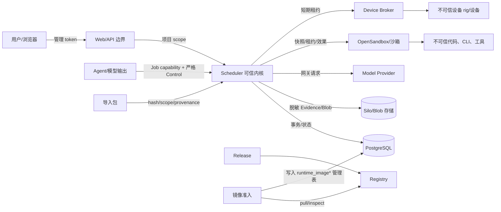

# 10 安全与信任边界

> 状态：**as-built**（#741）。标出用户、模型、执行环境、镜像、导入包和设备之间的信任边界及跨界校验点。
> 同步日期：2026-10-21

DeepSonar 把用户输入、模型输出、第三方镜像、导入包、设备和外部 Provider 都当作不可信或可能失效的边界对象。Scheduler 是可信执行内核，持有最小必要的控制权；PostgreSQL、Canvas、Evidence 和 Sandbox 各自保存不同真相。安全设计事实见 [DESIGN.md](../../DESIGN.md)、[DEVICE_ACCESS.md](../DEVICE_ACCESS.md) 和 [AI_NATIVE_TRUSTED_KERNEL.md](../AI_NATIVE_TRUSTED_KERNEL.md)。

## 信任边界图

箭头不是信任继承：通过一次校验只允许当前操作，不能让模型、沙箱或设备成为管理主体。Plane 当前没有集成接口，只作为未来扩展占位；沙箱内的代码可以失败或恶意输出，不能直接连接 PostgreSQL、管理 API、凭据或其他项目的文件。

## 跨边界校验点

| 跨界 | 校验和隔离 | 失败处理 |
| --- | --- | --- |
| 用户/Web → Management | token hash/prefix、scope、项目 path、请求 schema、审计；Web 不挂载 DB/Blob | 认证/授权拒绝，不产生领域副作用 |
| Agent/模型 → Control | capability token、Job/Canvas/project 绑定、snapshot hash、operation allowlist、严格 shared schema、引用可见性、预算、幂等 | 401/403/409/422/429 或 RepairFeedback；不接受普通文本伪造事件 |
| Scheduler → Provider | Provider 目录、凭据解密投递、模型/网络快照、响应脱敏、用量 ledger | 受限重试或失败；原文不进控制事件，不暴露长期密钥 |
| Scheduler → OpenSandbox | 镜像摘要、资源、网络 egress、凭据短期注入、Attempt effect、lease、清理回执 | 已知无效果失败可按策略处理；未知效果标记 unknown/orphan，禁止自动重放 |
| Release/Registry → image-admission | 按 `DEEPSONAR_COSIGN_*` 配置执行签名或 keyless identity/issuer 检查，并校验扫描、不可变摘要、运行时工具手册契约和来源状态；未启用策略时官方 catalog 可为 `signature: skipped` | fail closed；第三方镜像扫描失败不进入 trusted；签名策略未启用时不能把 skipped 解释为已验证，官方异常仍记录告警 |
| image-admission → Job snapshot | 只写受信目录和摘要，Dispatcher 再校验 enabled/trusted/兼容性 | Job 不可创建或 provisioning 失败；Agent 不能扩大镜像权限 |
| 导入包 → Scheduler | 格式、hash、大小/计数、路径、provenance、项目 scope、资源配额和 schema | 拒绝整包或隔离失败项，不执行包内脚本；历史终态可作为不可变记录保留，但不恢复 token/沙箱/secret 或直接授权新的 active execution |
| Scheduler → Device Broker/设备 | 项目 opt-in、任务冻结 device requirement、Broker token、当前实现的 device-key allowlist、租约和 Reaper；serial/VID-PID 枚举尚未实现 | 未授权返回冲突；租约过期回收；设备输出只作为不可信证据 |
| Canvas/Evidence → Verify/Report | 结构化 Fact、Artifact、Evidence manifest、输入 hash、验证门和权限 | 缺证据进入 waiting/rework/needs_human；投影失败不改写事实 |
| Plane（未实现占位） → Scheduler | 当前没有外部调用、配置、事件 dedup 或回执路径；未来集成须单独定义来源标识、作用域和审计 | 当前不存在集成失败路径；不得把占位描述解释为 as-built 外部边界 |
| Scheduler → Web/WS | 一次性 ticket、Job/project scope、本地 Evidence 可见性、消息大小和背压 | 不可见时 `visibility=unavailable`；关闭流而不伪造补读 |

## 秘密、资源和审计

凭据在管理域与运行时域分开：数据库保存加密字段和安全元数据，Job snapshot 只保存引用和经过审计的非秘密选择；Gateway 在 Scheduler 进程内按 Provider 认证转发请求，沙箱只拿到短期 Job token。Gateway 上游请求/响应体不落库，usage ledger 只保存用量计数；Job Evidence writer 在持久化运行流和 OTLP 前对已登记的运行时 secret 脱敏并清理控制字符，事件和审计仍按各自结构化 schema/投影保存。审计保留主体、scope、操作、结果和关联 ID。

权限校验不能替代资源隔离。沙箱网络、文件、设备、共享资产配额、Job 并发和事件预算仍由 Scheduler 和运行时 host 强制；镜像准入只回答“该摘要能否被选择”，不能让镜像取得平台管理权限。涉及 Job/Attempt 的沙箱 provision、Agent run、Gateway 和清理效果按各自 effect/settlement 与对账规则记录；Management 配置、image-admission 扫描和 Registry 发布使用自己的数据库状态与审计，不虚构 Job Attempt 账本。

## 维护升级的数据库与节点身份

升级管理员与业务运行身份分离。旧运行身份即使是初始化超级用户，也必须禁止 LOGIN 并清退现有会话；只改 HTTP 或只读默认值不能构成隔离证明。新代使用受限且不继承旧超级用户能力的身份；候选恢复后收敛 PUBLIC CONNECT/CREATE，运行时不能执行 schema 重建。秘密只保存在宿主私有恢复文件和受控 stdin，不进入 journal 或诊断输出。

受管 SSH 使用清单中的固定主机身份、工作目录和服务范围；worker 登记/心跳校验协议、平台版本与升级 generation，登记与心跳另校验独立的当前代秘密（数据库仅保存 hash）；旧节点持有原 node token 并伪报公开的新版本/generation 也不得重新获得当前代执行权。准备/激活/回滚都需要真实身份和状态证据，不能用模型判断、节点名称或进程存活替代。真实多节点成功及旧身份/公开世代伪报拒绝已有证据，完整恢复矩阵仍待验收，见 [升级演练](../../deploy/UPGRADE_REHEARSAL.md)，见 [ADR 0008](adr/0008-maintenance-candidate-upgrade.md)。
