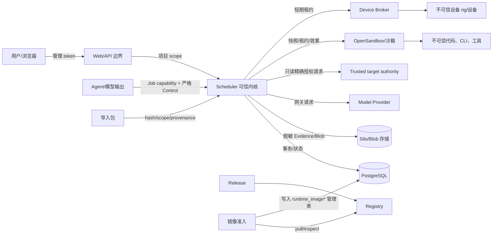

# 10 安全与信任边界

> 状态：**as-built**（#741；#767/#775 同步）。标出用户、模型、执行环境、镜像、导入包和设备之间的信任边界及跨界校验点。
> 同步日期：2026-10-31

DeepSonar 把用户输入、模型输出、第三方镜像、导入包、设备和外部 Provider 都当作不可信或可能失效的边界对象。Scheduler 是可信执行内核，持有最小必要的控制权；PostgreSQL、Canvas、Evidence 和 Sandbox 各自保存不同真相。安全设计事实见 [DESIGN.md](../../DESIGN.md)、[DEVICE_ACCESS.md](../DEVICE_ACCESS.md) 和 [AI_NATIVE_TRUSTED_KERNEL.md](../AI_NATIVE_TRUSTED_KERNEL.md)。

## 信任边界图

箭头不是信任继承：通过一次校验只允许当前操作，不能让模型、authority、沙箱或设备成为管理主体。Plane 当前没有集成接口，只作为未来扩展占位；沙箱内的代码可以失败或恶意输出，不能直接连接 PostgreSQL、管理 API、凭据或其他项目的文件。

## 跨边界校验点

| 跨界 | 校验和隔离 | 失败处理 |
| --- | --- | --- |
| 用户/Web → Management | token hash/prefix、scope、项目 path、请求 schema、审计；Web 不挂载 DB/Blob | 认证/授权拒绝，不产生领域副作用 |
| Agent/模型 → Control | capability token、Job/Canvas/project 绑定、snapshot hash、operation allowlist、严格 shared schema、引用可见性、预算、幂等 | 401/403/409/422/429 或 RepairFeedback；不接受普通文本伪造事件 |
| Scheduler → Trusted target authority | 仅使用 Scheduler 宿主配置的 URL、authority ID、secret 引用和动作链；请求绑定项目/目标/认证主体/tenant/role/resource、必需前置条件、内容与契约 SHA、派生 revision 和 freshness；response 严格复核作用域、精确动作、前置条件、authority revision 与 expiry | deny、撤权、过期、配置漂移、binding/前置条件不匹配、超时、重定向、secret 缺失或响应越界均 fail closed；secret 不进 Job snapshot、audit、feedback 或 Evidence，authority 不执行目标动作 |
| 项目知识/跨项目 Skill → Job | #752 分支只冻结本项目 active 或精确获授且已审批的 Skill 版本；读取再验版本、grant、source instance 与撤销 epoch；候选与来源 Memory/Evidence 均不继承授权 | 撤销后拒读；新 grant/重新启用不扩张旧 Job；试验 arm/audience 越界拒绝 |
| Scheduler → Provider | Provider 目录、凭据解密投递、模型/网络快照、响应脱敏、用量 ledger | 受限重试或失败；原文不进控制事件，不暴露长期密钥 |
| Scheduler → OpenSandbox | 镜像摘要、资源、网络 egress、凭据短期注入、Attempt effect、lease、清理回执 | 已知无效果失败可按策略处理；未知效果标记 unknown/orphan，禁止自动重放 |
| Release/Registry → image-admission | 按 `DEEPSONAR_COSIGN_*` 配置执行签名或 keyless identity/issuer 检查，并校验扫描、不可变摘要、运行时工具手册契约和来源状态；未启用策略时官方 catalog 可为 `signature: skipped` | fail closed；第三方镜像扫描失败不进入 trusted；签名策略未启用时不能把 skipped 解释为已验证，官方异常仍记录告警 |
| image-admission → Job snapshot | 只写受信目录和摘要，Dispatcher 再校验 enabled/trusted/兼容性 | Job 不可创建或 provisioning 失败；Agent 不能扩大镜像权限 |
| 导入包 → Scheduler | 格式、hash、大小/计数、路径、provenance、项目 scope、资源配额和 schema | 拒绝整包或隔离失败项，不执行包内脚本；历史终态可作为不可变记录保留，但不恢复 token/沙箱/secret 或直接授权新的 active execution |
| Scheduler → Device Broker/设备 | 项目 opt-in、任务冻结 device requirement、Broker token、当前实现的 device-key allowlist、租约和 Reaper；serial/VID-PID 枚举尚未实现 | 未授权返回冲突；租约过期回收；设备输出只作为不可信证据 |
| Canvas/Evidence → Verify/Report | 结构化 Fact、Artifact、Evidence manifest、输入 hash、验证门和权限 | 缺证据进入 waiting/rework/needs_human；投影失败不改写事实 |
| Plane（未实现占位） → Scheduler | 当前没有外部调用、配置、事件 dedup 或回执路径；未来集成须单独定义来源标识、作用域和审计 | 当前不存在集成失败路径；不得把占位描述解释为 as-built 外部边界 |
| Scheduler → Web/WS | 一次性 ticket、Job/project scope、本地 Evidence 可见性、消息大小和背压 | 不可见时 `visibility=unavailable`；关闭流而不伪造补读 |

## 秘密、资源和审计

知识 Skill 和项目治理 recipe 都是不可信内容，不得改变平台固定安全 case、Job 工具/网络/镜像/凭据边界。跨项目 grant 只许可精确内容版本；运行时读取仍以 Scheduler 的最新撤销记录为准。trial 的安全用例通过受控输入探针触发真实 API 拒绝，Evidence 要绑定 case×arm、独立 Job/Attempt 和 CAS 资产字节；当前夹具可验证校验逻辑，真实沙箱与模型行为尚需独立试验。见[项目知识专题](../PROJECT_KNOWLEDGE.md)。

凭据在管理域与运行时域分开：数据库保存加密字段和安全元数据，Job snapshot 只保存引用和经过审计的非秘密选择；Gateway 在 Scheduler 进程内按 Provider 认证转发请求，沙箱只拿到短期 Job token。Gateway 上游请求/响应体不落库，usage ledger 只保存用量计数；Job Evidence writer 在持久化运行流和 OTLP 前对已登记的运行时 secret 脱敏并清理控制字符，事件和审计仍按各自结构化 schema/投影保存。审计保留主体、scope、操作、结果和关联 ID。

权限校验不能替代资源隔离。沙箱网络、文件、设备、共享资产配额、Job 并发和事件预算仍由 Scheduler 和运行时 host 强制；镜像准入只回答“该摘要能否被选择”，不能让镜像取得平台管理权限。涉及 Job/Attempt 的沙箱 provision、Agent run、Gateway 和清理效果按各自 effect/settlement 与对账规则记录；Management 配置、image-admission 扫描和 Registry 发布使用自己的数据库状态与审计，不虚构 Job Attempt 账本。

## 目标授权的可信边界（#767）

任务契约的 target、identity、required/allowed actions 和 prerequisites 是待核验声明。对于目标写入或显式目标身份，Scheduler 生成 `deepsonar.target-authorization/v1` 请求，使用认证 actor 的 principal，再由 authority 核验声明身份；不接受任务自报的 authority 地址、secret 或 grant，也不把自报身份当作认证结果。当前只支持 `reference-http/v1` 的单一目标描述；authority 是平台配置的只读检查端点，不能作为目标写入客户端。

allow 只在项目、目标、主体、tenant/role/resource、精确动作顺序、全部必需前置条件、内容 SHA、规范化契约 SHA、派生 revision、authority 配置身份、策略 revision 和 freshness 全部一致时成立。Scheduler 把结果以不含 secret 的 snapshot 冻结进 Job，并在创建事务写入 `audit_logs` 的 `task.target_authorization` host grant；child/system follow-on Job 只能从该 Scheduler-owned 账本继承，Canvas metadata 或模型输出不能替换它。Dispatcher provisioning、`resume-frozen` 和 `rerun-current` 重新检查 live authority；缺失、改变或撤销的 grant 不得回退到旧记录或猜测放行。

`target_authorization_grant_invalid` 是非重试拒绝。创建阶段不建 Canvas/Job；执行阶段不创建 sandbox、Attempt 外部效果或目标动作；rerun 在中断 Attempt/状态转换前拒绝。Hub/Report 后置 admission 在 savepoint 中回滚本批新派发，保留前驱 terminal result 并暂停 Canvas convergence；Plan v2 依赖 admission 以同一原因持久停止而不撤销前驱已证明输出。详细字段和验证边界见 [目标授权专题](../TARGET_AUTHORIZATION.md) 与 [ADR-0011](adr/0011-trusted-target-authorization.md)。

## 维护升级的数据库与节点身份

升级管理员与业务运行身份分离。旧运行身份即使是初始化超级用户，也必须禁止 LOGIN 并清退现有会话；只改 HTTP 或只读默认值不能构成隔离证明。新代使用受限且不继承旧超级用户能力的身份；候选恢复后收敛 PUBLIC CONNECT/CREATE，运行时不能执行 schema 重建。秘密只保存在宿主私有恢复文件和受控 stdin，不进入 journal 或诊断输出。

受管 SSH 使用清单中的固定主机身份、工作目录和服务范围；worker 登记/心跳校验协议、平台版本与升级 generation，登记与心跳另校验独立的当前代秘密（数据库仅保存 hash）；旧节点持有原 node token 并伪报公开的新版本/generation 也不得重新获得当前代执行权。准备/激活/回滚都需要真实身份和状态证据，不能用模型判断、节点名称或进程存活替代。schema 61 → 62 的 16 项 Compose 场景及独立知识后台停写场景已通过并清理，包含真实多节点成功、旧身份/公开世代伪报拒绝及第二代失败恢复。历史基线与隔离环境见 [升级演练](../../deploy/UPGRADE_REHEARSAL.md)，决策见 [ADR 0008](adr/0008-maintenance-candidate-upgrade.md)；不据此宣称 Windows Docker 全流程或断电验收通过。

宿主自动补丁升级的信任配置独立于待验证 Release：固定验证器和 Sigstore 根哈希，签名同时绑定官方 workflow/tag/commit/schema 与三张镜像集合，缺失或不一致不能降级执行。生产 OIDC 签名已获明确授权，仅正式 tag 的独立 platform-signatures job 使用 id-token:write、contents:read 和既有 packages:write；不创建长期密钥，也不自动启用部署策略。签名失败阻止发布；隔离临时密钥不作为生产身份。Windows 私有恢复文件使用当前用户/SYSTEM 的受保护 DACL，进程锁借用覆盖孤儿 I/O 的生命周期。实际验收与权限范围见 [自动升级说明](../../deploy/UPGRADE_AUTOMATION.md)及[部署说明](../../deploy/README.md)，对应 IR-012。

## Pi 观测记忆与 Gateway workload（#815）

OM 的 registry/package/integrity、wrapper 指纹、冻结配置与 Job/Session 身份共同限定加载范围。业务 egress 与模型 Gateway 分开准入；独立 workload 由内核 token 行确定，不信任客户端 header/body 或模型自报来源。provider/model/route 只能取冻结配置，不能复用主 token 或读取 ambient Provider secret。

有限总额必须显式分配 main/background，轮换与撤销不重置历史消耗；pending/unknown 使用原 effect/usage 账本保守阻断，不返还未确认成本，也不自动重放。终态撤销不删除已开始请求的用量。wrapper 私有配置及 Session 守卫防止项目 settings、环境覆盖、切换或分叉；仅精确已知 quota 或内核确认 never-started transport 可见降级，provider 5xx/error prose 不构成未开始 authority，权限/协议/未知效果保持硬失败。

memory 只是上下文。新导出、RPC 副本、recall 与历史 Session preview/download 均在持久化或返回前做有界脱敏；Pi header/manifest 选择不改变不可变 archive metadata，projection bytes/SHA/Content-Digest 另报，不产生 Fact/Evidence、资格或语义完成 authority。新 Job 按所选镜像版本执行 OM 专属准入，启动/恢复前另过生产 package/entry/wrapper 内容守卫。实际本地 base 镜像已通过 canonical Pi/OM RPC、封装预检及缺包/缺 wrapper Docker guard 拒绝，详见 [RPC 专题](../PI_OBSERVATIONAL_MEMORY_RPC.md#2026-10-31-主线程-built-image-验收)。内核请求前 transport 证明、持久零用量结算和 provider JSON/SSE/refusal 防冒充已通过，见 [Gateway 专题](../PI_OBSERVATIONAL_MEMORY_GATEWAY.md)。已发布 v0.6.2 digest 不含 OM；最终组合 CI、发布通道/平台与 registry/catalog 证据仍另验。边界决策见 [ADR 0013](adr/0013-governed-pi-memory.md)。

## Plan 判据绑定信任边界

判据满足只来自显式授权操作员评价，并要求同 Canvas/项目的成功 Job/Attempt、当前 Artifact、finalized manifest 与实际留存文件 SHA。模型提案、项目关联、Fact verified 单独均不构成充分性。读取不请求远端 URI、不跟随符号链接；预算/缺失/unknown effect fail closed。整体完成与 Finding Verify 不被绑定改写；详见 [专题](../PLAN_GAP_PROJECTION.md)。

历史 B 首片的 plan_basis 仅记录既有 Intent 内一次补证，不新增权限；当前新执行使用下节 v2，不能把历史一次补证当作当前 lifetime 上限。Task 输入、Plan、来源、已读 projection 与事件 revision 在最终 Canvas→Job 事务重验；完成仍须全部必要判据当前正向操作员授权。未知外部效果禁止自动执行或完成，普通 request_human 可停止；来源 SHA 不伪造外部目标版本，见 [Plan 范围](../PLAN_GAP_PROJECTION.md)。

Plan 回执只绑定原 Job/Attempt、冻结快照及请求内容；查询不恢复执行。未知效果阻止 Hub 提案恢复，人工停止不受该阻断；普通调用不能借相同 event_id 穿过宿主预留。 详见 [持久化边界](../PLAN_BOUNDED_INTENT_DESIGN.md#持久化与原子性)。

## Plan v2 执行信任边界（#775）

用户目标与模型路线是两类身份：目标只能由有权限的操作员在 Canvas 行锁内以 CAS 更新，模型只能提交与当前目标恒等的 v2 Plan/Result，并以 `execution_route` CAS 调整尚未派发的 task。目标 revision、路线 revision、已派发 task SHA、Job/Attempt、Artifact、Evidence 和 unknown-effect 账本均为 Scheduler 重建的事实；新 key、路线理由、PlanResult 或旧 v1 输入不能重置 lifetime 预算或改写历史。

Plan v2 先通过完整 Hub Intent admission，再复用既有 materializer 创建普通 Worker Job；没有第二队列、模型通道或权限入口。依赖释放必须同时满足成功的当前目标 Job/Attempt、submitted 且未 superseded 的 Artifact/Finding/Fact、真实 semantic event、严格一致的 `plan.output`（含 task/目标身份、task SHA 和全部 expected outputs）以及当前 Attempt 留存文件的 provenance、manifest 和实际 SHA。该绑定只证明工程来源与字节留存，不给模型或 Artifact 语义 authority。

只有全部必要输出齐全且每项当前判据都有正向、完整、未截断、由操作员授权的评价，才可进入既有 Verify/Report/Task 完成门。取消、超时、失败、缺输出、无进展、预算耗尽、依赖 admission 拒绝和 unknown external effect 都持久阻断；后置 Hub/Report admission 的 grant 拒绝由 savepoint 回滚新批次但保留前驱 terminal result，Plan 依赖使用相同错误持久停止。历史 v1 replay baseline 冻结且只供不可变读取；当前 v2 replay 的定向证据也不能单独解释为质量或最终 head CI 通过。

## 目标结果与 Plan 显式关联（#767）

任务声明、证据真实来源、判据评价及完成 authority 是独立边界。目标评审是执行来源隔离而非不同人/模型认证；blocked/not_executed、失效、冲突、截断或预算不足不得贡献满足。Plan 可选关联只增加已选择绑定的持续来源约束，不给所有任务新增人工门，不自动赋予 operator_attestation 或赏金资格。详见[结果评审](../TASK_RESULT_REVIEW.md)、[Plan 关联](../PLAN_GAP_PROJECTION.md#可选目标评审关联767)及[验收矩阵](../TASK_DISPATCH_ACCEPTANCE.md)。

## 程序规则附加评审（#767）

程序规则独立评价只认证执行来源绑定和对 operator_supplied 材料的评审过程，不认证官方规则或当前程序授权，不产生 eligible authority。同 Finding/完整契约匹配、证据和完整集合冲突/失效/预算门继续适用。详见[评审](../TASK_GOAL_REVIEW.md)与[验收矩阵](../TASK_DISPATCH_ACCEPTANCE.md)。

规则证据失效且没有当前有效替代 review 时以 insufficient 阻塞程序规则结论；有效重评可恢复，不由历史失效永久否决。规则投影超过[源码累计上限](../../apps/scheduler/src/task-program-rule-report.ts)时全部阻塞，不保留先处理的正向结果；程序规则 ID 不得作为 Plan 通用判据 authority。

## 独立程序资格 authority（#822）

FR-FIND-008 只信任经过权限校验的操作员材料准入和独立评审；任务声明、Agent 输出、技术 `confirmed` 与普通 `program_rule_review` 都不能单独授予 `eligible`。项目绑定的管理员 token 也不能准入平台或其他项目材料，幂等键不能绕过项目隔离。评审绑定当前来源、Verify Attempt、材料版本和证据，写入按 Canvas 优先顺序锁定并重验，读取使用一致快照或已有报告事务的输入锁。材料是操作员见证，不声称已认证外部官方签名或自然人独立性；不授权目标执行或漏洞提交。见[ADR-0010](adr/0010-program-eligibility-authority.md)及[专题](../PROGRAM_ELIGIBILITY.md)。

## 证据追踪诊断修复

证据追踪依精确项目/Canvas/Job/Artifact/事件身份、当前成功来源和 rejected/效果门核验；使用 inspectCriterionEvidence 的 exact URI、manifest、大小、symlink 与共享8MiB实际字节检查。结构化 runtimeProof 不是宿主命令认证。详见[证据追踪](../EVIDENCE_TRACE.md)。

### #778 条件建议的信任边界

作者 applicability sidecar 与调用者 target 均为声明，不能改变 Job 快照或成为事实。在线建议仅检查本项目冻结精确版本；外国条目不进入候选、诊断、计数或排序。CAS 后整批复查版本及 item 撤销，选择事务锁定版本与 item 再查，后续 pull 仍独立授权。选择回执不是使用记录或权限票据，未知质量/token 余额不补估值；描述文本不参与匹配。详见[专题](../SKILL_SUGGESTIONS.md)。
