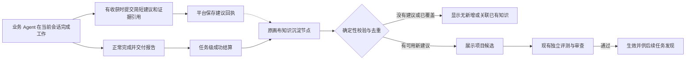

# 任务收尾的项目知识与 Skill 沉淀

> 状态：设计提案，待评审
> 日期：2026-11-21
> 范围：DeepSonar 任务画布、现有 Agent 会话、Scheduler 与项目知识治理
> 跟踪：[Issue #1197](https://github.com/SummerSec/DeepSonar/issues/1197)

## 目标与选择

每个用户任务的原画布末尾有一个「知识沉淀」节点。业务 Agent 在已有会话内记录值得复用的经验。整个任务通过完成门后，Scheduler 汇总各会话的建议，检查证据、消除重复，并显示建议、评测或生效结果。业务报告照常交付，下一个任务按项目权限和启动快照发现已经生效的条目。

| 方式 | 取舍 |
| --- | --- |
| 按项目攒数量或等待固定时长 | 能控制频率，但数量和等待时间很难判断材料价值。 |
| 任务后默认另起整理 Agent | 能读多份输入，但要重建上下文。没有新增时也可能花费模型额度。 |
| 在原会话写建议，任务完成时统一收口 | 能使用当前 Agent 已经掌握的内容。任务画布提供一个入口，平台仍负责证据核验和生效。采用此方案。 |

## 借鉴与现有能力

已于 2026-11-21 核对公开文档和本分支锁版本。上游能力与 DeepSonar 实际启用项分别判断。

| 工具 | 能借用的做法 | DeepSonar 的采用方式 |
| --- | --- | --- |
| Claude Code | Auto memory 允许 Claude 在会话中维护简短索引及按需读取的主题文件，跨会话复用。`Stop` 属于轮次，`SessionEnd` 也可能因为退出、清屏或切换会话触发。 | 学习原会话随手提炼和按需加载。业务是否完成以 Scheduler 回执为准。参考 [Memory](https://code.claude.com/docs/en/memory)、[Hooks](https://code.claude.com/docs/en/hooks)、[Skills](https://code.claude.com/docs/en/skills)。 |
| Codex | 启用本地记忆后，可以把符合条件的历史会话提炼为本地记忆，通常在后台更新。Skill 单独维护，按需读取。 | 学习按价值保留、按需读取，以及给生成过程留出独立预算。每条建议保留出处，任务完成后可查处理状态。参考 [Memories](https://learn.chatgpt.com/docs/customization/memories?surface=app)、[Skills](https://learn.chatgpt.com/docs/build-skills)。 |
| Pi | 上游提供 JSONL 会话持久化、恢复和上下文压缩。DeepSonar 锁定 `1.5.2`，已有会话归档，并接入了默认关闭的观察式记忆扩展。该扩展服务同一个冻结 Job 和会话。 | 原 Agent 可在正常收尾时利用当前会话中已有的上下文和已启用的观察式记忆。记忆帮助回想，事实和验证结果仍引用平台记录。参考 [Pi Sessions](https://github.com/earendil-works/pi/blob/main/packages/coding-agent/docs/sessions.md)、[锁版本](../../../agent-harness/runtime-images.json)、[观察式记忆接入](../../PI_OBSERVATIONAL_MEMORY_INTEGRATION.md)。 |
| DSH | 本分支锁定 `0.2.2-rc.1`。实际运行配置已有 JSONL 持久化、检查点、压缩和同进程会话续接。当前适配器的跨进程恢复标志为 `false`。社区也有跨会话记忆插件，但本项目的受治理配置未启用此类插件。 | 直接复用在运行的会话、已有压缩结果和会话归档。跨进程恢复、共享本地记忆目录及第三方插件不作为首版依赖。参考 [DSH 发布版本](https://github.com/deepseek-ai/deepseek-harness/releases/tag/dsh-v0.2.2-rc.1)、[社区插件](https://github.com/deepseek-ai/deepseek-harness/discussions/525)、[运行配置](../../../packages/runtime-sandbox/src/dsh-profile.ts)、[适配器](../../../packages/runtime-sandbox/src/runtime-adapters.ts)。 |

Pi、DSH 和 Claude 三种运行适配器共用一套收尾契约。DeepSonar 已有会话、归档、Fact、Evidence 和项目知识目录。需要补的是「从会话提交待核验的建议」以及「在任务成功后归档到画布节点」两个接点。归档可按权限回看，默认处理范围仅包含结构化建议及其证据引用。一个画布可能包含多个 Job、Attempt 和会话，各会话只提议自己有权引用的材料。

## 触发与生命周期

- **会话内提交。** 在业务 Job 的正常收尾指引里告诉 Agent，有可复用内容时提交一次简短建议，然后照常提交 `mark_job_done`。建议是可选项，缺失、输入错误或权限拒绝均不影响正常完成。没有建议时由平台记录「本次未提交建议」。收到明确的「无新增」则显示该结果。默认无单独总结提示、额外模型轮次或 maker Job。调用收尾工具仍可能增加原会话的文字和工具开销，需要计量。
- **使用独立的可选操作。** 保持现有严格 `mark_job_done` 契约，复用 Job-scoped Control API 的权限检查、持久事件和回执，给获授权的业务 Job 增加只登记建议的操作。它不派发工作。现有 `request_project_knowledge` 会建立治理工作，`propose_project_knowledge` 只接受已分派的 maker，两者各自保留原职责。建议写入必须发生在原 Job 的授权有效期间。终态撤销后，Scheduler 从已接受的回执读回，退出钩子和归档文件不能代替 Control API 写入。以同一提交的幂等键和内容复读原回执，禁止因回执暂缺自动换键重投。首版先用已有事件存储验证大小、权限、索引和保留策略。
- **任务级收口。** 带正式任务报告的任务，在当前轮次正式报告和 Root 成功结算后由 Scheduler 读回建议并更新原画布。报告重生成、页面读取和进程重启复用同一节点和结果。队列内外走同一判断。只有单个子 Job 成功、仍有待人处理或存在未决外部效果时，继续等待。首版失败或取消只显示原因并保留材料。其他任务路径要有明确的任务级结算信号才接入。
- **身份与恢复。** 一个任务的一次业务执行轮次对应一个逻辑收尾节点。记录至少绑定项目、Canvas、轮次、Job、Attempt、受认可的会话 ID（存在时）和回执。只采用成功且有效的 Attempt 的建议，未完成会话、失败或被替代的 Attempt 仅保留审计。子会话资料可由父 Agent 通过已授权的平台证据引用提议，组装时不拼接多条聊天。普通重试、人工续跑和补报告沿用原轮次。真正重跑使用新轮次。现有硬重跑会清空原画布的运行数据，首期将已接受的收尾建议和回执纳入现有知识保留检查，在清理前拒绝会抹去这些历史的硬重跑。需要重跑时创建新任务，原画布结果和回执继续可查。持久认领使用轮次和候选指纹，在同一项目锁内防重。若收尾登记和业务结算需隔离失败，用可重读的已提交业务结算补登。已开始的评测沿原回执恢复，未决效果等原结算。

## 建议、准入与去重

每个业务 Job 的一份建议最多两项，供任务级节点合并。每项至少包含种类、简短结论或方法、适用条件和有界证据引用。明确要修订已使用的知识时，附条目标识与精确版本。优先处理有证据的纠错，其次是可重复的方法，再次是新结论。建议正文及引用清单合计限 4 KiB UTF-8，每项最多 4 条证据引用。以上数量和字节数为试点设计值。实现继续沿用现有输入项数和字节边界，每轮自动评测最多一条，节点展示其余候选。

| 内容 | 节点如何处理 |
| --- | --- |
| 未提交、明确无新增、完全重复 | 分别显示结果。相同范围和版本下的确定性重复直接关联已有项。 |
| 只在会话压缩或记忆里出现的经验 | 可作为提示，缺少合格证据时标记「待补证据」。不读取或复制原始记忆池，也不凭总结标记为已验证。 |
| 有证据的新结论 | 形成项目 Memory 候选，记录结论、适用条件和证据。 |
| 可重复的方法 | 优先提出已有项目 Skill 的修订。新 Skill 候选须写清适用条件、步骤、核验和停止条件。 |
| 同一结论存在反证或版本差别 | 保留差异。修订绑定原版本和新证据，在评测中覆盖变化和原有有效场景。 |

Scheduler 只读取本项目、本任务当前轮次下的合法 Fact、Evidence、已接受的知识反馈及合法资产版本。自动进入评测以现有可机器校验的证据为前提，例如 `verified` Fact 或绑定精确版本且已校验证据的反馈。会话和压缩内容只作定位输入。首次校验权限、归属、版本和哈希，登记及评测前再次复核。输入仍按现有最多 19 项来源加一份可选 governor 和每项字节上限处理。证据缺失或超限时给出可查原因。候选正文和 Skill 均按不可信数据处理。

去重先比较规范化候选内容、证据内容摘要、环境/版本和验证状态，再在项目锁内核对目标条目、精确版本及已有评测。原引用 ID 保留作审计和来源清单完整性校验，语义相似只辅助查找。已有显式整理或旧批次覆盖部分材料时，按实际输入和目标基线逐项关联。剩余材料再参与选择。在途或效果未决时等原工作，有失败记录时展示原结果，不能通过换工作重置预算。

## 输入、持久化与节点状态

建议载荷使用版本化结构。提交者只提供下表的业务内容，归属信息由 Scheduler 依据当前 Job、有效 Attempt 和已提交的启动记录补齐。会话 ID 仅在运行适配器已有可信绑定时记录。平台以服务端归属做授权，展示会话 ID 只用于定位。

| 字段 | 含义与校验 |
| --- | --- |
| `result` | `suggestions` 或 `no_new`。后者必须没有候选。未提交由平台推导为单独结果。 |
| `items[].kind` | `memory` 或 `skill`。 |
| `items[].title`、`scope` | 简短标题、适用版本和环境，允许后续任务据此判断能否复用。 |
| `items[].content` | Memory 记结论和边界。Skill 记步骤、核验和停止条件。 |
| `items[].evidence_refs` | 指向可按当前权限校验的稳定平台引用。模型生成的正文、会话归档和压缩摘要不计为佐证。 |
| `items[].target` | 新建候选省略。修订需提供目标条目及其精确版本，供读取、去重和后续评测比较。 |

- **入库前检查秘密。** Scheduler 在入口检查所有自由文本字段，包括标题、适用条件和正文。在写入事件、回执、日志、追踪或画布投影之前，对当前执行可核对的受管秘密完整值和明显凭据模式做检查。首期发现匹配即拒绝整份建议，只返回稳定原因和字段位置。日志、错误和回执只记录安全元数据。所需的秘密检查无法执行时暂停该建议的登记，业务完成照常提交。现有受限会话导入可作为参考，新入口须独立验证。[受限会话导入](../../HUMAN_CONTINUATION.md#原生会话受限导入)
- **读取时核对来源权限。** 保存建议时绑定已校验的来源，通用画布节点及其持久投影只保留安全状态和不携带正文的详情入口。打开详情或历史预览时，先校验入口的项目或任务读取权，再按当前读者身份核对全部相关来源及修订目标，资产正文沿用资产读取权限。任一来源或目标无法确认归属、不可见或已撤权时，仅返回不含内容的通用状态，隐藏标题、正文、摘要及受限引用。候选进入评测和生效时继续遵守来源的可见范围，便于后续任务在授权内复用。

建议成功登记后，可用同一幂等键和载荷查询原回执。同一个 Attempt 的有效建议限一份。并发提交时按 Job/Attempt 串行认领。相同内容返回原结果，另一份内容返回可查的冲突原因。对结构错误在接受前返回字段级反馈，Agent 可以在原会话的既有预算内修正，也可以继续业务完成。建议的收录与任务成功结算分开记账。重启后 Scheduler 从已提交的任务结果和回执重建投影。`task run` 身份必须在队列内外稳定可复读，不能用变化的报告版本或临时唤醒时间代替。历史缺少稳定身份时仅做只读预览。

| 阶段 | 节点显示和推进条件 |
| --- | --- |
| 等待任务结算 | 业务继续运行，待人和未决效果显示原因。最终失败或取消只留下可查状态。 |
| 已查，无新候选 | 区分未提交、明确无新增、相同内容已关联和证据不足。证据不足的候选只供有权限的读者查看。 |
| 已发现候选 | 列出原 Job、证据、版本及新建或修订建议。首期到此结束。 |
| 已进入治理 | 后续阶段显示等待、评测、审查、被退回或待对账。条目链接须绑定原工作和原候选，恢复时保留预算。 |
| 已生效 | 显示独立审核通过的精确版本。其后撤回或被替换时展示原记录及当前有效状态。 |

## 从候选到复用

候选进入治理前，Scheduler 先在项目锁内核对持续授权、目标版本、输入指纹和是否已被原 collector 或显式工作认领。已有在途工作时链接原工作，待原结果落地。新工作冻结输入、适用条件和评测基线。评测用现有独立试验与 evaluator，审查工作须独立于提出建议的业务会话。针对已有版本的修订同时比较新增场景和已通过场景。候选必须经过已有评测、审查和精确版本检查才能发布。发布前若目标版本变更或授权被撤回，记录原因并保留已有结果，以新的明确评审决定是否重新评测。

新任务在现有知识目录中按范围和权限发现生效版本，按需拉取其内容。拉取记录和显式使用反馈分别绑定生效版本。拉取记录证明取得版本，实际采用及效果由反馈支持。后续收尾只有同时满足本任务归属和证据条件时才提出修订。用量、反馈和生效各自保留证据。没有反馈时效果记为未知。

画布节点靠近原任务结果，正常无新增折叠显示，常规等待无需通知或人工回复。候选有明确的证据来源和受阻理由，避免用户从额外的整理任务中拼接状态。应用按现有画布更新机制投影。项目内经授权的读者可以查看详情，跨项目发布沿用独立的精确版本准入流程。

## 评测准入与费用

**默认从原会话拿候选。** 展示候选和决定是否重复都由平台完成。首个小 PR 交付登记、汇总和预览。预览入口自身只读，试点接管自动治理时再切换旧 collector。后续接通评测时，应验证 Scheduler 能否把来源受限的结构化建议作为待审草稿有审计地交给原治理链。现有提案必须经 maker assignment，直入评测需要明确的治理入口和授权，评测、试验、审查与精确版本准入保持完整。若现行链路要求 maker，先走显式整理，由操作者选中有价值的材料。保留独立整理 Agent 作为明确选材后的补充。没有形成建议的任务不自动回看整段会话来补提案。

当前完整验证路径在无需修订时通常有 1 个 maker、12 个独立试验、1 个 evaluator 和 1 个 reviewer。复用会话直接节省的是提炼与重建上下文的开销，评测与审核单独计量。同项目最多运行一条治理工作，继续用现有 Job 数、运行时间和修订次数限制。试点保留连续两次自动工作实际执行而无正式产出即停发的约束。无建议、确定性去重、资格拦截和合法无新增不计入失败。效果未决时暂停新派发，按原结算记账。停发项目继续登记和展示候选，由显式成功按现有规则恢复派发。

| 观测 | 需要回答的问题 |
| --- | --- |
| 同类任务有无收尾建议时的主会话用量和报告延迟 | 原会话新增多少开销，是否增加了完成负担？ |
| 各阶段 Job 数、请求数、有效 token 计量 | 省下多少整理工作，试验和审查占多少？未知用量单列。 |
| 候选重复、证据不足、通过、后续拉取和已使用版本反馈 | 沉淀是否提高了后续任务的复用率，哪些有价值的结果被漏掉？ |

## 画布、读取与生效

节点优先显示一句结果，例如「本次无新增」「已关联项目 Skill v2」「Skill 修订待评测」「Memory 已生效」。详情提供来自哪些业务 Job、可访问的证据、归属版本和进度。区分等待任务结算、未提交建议、证据不足、已有关联、待处理、评测中、已生效、受阻或待对账。正常无新增折叠显示，候选和常规等待不发额外通知。下一任务走已有的项目知识和 Skill 发现与拉取入口，在其快照授权范围内读取生效版本。Barry 公共仓库继续由现有同步提供全局 Skill。项目经验若要推广，由维护者独立审查、脱敏并走 Git 评审。

优先复用受限的持久事件保存候选，在 Canvas 投影中保存安全状态，同时核对删除、备份和受治理引用的保留范围。具体存储选择以同事务防重、读取权限和保留验证为准。如果现有存储无法满足这些条件，先把缺口和最小变更在独立 PR 说明。会话归档只按现有权限和脱敏边界查看，项目候选保留短正文和必要引用。采用同一套平台目录来回用知识，各执行器无需共享 HOME 或依赖单一厂商的本地文件结构。

例如，Pi 的业务会话验证了新版本改变导出目录。Agent 在正常收尾时附上版本、操作条件、已验证结果和证据引用，建议修订「导出检查」项目 Skill。正式报告交付后，节点显示「发现一条 Skill 修订」。已有相同结果时直接关联，确有差异则保留候选。通过原有独立评测和审查后，后续 DSH 任务也能发现该生效版本。

## 分期、切换与验收

1. **小 PR 先交付建议和预览。** 接入受治理的提交回执、任务成功后的汇总与原画布只读结果。Pi、DSH、Claude 走同一入口。用代表性的有新增、重复、撤权和失败样本验证。历史补做继续只读预览已有来源和待复用结果，预览不凭旧聊天自动补造建议。未接入的项目仍走当前行为。
2. **验证后接通治理。** 在试点项目启用单候选评测时，同步暂停该项目的旧自动 collector。切换在同一项目锁内冻结旧入口认领，并保留切换前的连续失败记录和停发状态。已认领的工作仍由原入口按原回执和预算结算，有未决效果时等待对账。未认领的来源登记为历史待选，可从只读预览显式选材。与新建议重合的部分按证据和目标版本检查归属。先有小规模数据证明直入草稿的授权和验证，再扩大自动准入。暂停试点时继续登记和展示，两个入口均暂停新的自动派发。已接受结果和在途归属可查询。恢复时继续使用同一候选身份、原回执和预算。已经停发的项目仍需有符合规则的显式成功才能恢复自动派发。
3. **推广及清除旧准入。** 审查报表之后，再移除按数量和时间唤醒的旧规则。历史工作、使用反馈和证据可读。需要补做的历史任务由有权限的操作者显式选中来源，沿用原治理入口和工作预算。

| 验收项 | 通过条件 |
| --- | --- |
| Pi、DSH、Claude | 每种 adapter 用其已支持的正常会话路径提交建议，回放验证归属、重放及正常交付。Pi OM 关闭、DSH 无持久续接时也可提交。 |
| 多 Job 与恢复 | 多个有效业务会话只汇成一个任务节点。跨项目引用、陈旧 Attempt、终态 token 被拒。并发、重启、报告重生成没有重复候选或治理工作。硬重跑若会清除已登记历史，则返回保留原因，原结果和回执仍可查。 |
| 首期秘密与可见性 | 在标题、正文和适用条件中分别放入合成秘密标记，覆盖受管秘密完整值和明显凭据模式。验证拒绝后事件、回执、日志及画布投影无原文，业务仍能完成。用含受限来源的合规建议验证有权限者可见，普通项目读者和撤权后的读者在详情、画布和历史预览中仅见通用状态。 |
| 证据和成本 | 空内容、仅有记忆总结和确定重复的样本无新增模型调用。报告可在评测排队或受阻时交付。能分开核算原会话开销和独立评测成本。 |
| 知识复用 | 草稿留在审查入口，普通任务只能拉取获准生效版本。一个执行器提出的项目知识可以被另一执行器按授权发现。 |
| 试点切换 | 新旧自动入口不会重复认领同一来源。已停发项目切换或重新打开试点后仍停发。已认领工作按原预算结算，未认领的旧来源出现在历史预览。暂停、恢复和历史预览都能查到授权范围内的原证据、回执及预算。 |

工程验收走 GitHub Actions。实际模型用量、漏选和后续复用效果需要试点数据。运行时、数据库和 OpenAPI 的现状以对应专题为准。本文记录完整目标。首期工程状态见[项目知识专题](../../PROJECT_KNOWLEDGE.md#任务会话收尾1197)。自动评测、发布和切换旧采集器属于后续阶段。

- 任务结算与原入口见 [报告结算](../../../apps/scheduler/src/report.ts)、`当前自动登记`、[现有按批次准入规则](../../architecture/adr/0024-project-knowledge-batching-admission.md)。
- 会话和写入边界见 [会话归档适配器](../../../packages/runtime-sandbox/src/cli-session-adapters.ts)、[完成载荷](../../../packages/shared-types/src/index.ts)、[项目知识提案](../../../apps/scheduler/src/domains/project-knowledge/proposals.ts)、[项目知识专题](../../PROJECT_KNOWLEDGE.md)。
