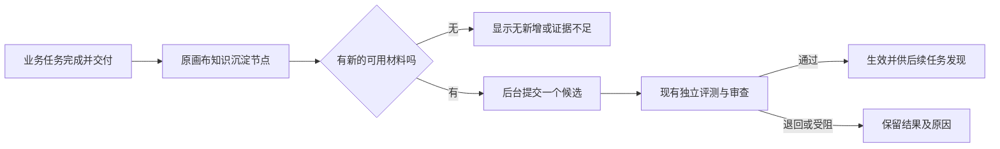

# 任务收尾的项目知识与 Skill 沉淀

> 状态：设计提案，待评审
> 日期：2026-11-21
> 范围：DeepSonar 任务画布、Scheduler 与现有项目知识治理

## 目标与选择

每个进入执行的用户任务，在原画布末尾有一个由 Scheduler 管理的「知识沉淀」节点。整个业务任务通过完成门后，节点从任务产出里找出可复用的结论和可重复执行的方法。用户可以从一个地方看到沉淀结果、引用证据、评测进度和生效版本。业务任务照常交付，项目内后续任务可以使用已生效版本。

| 可选方式 | 取舍 |
| --- | --- |
| 项目按数量和时间开批 | 能限制频率。来源数量和等待时间无法判断材料价值，也让用户难从原任务找到整理结果。 |
| 业务 Agent 完成前直接总结 | 能利用现成上下文。上下文可能很长，且整理失败会拖延交付。业务 Agent 的建议需要独立校验。 |
| 原画布收尾节点，由后台按差异处理 | 符合用户指定的收尾时机。平台直接过滤空材料和完全重复，有材料再复用现有整理 Agent。新增工作主要落在任务完成信号、来源归属和画布投影。 |

采用第三种。首版沿用现有任务执行、知识提案、评测、审查和用量账本。Barry 全局仓库继续通过现有同步机制维护，项目产出默认留在项目内。

## 触发与生命周期

- **完成依据。** 从平台实际提交的任务级成功结算生成记录。带报告的任务使用当前业务执行轮次的正式任务报告和 Root 成功结算。首版自动处理有正式任务报告的用户任务，覆盖队列内外。其他任务仍可展示节点，确有独立任务级成功结算信号的路径，在接入同样的验证后再启用派发。只有子 Job 状态的路径显示「此类任务暂未接入自动沉淀」。队列内外共用同一判断，不靠队列出队或普通子 Job 成功触发。报告重生成、读页面和重启都只重新读取同一结果。任务有在途业务、待人处理或未决外部效果时，节点显示等待，结算条件满足后再推进。最后失败或取消的节点显示对应原因，首版将失败复盘留在原任务材料内。
- **处理单位。** 一个用户任务的一次业务执行轮次，对应一条收尾记录和最多一个自动整理工作。同一 Canvas 真实重跑后仍只展示一个节点，详情保留上一轮历史。轮次由平台接受任务启动或真实重跑时分配并持久关联，使用现成稳定的启动身份时要证明两条路径语义一致。普通 Attempt 重试、人工回复后续跑、解锁继续、补报告和报告重生成沿用原轮次。首版沿用知识历史保留门。若原画布硬重试被该门拒绝，显式创建新任务即开始新轮次，旧画布和引用完整保留。已有 Task Queue `generation_at` 用于拒绝陈旧完成结果，不能直接当永久身份。
- **后台执行。** 成功终态只持久登记有界引用，整理按原 Scheduler 派发。候选评测可以晚于业务报告完成，画布结果、任务队列释放、业务成功状态和通知都根据原业务规则处理。新增节点不要求用户回复。已有治理任务在运行时仍受其工作归属、配额和沙箱约束，所有系统维护、Report 和治理 Job 都排除在再次触发范围之外。
- **故障恢复。** 优先让业务成功与收尾标记同事务提交。若必须保留知识错误隔离，则同事务保存可重读的业务完成标识，调度器只补登记切换后缺失的收尾记录。外部读取在事务外执行，事务内复查轮次、项目状态、来源权限和哈希，再原子链接工作引用。完成重放、并发、重启都命中原记录。仅对确认没有发起模型调用的瞬态准备故障做有界重试，沿用现有三次准备上限和持久退避。调用结算未知时进入「待对账」，恢复从原回执继续。

## 来源、去重与候选

只取本项目、本任务当前轮次、通过现有权限与来源检查的记录。可用材料为成功业务 Attempt 的 Fact、Evidence、已接受的结构化知识反馈及被其合法引用的资产版本。报告仅作定位和概览。按最新有效 Attempt、来源所有权、权限撤销和内容完整性复查。被撤销或内容校验不通过的记录保留原因，候选不能引用它们。未经独立验证的材料可以保留为线索，不足以触发首次自动评测。对旧条目的修订必须绑定条目版本及新增的有效证据。

| 判断 | 动作 |
| --- | --- |
| 没有合格来源、只有线索或权限已变化 | 显示具体原因。无需模型。 |
| 已评估的相同材料、适用范围和目标版本 | 关联已有候选或结果，保留当前来源。无需模型。 |
| 证据相同，输入只是表述变体 | 只有确定性比对能证实相同时才合并。语义相似仅协助查找。 |
| 现有条目被可核验证据纠正 | 首选对精确版本发起修订，评测覆盖差异与既有有效场景。 |
| 有已验证且适用范围明确的新结论 | 生成一条项目 Memory 候选。 |
| 有经过验证的、可反复执行的操作方法 | 首选更新现有项目 Skill。缺少对应方法时提出新 Skill 候选，包含适用条件、步骤、核验方式和停止条件。 |

零模型自动准入以已有结构化字段为准。首版只使用状态为 `verified` 的 Fact，或者已接受、指向精确知识版本且证据经来源校验的反馈。普通 Evidence 可补充佐证。方法类型从明确的步骤、输入和验证结果字段识别。字段无法证明是方法时，不猜目标 Skill，由整理 Agent 在已准入材料里作分类，仍需审核。

去重分两步。读材料时比对同项目的规范化正文、验证状态、证据内容摘要和明确的环境/版本。已知目标时再比对条目及版本，未知时仅能确定整份材料历史和语境完全一致才可跳过。候选提交后以「项目、种类、适用条件、内容指纹、目标知识版本」在项目锁内重验。现有包含来源 ID 的来源清单哈希继续用于完整性校验。原始 ID、版本与引用继续留在审计里。版本、环境、验证状态和反证差异都要保留。只在同项目权限内查找已有条目与候选。两项内容均有价值时，首版只自动评测优先级最高的一项，依次考虑已用条目的有证据纠错、能复用的操作方法和其余结论，其他材料继续可从原任务查看。遇到多个同级条目，使用来源证据质量与稳定排序选取，避免模型自行启动多条链路。

平台将输入限制在现有最多 19 项来源加一份可选 governor 的范围内，沿用每项字节限制。报告全文、全量聊天和项目材料全集留在各自原位。来源超过上限或缺少关键材料时把原因和遗漏计数显示出来。能安全挑出完整候选时允许只整理这一条，证据不完整时显示「证据不足」。

## 整理、评测与费用

平台先做确定性筛选，再决定是否派发现有 maker 角色的整理 Agent。每轮自动筛选最多调度一个初始 maker Job，该 Job 只可提交一个候选或明确结束为「无新增」。「无新增」需要同一个 maker 工作上的明确、可校验回执。现有实现把缺提案当成失败，须添加一个版本化结果或等价的工作结算契约，区分正常无新增与 Agent 退出未交付。首版仅对这一自动入口限制单候选，显式整理仍按现行规则执行。候选形成后，可按现有工作预算进行有界修订。评测和审查继续沿用独立 Job、当前预算和权限。Memory 写清结论、版本条件和证据，Skill 写清可执行步骤和验收方式。禁止将未经验证的草稿放进普通 Job 的可用目录。后续任务只在现有项目权限下发现、拉取生效版本，反馈记录绑定实际用过的版本。无反馈仍显示「效果未知」。

同项目最多一条运行中的知识整理沿用现有约束。正在运行时，新节点立即记录待处理理由，待前一条结算后择优派发。排队项圈定每次扫描规模，默认沿用每轮最多扫描 32 项并留出老项处理机会。相同材料和同一目标基线共用一个在途评测。治理基线、知识版本或权限在评测期间变化时停止晋升并记录原因，原草稿、证据和预算可查。已有显式整理可优先处理。以冻结的输入引用、内容和目标基线为单位查旧批次、显式整理及当前运行。部分材料已覆盖时逐项关联旧 work，余下材料才参与本轮候选。原工作运行中或效果未决时等待原工作，已知失败时在节点保留原原因。只凭来源 Job 相同或者整体清单不相同，都不足以决定是否重复。认领、派发和旧链路归属在同一项目锁下复查。

试点默认沿用连续两次自动工作执行后无正式产出即停发的规则。确定性跳过、有效关联已有知识和有依据的「无新增」单独记账。原有已停发项目从历史保留停发状态，等现有显式整理成功后恢复自动派发。项目停发期间照常登记收尾结果。按下表处理停发计数。排队公平、低成本路径和停发代替按日等待作为常规成本控制。现有 Job 数、运行时间和修订次数继续硬限制。默认上限沿用每条工作 32 个 Job、累计运行 1800 秒、最多两次修订。一个新候选未发生修订时，现有完整验证链通常需要 1 个 maker、12 个独立试验、1 个 evaluator 和 1 个 reviewer，共 15 个 Job，因此优先拦截低价值材料。模型用量从现有账本读取，明确标记缺失。首版可以核算消耗，精确的整链 token 硬上限仍属于独立设计。

| 自动或显式结果 | 项目连续无产出计数 |
| --- | --- |
| 自动或显式工作已完成，且存在状态为 `active` 或 `retired` 的提案 | 清零。当前停发项目只接受有权限的显式成功来恢复。 |
| 自动工作已实际执行，超时、评测失败、预算用完、流程取消或未提交有效结果，且无正式产出 | 每条工作加一次。使用持久结算事实跨重启计算。 |
| 重复关联、确定性跳过、合法「无新增」、执行前取消、等待或准备失败 | 计数保持。分别记原因。 |
| 外部效果未决 | 计数保持，暂停该项目的新自动派发，等待原效果对账后按实际结果记账。 |

## 节点、安全与数据边界

节点优先显示一句能看懂的结果，详情提供阶段、来源、候选、评测摘要、生效版本和受阻原因，沿用现有 Canvas 更新机制。正常的「无新增」折叠显示。用户可以从原画布查看结果和已有知识记录。后台治理的运行详情经授权进入已有知识视图，接入工作台的知识整理历史筛选。对应实现以 #1195 的集成状态为准。普通待评测或无新增不产生额外通知和人工请求。未决效果沿用平台对账入口。

| 状态 | 画布显示 |
| --- | --- |
| `waiting_task` | 等待任务完成 |
| `accepted` / `queued` | 已收集材料 / 等待整理，展示等待原因 |
| `skipped` / `reused` | 无新增、证据不足、权限变化，或已关联条目 |
| `drafting` / `evaluating` | 正在整理 / 候选待评测，展示目标版本 |
| `active` | 知识或 Skill 已生效，展示版本 |
| `rejected` / `blocked` | 评测未通过、项目已停发、预算耗尽等原因 |
| `reconcile` / `cancelled` | 等待原效果对账 / 任务已取消 |

收尾记录归 Scheduler 所有，绑定项目、Canvas 和执行轮次，保存有界来源引用、决策原因、输入指纹和 `work_ref`。工作和候选的当前状态从既有记录投影到节点。首选用系统专属 Canvas 节点类型保存收尾元数据，使用由项目、Canvas 和轮次派生的稳定主键复用数据库主键约束。原画布是展示位置，后台运行继续使用原有治理工作槽位。实施前用原型证据验证系统节点的写权限、生命周期、并发唯一性及删除/清理安全。若现有节点无法保证引用不丢失或同事务防重，单独提交最小 schema 方案评审。已有知识保留规则须覆盖首版新增链接，任务清理前保留受治理引用和对账事实。

任务文本、Feedback 和 Skill 正文都按输入数据处理。整理 Agent 复用 Job 隔离和相关工具权限，平台在运行和晋升前重验身份、项目、版本和授权。候选不能扩大写权限、网络、共享范围或工具配置。Barry 的仓库通过现有同步提供全局 Skill。若需要把项目经验推广成全局 Skill，由维护者走独立的脱敏、复用验证和 Git 评审，平台收尾节点没有 Git 写权限。

## 一次收尾示例

某任务验证了导出目录默认值变化，并保存了配置版本、操作步骤和自动检查结果。报告落地后，原画布立即显示「知识沉淀 · 正在检查材料」。平台识别出其中三条旧结果已经关联知识条目，只把新的完整验证结果交给整理 Agent。Agent 为现有「导出检查」项目 Skill 提出一次修订，补上新版本的目录条件和核验步骤。节点随后显示「Skill 修订待评测」，点开可以看到原证据和候选版本。通过审查后变为「Skill v3 已生效」。若下一项任务在 v3 生效前开始，它仍按启动时的既有目录运行。再下一项任务可以正常发现 v3。

## 切换、历史补做与验收

1. **先做预览。** 用现有历史资格预览的读取边界，选择有重复、有新证据、有纠错和失败的代表任务，对照旧批次与收尾节点的决策。输出会关联、会评测或会跳过的原因，以及预计整理和评测 Job 数。模型费用和最终可复用产出由后续验证测量。
2. **小范围启用。** 使用一个服务端切换策略，试点项目只给切换后完成的任务启用收尾调度。该项目的旧 collector 停止创建新批次，切换瞬间的归属与去重在项目锁内确认。既有在途工作可以用原预算完成。待材料继续留在历史预览。其余项目沿用旧流程，直到进入正式切换。回滚将该项目自动派发切到暂停，继续登记新完成的任务。已提交的候选与审计仍可读。在试点周期内，暂停状态不恢复该项目的旧 collector。重新启用按原身份与认领记录续接，防止同一材料二次花费。
3. **验证后扩大。** 对已完成任务使用只读预览。确实有价值的历史材料，由有权限的操作者后续明确选定来源，再走现有显式整理入口。已有 work 的材料先查原 work 和效果，禁止通过新入口重置预算。正式切换后，旧按数量和时间唤醒的规则从自动准入流程退出，历史 work 保留。

| 验收项 | 通过条件 |
| --- | --- |
| 触发与交付 | 多个成功子 Job 只在业务真正完成后产生一个节点。带报告任务覆盖队列内和队列外。未接入完成信号的任务显示原因且不触发。知识整理排队或失败时，报告和下一项业务任务照常交付。 |
| 恢复 | 并发、重复回执、重启与报告重生成均无额外 work。真正重跑只处理新增差异。未决效果、撤权和版本冲突有可查状态。 |
| 去重和成本 | 完全重复和空材料得到零模型调用。单条已验证纠错可立即进入排队。一个执行轮次仅一条自动评测链，同项目运行并发符合现有上限。达到停发线后不继续派发。 |
| 治理 | 草稿不能被普通任务拉取。通过评测审查后显示精确生效版本。跨项目边界与全局仓库写权限保持隔离。 |
| 切换 | 切换点前后同一份材料没有双跑。旧工作、证据与计量可追踪，历史预览不会发任务。 |
| 效果 | 对比每个完成任务的整理 Job 数与报告延迟、每个生效条目的模型请求及已报告 token、候选通过率、后续拉取和显式反馈覆盖率。按证据类型分开看漏选，缺计量或样本时记录未知。 |

工程验收在 GitHub Actions 覆盖画布结算、数据库并发与恢复、项目权限、治理和 Web 投影。真实模型效果和使用率单独验收。实现按三个可独立审查的变更交付。先接完成信号和只读预览，再接有界候选与现有治理，最后完成节点展示和可回滚切换。试点默认采用每轮一个自动候选、原画布一个节点、旧历史只读预览。具体内部结构和排序实现由实现者按上述契约裁定。

## 现有实现依据

- `report.ts` 的 `finalizeReportJob` 在正式任务报告成功时更新报告、报告节点和 Root。`task-queue-model.ts` 校验当前 Root、报告、等待人和未知效果后才释放队首。
- `automatic.ts` 在成功业务 Job 终态登记来源，`collection-policy.ts` 使用来源数量、等待时间和失败历史决定采集时机。`collector-sources.ts` 的来源清单内容哈希包括部分来源 ID。
- 现有治理评测、预算、精确版本授权、Audit、历史预览和反馈定义见项目知识专题。现行按数量和时间启动的策略见 ADR 0024。本设计在获采纳与实现时同步 FR-KNOW-001、追溯矩阵、运行时、数据、接口与安全视图。 [项目知识专题](../../PROJECT_KNOWLEDGE.md) · [ADR 0024](../../architecture/adr/0024-project-knowledge-batching-admission.md)
